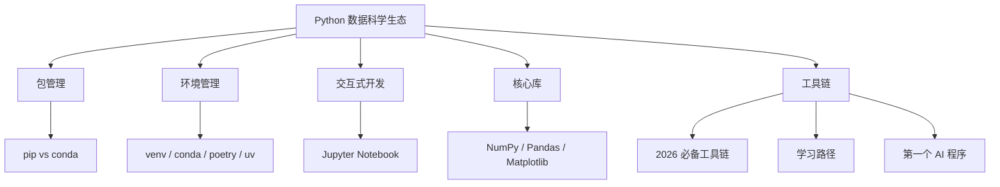

AI 从业者不需要精通 Python，但需要会用三个工具处理数据：NumPy（数组计算）、Pandas（表格处理）、Matplotlib（画图）。这篇覆盖最常用的 20%。

> **生活比喻**：学 Python 做 AI 就像学开车——你不需要会修发动机（写底层算法），只需要会握方向盘、踩油门、看后视镜（NumPy、Pandas、Matplotlib）。你的目标是到达目的地，而不是成为汽车工程师。

## 2026 年，你用 Python 做什么

你不是在"学 Python 语言"，你是在学"用 Python 操作 AI 工具"。2026 年，一个 AI 应用开发者（非专业程序员）的日常 Python 使用场景只有这几个：

1. **数据预处理**：用 Pandas 读取 CSV/JSON 数据集，清理空值，筛选字段，转换成模型能吃的格式。通常不超过 20 行代码。
2. **API 调用**：用 `requests` 库调用 OpenAI、Claude、Gemini 等模型的 API，发送提示词，接收返回结果。核心就三行代码。
3. **结果处理**：用 `json` 库解析 API 返回的 JSON 数据，提取需要的字段。
4. **可视化**：用 Matplotlib 画几张图，看看数据分布或模型效果。
5. **向量计算**：用 NumPy 做简单的相似度计算（余弦相似度）。

你不需要写算法、不需要写框架、不需要写 Web 服务。你只需要当"数据管道工"——把数据从 A 搬到 B，中间做点清洗和转换。本章帮你弄懂做这些事需要的最小工具集。

## 本章目录

1. [[2.1 pip 与 conda-包管理工具对比|2.1 pip 与 conda：包管理工具对比]]
2. [[2.2 Python环境管理-venv vs conda vs poetry vs uv|2.2 Python环境管理：venv vs conda vs poetry vs uv]]
3. [[2.3 Jupyter Notebook实战-AI开发的交互式工作台|2.3 Jupyter Notebook实战：AI开发的交互式工作台]]
4. [[2.5 零基础最需要的 5 个 Python 库|2.5 零基础最需要的 5 个 Python 库]]
5. [[2.6 你不需要成为程序员|2.6 你不需要成为程序员]]
6. [[2.7 2026 年推荐学习路径-不要从头学 Python，按需学|2.7 2026 年推荐学习路径：不要从头学 Python，按需学]]
7. [[2.8 2026年AI开发必备工具链|2.8 2026年AI开发必备工具链]]
8. [[2.9 从零到第一个AI程序-5步跑通你的第一个 AI 调用|2.9 从零到第一个AI程序：5步跑通你的第一个 AI 调用]]

## 相关笔记

- [[Ch03 AI 需要的数学]] — 线性代数 + 概率论基础
- [[Ch06 神经网络基础]] — NumPy 在神经网络中的实际应用

## 跨章节关联

- [[Ch03 AI 需要的数学]] — 编程之后：AI 需要的数学基础
- [[Ch06 神经网络基础]] — 用 Python 实现第一个神经网络
- [[项目/摘要]] — 学了就用：6 个实践项目

## 来源

- NumPy 官方文档, https://numpy.org/doc/
- Pandas 官方文档, https://pandas.pydata.org/docs/
- Matplotlib 官方文档, https://matplotlib.org/

