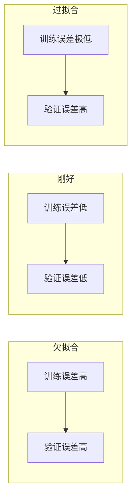

在谈评估指标之前，先搞清楚模型"学得不好"的两种典型情况。

### 5.1.1 欠拟合（Underfitting）

模型太简单，连训练数据里的规律都没学会。就像学生只背了课本第一页就去考试——连做过的题都做不对。

| 特征 | 表现 |
|---|---|
| 训练集表现 | 差（训练误差高） |
| 测试集表现 | 差（测试误差高） |
| 根本原因 | 模型太简单，或者特征太少 |
| 典型场景 | 用线性回归去拟合二次函数的数据 |
| 解决方法 | 增加模型复杂度、增加特征、减少正则化、训练更久 |

**生活比喻**：让一个刚学加法的小学生去解微积分——不是他不想学，是他的"模型结构"装不下那么复杂的规律。

### 5.1.2 过拟合（Overfitting）

模型太复杂，把训练数据里的噪声和随机波动都当成规律记住了。就像学生把练习册的答案全背下来了，但题目稍微改个数就不会做。

| 特征 | 表现 |
|---|---|
| 训练集表现 | 极好（训练误差很低） |
| 测试集表现 | 差（测试误差高） |
| 根本原因 | 模型太复杂，记住了不该记的 |
| 典型场景 | 用 100 次多项式拟合 10 个数据点 |
| 解决方法 | 增加数据量、正则化、Dropout、早停、交叉验证 |

**生活比喻**：一个学生做练习册，把每道题的编号和答案都背下来了。"第 3 页第 2 题，选 C"——他不是在解题，他是在背答案表格。考试时题目顺序一换，全错。

### 5.1.3 怎么判断

核心原则：**训练误差和测试误差之间的差距。**
- 两者都高 = 欠拟合
- 训练低、测试高 = 过拟合（差距大）
- 两者都低且接近 = 理想状态



### 5.1.4 过拟合与欠拟合的深度诊断

前面的内容给出了过拟合和欠拟合的基本定义。这一节深入诊断工具和理论。

**学习曲线（Learning Curve）**：诊断过拟合和欠拟合的最重要工具。

学习曲线画的是：训练集大小 vs 训练误差和验证误差。

- **欠拟合的学习曲线**：两条曲线都高，且随着训练数据增加，两条曲线趋于接近但都降不下来。增加更多数据没有帮助——模型本身太简单，装不下数据的规律
- **过拟合的学习曲线**：训练误差很低，验证误差很高，两条曲线之间有很大的"鸿沟"。随着训练数据增加，两条曲线逐渐靠拢——增加数据是有效的
- **理想的学习曲线**：两条曲线都很低且接近，随着训练数据增加平稳收敛

**实际使用**：
```python
from sklearn.model_selection import learning_curve
train_sizes, train_scores, val_scores = learning_curve(
    model, X, y, cv=5, train_sizes=np.linspace(0.1, 1.0, 10)
)
```
画出三条曲线：训练得分均值、验证得分均值、以及它们之间的差距。

**验证曲线（Validation Curve）**：诊断"某个超参数对过拟合/欠拟合的影响"。

比如你想知道"模型复杂度（如决策树深度）对过拟合的影响"。验证曲线画的是：不同深度下的训练得分和验证得分。

- 深度小时：训练和验证得分都低 → 欠拟合
- 深度增加：训练得分升高，验证得分先升后降 → 最优深度在验证得分最高点
- 深度继续增加：训练得分继续升高，验证得分下降 → 过拟合

**偏差-方差分解（Bias-Variance Decomposition）**：理解过拟合和欠拟合的理论框架。

模型的期望预测误差可以分解为三个部分：

`期望误差 = 偏差^2 + 方差 + 不可约误差`

- **偏差（Bias）**：模型预测的期望值和真实值之间的差距。高偏差 = 模型太简单，学不到数据的真实规律 = 欠拟合
- **方差（Variance）**：模型对训练数据的微小变化的敏感度。高方差 = 模型太复杂，对训练数据中的随机波动过度反应 = 过拟合
- **不可约误差（Irreducible Error）**：数据本身的噪声，任何模型都无法消除

**偏差-方差权衡（Bias-Variance Tradeoff）**：这是经典机器学习的核心概念。
- 简单模型（线性回归）：高偏差、低方差
- 复杂模型（深度神经网络）：低偏差、高方差
- 目标：找到偏差和方差的最佳平衡点

**双下降现象（Double Descent）**：2026 年深度学习领域的重要发现，它挑战了经典的偏差-方差权衡。

经典理论说：模型复杂度增加 → 方差增加 → 过拟合 → 验证误差上升。但双下降现象表明：验证误差随模型复杂度增加，先下降（第一下降），再上升（临界点，刚好插值训练数据），然后再次下降（第二下降）。

**直觉**：当模型参数数量刚好等于训练样本数量时，模型可以完美拟合训练数据（插值），但此时的验证误差最高。继续增加参数（过参数化），验证误差反而会再次下降。这就是为什么大模型（GPT-4、Claude 等）即使参数远超训练数据量，也不会严重过拟合。

**2026 年：大模型的过拟合问题**

大模型（LLM）的过拟合表现与传统模型不同：
- **传统过拟合**：训练 loss 降，验证 loss 升。你会清楚地看到"过拟合"发生
- **大模型过拟合**：训练 loss 和验证 loss 可能都降，但模型开始"记住"训练数据的具体内容而不是学习规律。表面上看 metrics 都很好，但实际泛化能力下降

**大模型过拟合的检测方法**：
- **数据泄露测试**：检查模型是否能逐字复述训练数据中的长段落。如果能，说明模型在记数据而不是学规律
- **对抗测试**：对训练数据做微小改动（换一个词、改一个数字），看模型是否还能正确回答。如果准确率骤降，说明模型依赖的是记忆而不是理解
- **分布外测试（OOD）**：用与训练数据分布不同的测试集评估。如果性能骤降，说明过拟合了训练数据的分布
- **困惑度 vs 下游任务**：困惑度在降，但下游任务（如推理、总结）的表现不再提升——说明模型在优化"表面的语言流畅度"，而不是"真正的理解能力"

**大模型防止过拟合的方法**：
- **Dropout**：训练时随机关闭一部分神经元。在 Transformer 中，Dropout 通常加在注意力层和前馈层之后，概率 0.1
- **数据增强**：对大模型来说，数据增强不是"旋转图片"，而是"改写文本"——用不同的措辞表达相同的意思，增加训练数据的多样性
- **正则化**：权重衰减（Weight Decay）在 AdamW 中解耦，是最常用的正则化手段
- **早停（Early Stopping）**：监控验证集 loss，当 loss 不再下降时停止训练。2026 年的趋势是训练到收敛（甚至过拟合）然后通过后训练（RLHF、DPO）来修复

---

> ← 上一节：[[Ch05 模型评估与特征工程|章首]] ｜ 下一节：[[5.2 分类问题的评估]] →
