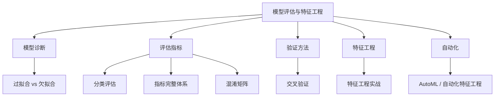

[[Ch04 机器学习核心算法]] 讲了五个必知算法。但"算法好不好"需要量化指标。这篇讲评估方法和特征工程的入门。

> **生活比喻**：模型评估就像考试——你刷了很多题（训练模型），但真正检验水平的是模拟考（测试集）。过拟合是死记硬背、只会做原题换个数字就不会了；欠拟合是根本没学进去，连原题都做不对。交叉验证就是多出几套不同的模拟卷，确保成绩不是碰运气。

## 本章目录

1. [[5.1 过拟合 vs 欠拟合-模型的两大病症|5.1 过拟合 vs 欠拟合：模型的两大病症]]
2. [[5.2 分类问题的评估|5.2 分类问题的评估]]
3. [[5.4 评估指标的完整体系|5.4 评估指标的完整体系]]
4. [[5.5 混淆矩阵深度解析|5.5 混淆矩阵深度解析]]
5. [[5.6 交叉验证完全指南|5.6 交叉验证完全指南]]
6. [[5.7 特征工程实战|5.7 特征工程实战]]
7. [[5.8 2026 年-AutoML 和自动化特征工程|5.8 2026 年：AutoML 和自动化特征工程]]

## 相关笔记

- [[Ch04 机器学习核心算法]] — 算法本身
- [[Ch03 AI 需要的数学]] — 精确率/召回率的概率基础，损失函数的数学推导

## 跨章节关联

- [[Ch04 机器学习核心算法]] — 评估的前提：理解 ML 算法
- [[Ch11 模型微调]] — 微调效果的评估标准
- [[Ch13 RAG 进化树]] — RAG 系统的评估方法

## 来源

- Scikit-learn, Model Evaluation, https://scikit-learn.org/stable/modules/model_evaluation.html
- AutoGluon, https://auto.gluon.ai/
- PyCaret, https://pycaret.org/
- Featuretools, https://www.featuretools.com/
- BERTScore, https://github.com/Tiiiger/bert_score
- Raschka & Mirjalili, "Python Machine Learning", 3rd Edition, Packt Publishing

