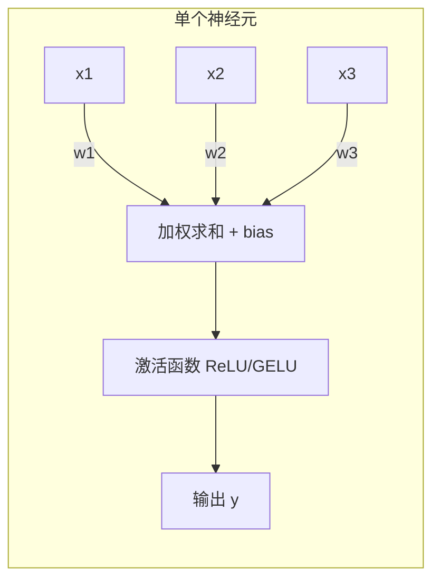

一个感知机（Perceptron）就是"加权求和 + 激活"。在老教材里，这整个体系叫 ANN（人工神经网络），但现在大家直接叫"神经网络"或"深度学习"。本文用"神经网络"。

理解感知机，就像理解乐高积木中最基本的一块——它本身只能做极其简单的事，但无数个它组合起来，能搭建出任何结构。

## 6.1.1 数学模型：加权求和 + 非线性判断

感知机的计算分两步：

**第一步：加权求和。** 每个输入 $x_i$ 乘以对应的权重 $w_i$，全部加起来，再加上一个偏置 $b$（bias，可以理解为"默认倾向"——就像你天生对甜食有偏好，不管看到什么食物都先加一分好感），得到净输入 $z$。

**第二步：激活判断。** 净输入通过激活函数（原始感知机用的是阶跃函数），大于 0 输出 1，小于等于 0 输出 0（或 -1）。

```
输入：[0.5, 0.8, -0.3]
权重：[0.2, 0.6, 0.4]
偏置 b = -0.2
加权求和 z = 0.5x0.2 + 0.8x0.6 + (-0.3)x0.4 + (-0.2) = 0.26
激活函数：0.26 > 0 ? 输出 1 : 输出 0
结果：1
```



从几何角度看，一个感知机做的事情，就是在空间中画一条线（高维空间中是超平面），把数据分成两类——线的一边是"是"，另一边是"不是"。权重决定了这条线的方向（倾斜角度），偏置决定了这条线的位置（离原点多远）。^[Rosenblatt, "The Perceptron: A Probabilistic Model for Information Storage and Organization in the Brain", Psychological Review, 1958]

## 6.1.2 感知机如何学习：对则不改，错则调整

感知机的学习规则极其简单——可以说是所有机器学习算法中最直觉的一个：

- 预测正确：权重不变
- 预测错误：朝正确的方向调整权重

具体来说，如果应该输出"是"（+1）的样本被错误判断为"否"（-1），就把这个样本的输入值加到权重上——相当于把决策边界朝这个样本的方向"拉"近一点。反之，如果应该输出"否"的样本被判断为"是"，就从权重中减去这个样本——相当于把决策边界朝远离这个样本的方向"推"开一点。

这种调整规则的"直觉"可以类比为投篮练习：投偏了就往反方向调整力度和角度，投中了就记住这次的感觉。感知机的学习就是不断重复这个"错了就改"的过程。

这个规则有一个优雅的理论保证：如果数据本身是**线性可分**的（存在一条直线/平面能把两类完美分开），感知机一定能在有限步内找到这条线。这个结论叫做"感知机收敛定理"，是神经网络领域最早的数学保证之一，由 Novikoff 在 1963 年证明。^[Novikoff, "On Convergence Proofs for Perceptrons", Symposium on the Mathematical Theory of Automata, 1963]

> 要感受这种"错了就改"如何在多层网络中运作，[[概念-梯度下降]]（让模型沿着误差最快的下降方向更新参数）和[[概念-反向传播]]（把误差的责任分配回每一层）分别在第 6.10 节和概念文件夹中展开。

## 6.1.3 感知机的致命缺陷：XOR 问题

1969 年，Marvin Minsky 和 Seymour Papert 出版了《感知机》一书。这场著名的"数学阻击"证明了一个结论：单个感知机连 XOR（异或）这种基础逻辑都解决不了。^[Minsky & Papert, "Perceptrons: An Introduction to Computational Geometry", MIT Press, 1969]

XOR（异或）的逻辑很简单：两个输入**相同**则输出 0，两个输入**不同**则输出 1。

在二维平面上画出四个点：(0,0) → 0，(1,1) → 0，(0,1) → 1，(1,0) → 1。你会发现，无论怎么画一条直线，都无法把"输出 0"的两个点和"输出 1"的两个点分开——它们交叉分布，就像棋盘的对角，直线永远切不开。

这个证明直接导致了 1970 年代的第一次"AI 寒冬"——研究经费被砍，整个领域陷入停滞。当时的学术氛围可以用一句话概括："连 XOR 都学不会，还指望它干什么？"

但解药也藏在这本书里：如果把**多个感知机叠起来**（加一个隐藏层），XOR 就能被完美解决。两个隐藏神经元各自画一条线，它们的输出组合起来，再由第三个神经元画线——问题迎刃而解。这就是[[6.2 层-感知机的堆叠]]要讲的内容：堆叠赋予了网络非线性表达能力。

## 6.1.4 从 1958 年到 GPT-4：不变的核心

1958 年的感知机用的是"阶跃函数"——输出只能是 0 或 1。这带来一个关键问题：阶跃函数在 0 处是一个断崖（不可导），无法用梯度来指导参数更新。

1986 年，Rumelhart、Hinton 和 Williams 用 Sigmoid（平滑的 S 形曲线）替换阶跃函数，让反向传播成为可能。^[Rumelhart, Hinton & Williams, "Learning Representations by Back-propagating Errors", Nature, 1986] 后来 [[概念-ReLU]]（`f(x) = max(0, x)`，比 Sigmoid 更快更稳）取代了 Sigmoid，再后来 [[概念-GELU]]（ReLU 的平滑版）成了 Transformer 的标配。激活函数一直在进化，但基本结构——**加权求和 + 非线性激活**——从 1958 年至今，从未改变。

一个感知机只能做简单判断（大于 0 还是小于 0）。但几千亿个感知机叠在一起——就变成了 [[Ch10 LLM 原理与架构演进|GPT-4]]（OpenAI 在 2023 年发布的大语言模型，参数量估计在万亿级别，是第一个让全世界普通人感受到"AI 真的会思考了"的模型，也是这本书反复提及的标杆级 LLM）。

现代神经网络的"感知机"已经不再是阶跃函数了——而是 ReLU、GELU、Swish 等各种平滑激活函数。但核心思想完全相同：加权求和，通过非线性函数，输出结果。这就是为什么理解感知机，是理解一切深度学习的地基。

---

> ← 上一节：[[Ch06 神经网络基础|章首]] ｜ 下一节：[[6.2 层-感知机的堆叠]] →
