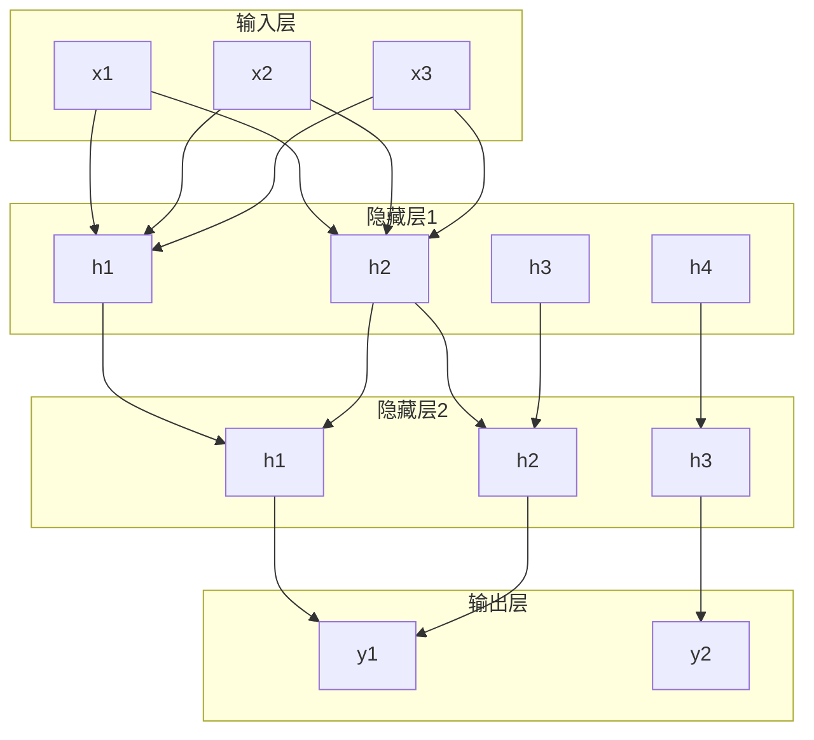

神经网络是分层的。每一层有很多个神经元（感知机），前一层的输出是后一层的输入。

输入层（接收数据）-> 隐藏层（做计算）-> 输出层（给结果）。

一个词向量（768 个数字）进入 **[[Ch09 Transformer 架构精讲|Transformer]]**（一种用[[概念-注意力机制|自注意力]]取代逐字阅读的神经网络架构——它让每个词同时看到句子里所有其他词，并行计算而不是串行。Ch01 的年表里提过它的诞生年份，Ch09 会逐层拆解它）的第一层，经过 768×3072 的矩阵乘法，变成 3072 个数字。再经过 3072×768 的矩阵乘法，变回 768 个数字。这就是一层。Transformer 堆了 32-96 层。

---

> ← 上一节：[[6.1 感知机-神经网络的原子]] ｜ 下一节：[[6.3 神经网络为什么有效]] →
