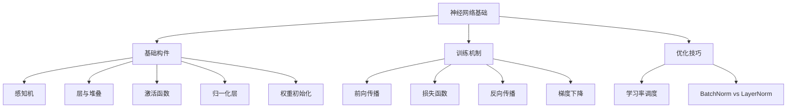

你已经用了很多 AI，但还不知道它"长什么样"。神经网络就是 AI 的物理形态——一堆数字经过一层层变换，从输入走到输出。这篇用最简单的语言解释这个过程。

> **生活比喻**：神经网络像一条流水线——原材料（输入数据）经过一道道工序（层），每道工序做一点加工（加权求和），质检员（激活函数）决定哪些继续往下传，最终产出一件成品（预测结果）。反向传播就是质检员从成品往回走，告诉每道工序"你这里偏了 3 毫米，下次往左调一点"，所有工序一起改进，下次成品就更好了。

## 本章目录

1. [[6.1 感知机-神经网络的原子|6.1 感知机：神经网络的原子]]
2. [[6.2 层-感知机的堆叠|6.2 层：感知机的堆叠]]
3. [[6.3 神经网络为什么有效|6.3 神经网络为什么有效]]
4. [[6.4 激活函数-为什么不能全用线性|6.4 激活函数：为什么不能全用线性]]
5. [[6.5 常见激活函数深入|6.5 常见激活函数深入]]
6. [[6.6 归一化层-BatchNorm 与 LayerNorm|6.6 归一化层：BatchNorm 与 LayerNorm]]
7. [[6.7 权重初始化|6.7 权重初始化]]
8. [[6.8 前向传播-从输入到输出|6.8 前向传播：从输入到输出]]
9. [[6.9 损失函数-衡量模型多差|6.9 损失函数：衡量模型多差]]
10. [[6.10 反向传播-怎么让模型变好|6.10 反向传播：怎么让模型变好]]
11. [[6.11 学习率调度的艺术|6.11 学习率调度的艺术]]
12. [[6.12 2026年-从零手写神经网络还有意义吗|6.12 2026年：从零手写神经网络还有意义吗]]

## 相关笔记

- [[Ch03 AI 需要的数学]] — 矩阵乘法、梯度、Softmax 的数学
- [[Ch09 Transformer 架构精讲]] — Transformer 的具体层结构
- [[Ch11 模型微调]] — LoRA 就是在这个框架上加补丁

## 本章概念与已学章节的关联

本章的内容串联了前面多章的知识，也为你理解后续章节铺路：

- Transformer 的每一层 = 自注意力 + 前馈网络（就是全连接层）
- [[Ch13 RAG 进化树|Embedding]] = 输入层（把文字变成向量）
- GPT 的自回归生成 = 反复前向传播
- LoRA = 不更新原始参数，只在旁边加"小补丁"
- [[Ch03 AI 需要的数学|Ch03]] 的矩阵乘法 = 前向传播的核心运算
- [[Ch03 AI 需要的数学|Ch03]] 的梯度 = 反向传播的核心驱动力

## 跨章节关联

- [[Ch07 CNN 与计算机视觉]] — 神经网络在图像上的应用
- [[Ch08 RNN 与序列模型]] — 神经网络在序列上的应用
- [[Ch09 Transformer 架构精讲]] — 从基础网络到 Transformer 的跃迁
- [[Ch11 模型微调]] — 训练好的网络怎么微调

## 来源

- 3Blue1Brown, "Neural Networks", https://www.3blue1brown.com/topics/neural-networks
- Goodfellow, Bengio & Courville, "Deep Learning", 2016
- Rosenblatt, "The Perceptron", Psychological Review, 1958
