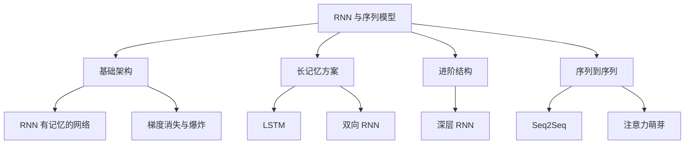

[[Ch07 CNN 与计算机视觉]] 讲了卷积核怎么看图。但图片是静态的——一张图就是一个快照。文字不一样——"我打你"和"你打我"词一样，顺序不同，意思完全不同。

RNN（循环神经网络）就是为"顺序敏感"的数据设计的。

> **生活比喻**：RNN 像一个人边读小说边记笔记——每读完一句，你把这句话的要点写在纸条上，和之前记的纸条摞在一起，然后读下一句时翻看之前所有纸条来理解上下文。普通神经网络只能看一张快照，RNN 能记住"前面发生了什么"，所以它擅长处理文字、语音这种有前后顺序的信息。

## 本章目录

1. [[8.1 RNN-有记忆的网络|8.1 RNN：有记忆的网络]]
2. [[8.2 LSTM-更长的记忆|8.2 LSTM：更长的记忆]]
3. [[8.3 梯度消失与梯度爆炸-为什么深层 RNN 训练不好|8.3 梯度消失与梯度爆炸：为什么深层 RNN 训练不好]]
4. [[8.4 双向 RNN-同时看过去和未来|8.4 双向 RNN：同时看过去和未来]]
5. [[8.5 Seq2Seq-输入一串，输出一串|8.5 Seq2Seq：输入一串，输出一串]]
6. [[8.6 2026 年-理解 RNN 是理解序列建模的基础|8.6 2026 年：理解 RNN 是理解序列建模的基础]]

## 相关笔记

- [[Ch06 神经网络基础]] — RNN 是带循环的神经网络
- [[Ch09 Transformer 架构精讲]] — Transformer 为什么取代 RNN
- [[Ch01 AI 简史与必知过时技术]] — Seq2Seq 是 RNN 时代的 NLP 主力

## 跨章节关联

- [[Ch06 神经网络基础]] — RNN 的前置：神经网络基础
- [[Ch09 Transformer 架构精讲]] — Transformer 如何取代 RNN
- [[Ch17 多模态 AI]] — 序列模型在语音 AI 中的应用

## 来源

- Hochreiter & Schmidhuber, "LSTM", 1997
- Cho et al., "GRU", 2014
- Sutskever et al., "Seq2Seq", 2014

