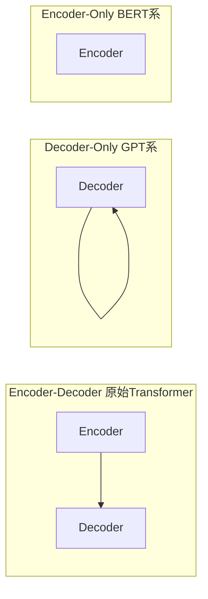

### 9.8.1 生活比喻：写连载小说 vs 校对文稿

理解三种架构的最好方式是类比文字工作：

- **Encoder-Only（BERT 系）**相当于一个校对员。他拿到完整的文章，可以从头到尾反复阅读，前后对照，找出错别字或标记关键信息。但他不会自己写新文章。
- **Encoder-Decoder（T5 系）**相当于一个翻译员。他先通读原文（编码），理解全部意思，然后逐句翻译（解码）。翻译每一句时都可以回看原文。
- **Decoder-Only（GPT 系）**相当于一个写连载小说的作者。他坐在打字机前，已经写了一部分，现在要写下一个词。他只能看到自己已经写过的内容，不能偷看还没写的部分。每一个新词都建立在前文之上。

2026 年，几乎所有你能用到的 AI 对话产品都是"连载小说作者"这个类型。为什么？本节逐步拆解。

### 9.8.2 三种架构范式

**Encoder-Decoder（T5, BART, 原始 Transformer）**：编码器用双向注意力做完整理解，解码器用因果注意力做自回归生成，两者通过交叉注意力桥接。天然适合"输入-输出"型任务（翻译、摘要）。但架构包含两套独立参数，训练和推理都比单一架构复杂。

**Encoder-Only（BERT, RoBERTa, DeBERTa）**：只有编码器，使用双向注意力。预训练用掩码语言模型（MLM）——随机遮住 15% 的 token，让模型根据上下文预测被遮住的词。这就像完形填空，训练出来的模型极度擅长"理解"——分类、实体识别、问答中的答案抽取。但它不能自然地生成连贯文本，因为在训练中它从未学过"从前文预测下一个词"。

**Decoder-Only（GPT, Llama, Qwen, Mistral, DeepSeek, Claude, Gemini）**：只有解码器，使用因果注意力（只能看到过去）。预训练用下一个 token 预测——给定前文，预测下一个词。这看似简单，但它有一个深刻的结果：**任何 NLP 任务都可以被重新表述为"给定上下文，生成下一个 token"**。翻译可以表述为"将以下英文翻译成中文：Hello → 你好"，摘要可以表述为"请总结以下文章：... → 总结内容"。这种统一性让一个模型可以通过不同的 prompt 完成所有任务，而不需要为每种任务设计不同的架构头 ^[Liu et al., "Pre-train, Prompt, and Predict: A Systematic Survey of Prompting Methods", 2023, https://arxiv.org/abs/2107.13586]。

### 9.8.3 为什么 Decoder-Only 赢了

这不是偶然，而是由多个结构性因素共同决定的：

**（1）自回归生成是 LLM 的本体任务。** 对话、写作、代码生成、推理——所有这些任务的本质都是"给定上下文，生成下一个 token"。Decoder-Only 的因果注意力天然适配这个范式。相比之下，Encoder-Decoder 在对话场景中效率低：每一轮新对话都需要重新编码全部历史，而 Decoder-Only 只需把新消息追加到已有序列末尾，KV 缓存可以复用 ^[Google DeepMind, "Encoder-Decoder or Decoder-Only? Revisiting Encoder-Decoder LLM", 2025, https://arxiv.org/abs/2510.26622]。

**（2）架构统一带来可预测的 Scaling。** Decoder-Only 只有一种 Transformer 块（掩码自注意力 + FFN），没有 Encoder-Decoder 交叉注意力。统一的架构意味着统一的 scaling law——增加层数、宽度、数据量，性能提升更可预测。Google DeepMind 从头训练对比发现，Decoder-Only 在预训练阶段的计算最优边界上优于 Encoder-Decoder，虽然经过指令微调后差距缩小 ^[ibid.]。

**（3）KV 缓存是 Decoder-Only 的杀手优化。** 这是 Decoder-Only 最被低估的优势。自回归生成时，每生成一个新 token，因果注意力只需要计算新 token 的 Q，而所有历史 token 的 K 和 V 可以**永久缓存**——因为因果掩码确保历史 token 不会看到未来，它们的 K/V 表示永远不会改变。在 Encoder-Decoder 中，解码器的交叉注意力虽然也能缓存编码器输出的 K/V，但解码器的自注意力层仍然需要重新处理变长的目标序列。KV 缓存的简洁性直接转化为推理速度的显著优势 ^[Sun et al., "YOCO: You Only Cache Once", NeurIPS 2024, https://arxiv.org/abs/2405.05254]。

**（4）上下文学习是涌现出来的。** 当 Decoder-Only 模型在足够大的数据上训练时，它学会了"利用上下文中的模式来解决问题"——不需要微调，只需在 prompt 中给几个示例（few-shot），模型就能适应新任务。这种上下文学习能力是模型规模和训练数据量的涌现产物，在 Encoder-Only 模型中不明显。本质上，因果语言建模迫使模型成为一个"通用模式匹配器"——任何在上下文中重复出现的模式，模型都会尝试延续它 ^[Brown et al., "Language Models are Few-Shot Learners", 2020, https://arxiv.org/abs/2005.14165]。

**（5）统一的对话接口。** Decoder-Only 的因果注意力让多轮对话变得极其自然：每一轮对话只是在前一轮的序列末尾追加新 token。模型始终在"根据历史预测下一个词"。Encoder-Decoder 需要每一轮重新编码整个对话历史，这在高频对话场景中成本极高。

### 9.8.4 一点微妙的反向证据

2024-2025 年的研究让这个图景变得更加复杂。Google DeepMind 从头训练了 150M 到 8B 参数的 Encoder-Decoder 和 Decoder-Only 模型，在相同数据上对比，发现：经过指令微调后，Encoder-Decoder 在下游任务上可以达到相当甚至更好的性能，且推理效率更高（因为编码器可以更高效地处理长输入）^[Google DeepMind, 2025]。

此外，Johns Hopkins 和 LightOn 的 Ettin Suite（2025）首次在完全受控的条件下对比了两种架构，结论是："架构选择本身至关重要，而不仅仅是训练目标"——编码器在分类和检索上压倒性优于解码器，解码器在生成上占据优势 ^[Ettin Suite, LightOn, 2025, https://lighton.ai/blog/introducing-ettin-suite]。

这说明 Decoder-Only 的胜利并不完全是"架构更优"，而更多是"工程便利性 + 训练规模化 + 对话场景的天然适配"的综合结果。对于非对话式的专用任务（如嵌入检索、分类），Encoder-Only 仍有不可替代的优势。

### 9.8.5 2026 年格局

2026 年的 LLM 格局：Llama 4、Qwen 3.x、Mistral Large、DeepSeek-V3、Claude Sonnet/Opus、Gemini 3.5 Pro——全部是 Decoder-Only。Encoder-Only 和 Encoder-Decoder 架构退居专用场景：

- **嵌入模型**（BGE、E5、GTE）：Encoder-Only 的双向注意力天然适合生成高质量的句子表示，用于语义搜索和检索 ^[Muennighoff et al., "MTEB: Massive Text Embedding Benchmark", 2023, https://arxiv.org/abs/2210.07316]
- **翻译模型**（NLLB、M2M-100）：Encoder-Decoder 在源语言理解-目标语言生成的分工上有架构优势
- **检索模型**（ColBERT）：Encoder-Only 的双向注意力在查询-文档匹配上更高效

对于绝大多数读者来说，理解 Decoder-Only 就够了——因为所有你能用到的对话式 AI 都是这个架构。后续 [[9.9 2026 Transformer 进化|9.9 节]] 会介绍 GQA、FlashAttention 等让 Decoder-Only 架构更高效的现代优化。相关概念可交叉阅读 [[概念-Transformer]] 和 [[概念-注意力机制]]。

^[Ranksquire, "LLM Architecture 2026", https://ranksquire.com/2026/04/13/llm-architecture-2026/]; ^[Knight Li, "LLM Architecture Evolution 2023-2026", https://knightli.com/en/2026/05/17/llm-architecture-evolution-2023-2026/]

---

> ← 上一节：[[9.7 完整编码器-解码器架构]] ｜ 下一节：[[9.9 2026 Transformer 进化]] →
