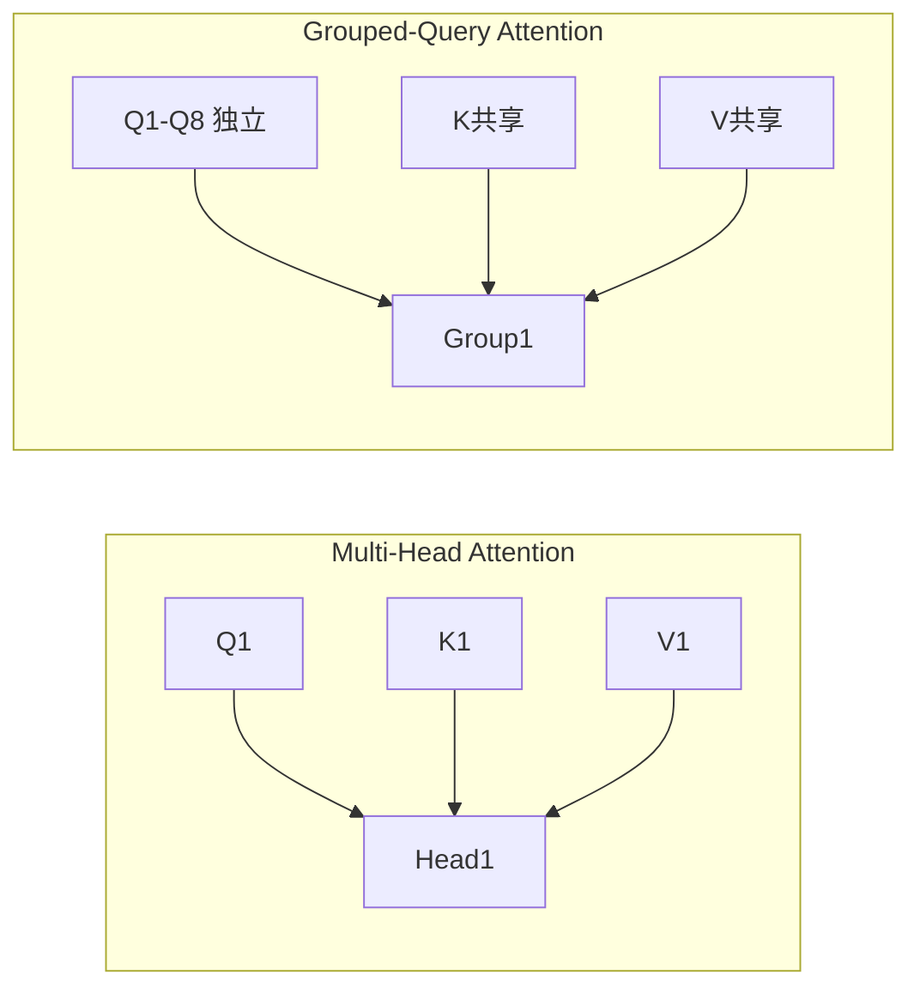

### 9.9.1 GQA：分组查询注意力

标准多头注意力（MHA）中，每个头有独立的 Q、K、V。推理时，每生成一个新 token，需要存储所有历史 token 的 K 和 V（KV 缓存），避免重复计算。KV 缓存大小 = 2 × h × d_k × seq_len × layers × batch_size × 精度（字节）。对于大模型，这是巨大的内存开销。

**MHA → MQA → GQA 的演进**：

- **MHA（Multi-Head Attention）**：h 个 Q 头，h 个 K 头，h 个 V 头。KV 缓存 = 2h × d_k。质量最优，但缓存最大
- **MQA（Multi-Query Attention）**：h 个 Q 头，1 个 K 头，1 个 V 头。所有 Q 共享同一组 K/V。KV 缓存 = 2 × d_k。缓存减少 h 倍，但质量下降明显（注意力多样性丧失）
- **GQA（Grouped-Query Attention）**：h 个 Q 头，g 个 K/V 头（1 < g < h）。每 h/g 个 Q 头共享一组 K/V。KV 缓存 = 2g × d_k。缓存减少 h/g 倍，质量接近 MHA

**2026 年 GQA 配置实例**：

| 模型 | Q 头数 | K/V 头数 | 分组数 | KV 缓存缩减 |
|------|--------|----------|--------|-------------|
| Llama 2 70B | 64 | 8 | 8 | 8× |
| Llama 3 70B | 64 | 8 | 8 | 8× |
| Llama 4 | 64 | 8 | 8 | 8× |
| Mistral | 32 | 8 | 4 | 4× |
| Qwen 2.5 72B | 64 | 8 | 8 | 8× |

GQA 最早由 Llama 2（2023 年 7 月，34B/70B 模型）引入，此后 Llama 4/4.1、Mistral、Qwen 3.7 均采用，已成 2026 年标配 ^[IBM, "GQA in Llama 2", https://www.ibm.com/think/topics/grouped-query-attention]; ^[Developers Digest, "LLM Architecture Complexity", https://www.developersdigest.tech/blog/llm-architecture-complexity-moe-flexattention]。

### 9.9.2 FlashAttention 1/2/3

注意力计算的标准做法是把整个注意力矩阵（n×n）完整算出来存在 GPU 的高带宽内存 HBM（显卡的大容量显存，带宽高但访问延迟也高，是 GPU 的"主存"）中。FlashAttention 换了一种做法：不写完整矩阵，而是在 GPU 片上的 SRAM（芯片内置的高速缓存，容量极小但访问速度比 HBM 快一个数量级）里分块计算、边算边聚合，算完一块扔一块。这样既省显存（O(n) 而非 O(n²)）又提速。

**FlashAttention-1（2022）**：两个核心创新——**分块（tiling）** 和 **重计算（recomputation）**。将 Q、K、V 分成小块，每块在 SRAM 中完成局部注意力计算。使用 online softmax（追踪全局最大值和和）来正确聚合各块的 softmax 结果。反向传播时重新计算注意力矩阵而非从 HBM 读取，以计算换存储。内存复杂度从 O(n²) 降到 O(n)，计算速度提升 2-4 倍 ^[Dao et al., https://arxiv.org/abs/2205.14135]。

**FlashAttention-2（2023）**：改进并行策略。FA-1 只在 batch 和 head 维度并行，FA-2 增加了序列长度维度的并行。减少非矩阵乘法操作（softmax 的 rescaling 操作）。更好地利用 GPU 的 warp 调度。2 倍于 FA-1 的速度 ^[Dao, https://arxiv.org/abs/2307.08691]。

**FlashAttention-3（2024）**：针对 Hopper 架构（H100/H200）优化。利用异步计算（TMA 异步拷贝 + WGMMA 异步矩阵乘法），让数据搬运和计算重叠。支持 FP8 精度。1.5-2 倍于 FA-2 的速度。2024-2026 年几乎所有前沿模型训练的基础设施 ^[Shah et al., https://arxiv.org/abs/2407.08608]。

### 9.9.3 RoPE 扩展：NTK、YaRN、动态 NTK

RoPE 的局限性：训练时使用的基础频率（θ_i = 10000^{-2i/d}）是为特定上下文长度设计的。当推理长度超过训练长度时，高频维度（小 i）覆盖的位置范围不够，导致注意力分数混乱。

三种主流扩展方案：

**NTK-aware 缩放**：将基数 10000 替换为 α × 10000（α > 1），相当于"拉伸"频率。数学上等价于插值位置索引。NTK 意识版（NTK-aware）不是均匀拉伸所有维度，而是保留高频维度（对局部位置敏感）不变，只拉伸低频维度（对长距离位置编码）。效果显著优于均匀插值。

**YaRN（Yet another RoPE extensioN）**：结合 NTK 缩放 + 温度调优 + 窗口化。温度因子 t 缩放注意力 logits（scores → scores / t），让 softmax 更"平滑"，减少长距离上的错误注意力。窗口化限制注意力范围。YaRN 是 2024 年外推效果最好的 RoPE 扩展方案。

**动态 NTK**：不固定 α，而是根据当前序列长度动态调整。α = current_len / original_len。当序列较短时（在训练长度内），α = 1，不缩放。当序列增长时，α 自动增大。这避免了短序列上的性能损失。

2026 年实践：大多数 LLM 在推理框架（如 vLLM、TensorRT-LLM）中内置了动态 NTK 或 YaRN，用户只需指定目标上下文长度即可自动外推。

^[Raschka, "LLM Research Papers 2026 Part 1", https://magazine.sebastianraschka.com/p/llm-research-papers-2026-part1]; ^[bloc97, "NTK-Aware Scaled RoPE", 2023, https://www.reddit.com/r/LocalLLaMA/comments/14lz7j5/ntkaware_scaled_rope_allows_llama_models_to_have/]; ^[Peng et al., "YaRN", 2023, https://arxiv.org/abs/2309.00071]

### 9.9.4 Sliding Window Attention

Mistral 引入了滑动窗口注意力：每个 token 只关注它前面 W 个 token（W 是窗口大小），而非整个序列。这使注意力复杂度从 O(n²) 降为 O(n·W)，对于长序列节省巨大。

但信息如何跨越超过 W 距离的 token？**通过多层的逐层传播**。类比 CNN 的感受野：第 1 层只能看到前 W 个 token，第 2 层能看到前 2W 个（因为前一层的输出已经聚合了 W 范围的信息），第 L 层能看到前 L×W 个。对于 32 层、W=4096 的模型，理论感受野超过 130K。

Mistral 的做法：大部分层使用滑动窗口，少数层使用全局注意力（"global attention layers"），让信息可以跨越任意距离。这平衡了效率和长距离建模能力。

### 9.9.5 混合架构：Mamba + Transformer

Transformer 的 O(n²) 复杂度是长上下文场景的根本瓶颈。状态空间模型（SSM）如 Mamba 提供了 O(n) 的替代方案，但在某些任务上的质量不如 Transformer。

**混合架构**的思路：交替使用 Mamba 层和 Transformer 层：

- **Mamba 层**（3:1 或 7:1 的比例）：高效处理长序列，O(n) 复杂度
- **Transformer 层**（少数）：提供高质量的注意力，处理关键位置

代表模型：Jamba（AI21 Labs，2024）、Samba（微软，2024）。Jamba 使用 7:1 的 Mamba:Transformer 比例，在长上下文基准上表现优异，推理速度比纯 Transformer 快 3-5 倍。

2026 年状态：纯 Transformer 仍占主导地位（因为 FlashAttention + GQA 已大幅缓解效率问题）。混合架构在超长上下文（1M+ token）和边缘设备场景中更有优势。Mamba-2 和 Mamba-3 的持续改进可能改变这一格局。

^[Gu & Dao, "Mamba: Linear-Time Sequence Modeling with Selective State Spaces", 2023, https://arxiv.org/abs/2312.00752]; ^[Lieber et al., "Jamba: A Hybrid Transformer-Mamba Language Model", 2024, https://arxiv.org/abs/2403.19887]

---

> ← 上一节：[[9.8 Decoder-Only - 为什么 LLM 只用解码器]] ｜ 下一节：[[9.10 动手实现 Self-Attention]] →
