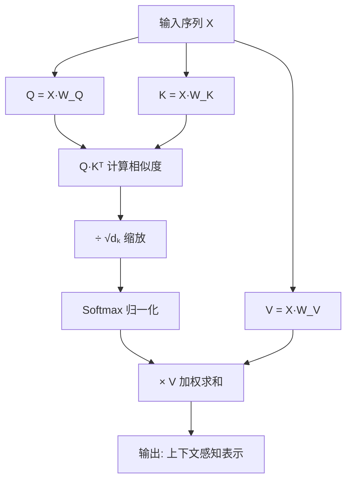

## 一句话理解

让模型"关注"输入中最重要的部分——不是所有输入都同等重要，注意力机制让模型学会给不同位置分配不同的权重。

## 零基础理解

想象你在阅读一段文字："猫是一种哺乳动物，它喜欢吃鱼，它的毛很柔软。" 当被问到"猫喜欢吃什么？"时，你不会逐字逐句地读，而是会重点看"猫"和"吃"和"鱼"这几个关键词。注意力机制做的就是类似的事情——给重要的词分配更多"注意力"，给不重要的词分配更少。

## 核心概念

### Query, Key, Value (QKV)

注意力机制的核心思想源于信息检索：给定一个查询(Query)，在一组键值对(Key-Value)中找出与查询最相关的信息。

| 概念 | 角色 | 类比(数据库检索) | 来源 |
|------|------|------------------|------|
| Query (Q) | 当前要查询的信息 | 搜索关键词 | 当前token的表示 |
| Key (K) | 用于匹配的索引 | 文档标题/摘要 | 所有token的表示 |
| Value (V) | 实际输出的内容 | 文档正文 | 所有token的表示 |

**计算流程**:

1. 计算Query与每个Key的相似度(点积),得到注意力分数(Attention Scores)
2. 对分数进行缩放(除以 $\sqrt{d_k}$ ),防止点积过大导致softmax梯度消失
3. 通过Softmax将分数归一化为概率分布(注意力权重)
4. 用注意力权重对Value加权求和,得到最终输出

### 缩放点积注意力 (Scaled Dot-Product Attention)

$$
\text{Attention}(Q, K, V) = \text{softmax}\left(\frac{QK^T}{\sqrt{d_k}}\right)V
$$

**为什么需要缩放因子 $\sqrt{d_k}$**:
当 $d_k$ 较大时,点积的方差会增大,导致softmax输出过于尖锐(接近one-hot),梯度几乎为零。除以 $\sqrt{d_k}$ 将方差控制为1,保持梯度稳定。

### 注意力权重

注意力权重是一个概率分布,表示每个位置对当前位置的"重要程度"。

| 特性 | 说明 |
|------|------|
| 范围 | [0, 1],由Softmax保证 |
| 总和 | 每个Query的权重之和为1 |
| 可解释性 | 可视化注意力权重可以理解模型在"看"哪里 |
| 稀疏性 | 实际训练中,注意力往往集中在少数位置 |

## 注意力类型

### 自注意力 (Self-Attention)

$$
Q = XW^Q, \quad K = XW^K, \quad V = XW^V
$$

同一个序列既做Query又做Key和Value,让序列中的每个位置都能关注到序列中的所有位置(包括自己)。Transformer的核心组件。

**特点**: 捕捉序列内部的长距离依赖,不受距离限制。

### 交叉注意力 (Cross-Attention)

$$
Q = XW^Q, \quad K = YW^K, \quad V = YW^V
$$

Query来自一个序列,Key和Value来自另一个序列。典型应用: Transformer解码器中的编码器-解码器注意力,解码器(Query)关注编码器输出(Key, Value)。

### 多头注意力 (Multi-Head Attention)

将Q、K、V分别投影到多个低维子空间,在每个子空间中独立计算注意力,最后拼接结果。

$$
\text{MultiHead}(Q, K, V) = \text{Concat}(\text{head}_1, \ldots, \text{head}_h)W^O
$$

$$
\text{head}_i = \text{Attention}(QW_i^Q, KW_i^K, VW_i^V)
$$

**为什么需要多头**: 不同头可以关注不同的表示子空间,例如一个头关注语法关系,另一个头关注语义关系。

## 注意力类型对比

| 类型 | Q来源 | K来源 | V来源 | 典型应用 | 计算复杂度 |
|------|-------|-------|-------|----------|-----------|
| 自注意力 | 自身 | 自身 | 自身 | Transformer编码器 | $O(n^2d)$ |
| 交叉注意力 | 解码器 | 编码器 | 编码器 | Transformer解码器 | $O(nmd)$ |
| 多头注意力 | 任意 | 任意 | 任意 | 所有Transformer | $O(hn^2d/h)$ |
| 因果注意力 | 自身 | 自身(掩码) | 自身 | GPT自回归生成 | $O(n^2d)$ |
| 稀疏注意力 | 自身 | 自身(局部) | 自身 | Longformer/BigBird | $O(n\log n d)$ |

## 从Bahdanau到Transformer的演化

| 年份 | 模型 | 创新 | 局限 |
|------|------|------|------|
| 2014 | Bahdanau Attention | 首次将注意力引入Seq2Seq,对齐源语言和目标语言 | 依赖RNN编码器,无法并行 |
| 2015 | Luong Attention | 提出多种注意力打分函数(dot/general/concat) | 仍依赖RNN |
| 2017 | Transformer | 完全抛弃RNN,仅用自注意力,实现并行训练 | 长序列计算复杂度高 |
| 2020+ | 高效注意力 | 线性注意力,稀疏注意力,FlashAttention | 性能和效率的权衡 |

## 为什么注意力是深度学习最重要的机制之一

1. **长距离依赖**: 信息传递路径长度为O(1),无论两个token距离多远,注意力都能直接连接
2. **并行计算**: 不依赖序列顺序,可在GPU上高效并行
3. **可解释性**: 注意力权重可视化提供了模型决策的直观理解
4. **通用性**: 从NLP扩展到CV(ViT)、语音、多模态等多个领域

## 2026年趋势

| 方向 | 代表工作 | 核心思想 |
|------|---------|---------|
| 线性注意力 | Mamba/Mamba2 | 将注意力复杂度从$O(n^2)$降到$O(n)$ |
| 稀疏注意力 | Longformer | 局部窗口+全局token |
| KV缓存优化 | vLLM/FlashAttention | IO感知的注意力计算 |
| 混合架构 | Jamba/Griffin | 注意力+状态空间模型 |

## 相关笔记

- [[Ch09 Transformer 架构精讲]] — 注意力机制的完整工程实现
- [[Ch08 RNN 与序列模型]] — 注意力机制如何解决RNN的瓶颈
- [[Ch10 LLM 原理与架构演进]] — 注意力在LLM中的核心地位
- [[概念-RWKV]] — 线性注意力的替代方案
- [[概念-CLIP]] — 图文对比学习中的注意力

## 来源

- Vaswani et al., "Attention Is All You Need" (2017) — https://arxiv.org/abs/1706.03762
- Bahdanau et al., "Neural Machine Translation by Jointly Learning to Align and Translate" (2014) — https://arxiv.org/abs/1409.0473
- Jay Alammar, "The Illustrated Transformer" — https://jalammar.github.io/illustrated-transformer/
- Lilian Weng, "Attention? Attention!" — https://lilianweng.github.io/posts/2018-06-24-attention/