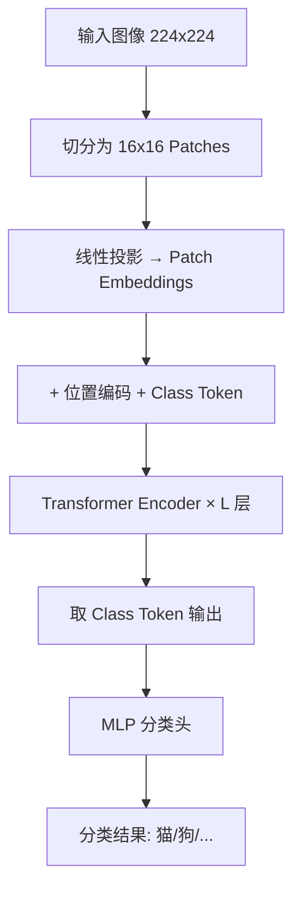

## 一句话理解

把图像切成固定大小的 patch，每个 patch 当作一个 token，直接送入标准 Transformer Encoder 进行分类——全程不使用卷积操作，打破了 CNN 在计算机视觉领域长达近十年的统治地位。

## 零基础理解

假设你有一张猫的照片。CNN 处理这张图的方式，就像一个人拿着放大镜，先看局部细节（猫耳朵的纹理、眼睛的轮廓），然后逐层把这些局部信息组合成更高级的特征（耳朵 -> 猫头 -> 整只猫）。CNN 天然假设"相邻的像素关系更紧密"，这叫做**局部性归纳偏置 (Locality Inductive Bias)**。

ViT 的处理方式完全不同。它把这张猫的照片切成 16x16 的小方格（比如一张 224x224 的图切成 196 个 patch），每个小方格被展平成一个向量，就像把图像的每个"词"找出来，然后一股脑扔给 Transformer。Transformer 通过自注意力机制 (Self-Attention)，让每个 patch 都能直接和图中任意其他 patch "交流"——猫耳朵的 patch 可以直接和猫尾巴的 patch 建立联系，不需要像 CNN 那样逐层传递。

**类比**：CNN 像读一篇文章时逐句理解，通过局部上下文逐步构建全局理解；ViT 像一眼扫过整页，任意两个词之间都可以直接关联。

## 核心概念

### 1. Patch Embedding

这是 ViT 将图像"Token 化"的关键步骤。给定一张图像 $X \in \mathbb{R}^{H \times W \times C}$，将其分割为 $N = \frac{HW}{P^2}$ 个 $P \times P$ 大小的 patch。每个 patch 被展平为长度 $P^2 \cdot C$ 的向量，再通过一个可训练的线性投影矩阵 $E \in \mathbb{R}^{(P^2 \cdot C) \times D}$ 映射到 $D$ 维嵌入空间。

这个过程本质上是用一个**大卷积核 + 大 stride** 的卷积层来实现的（卷积核大小和 stride 都等于 patch size），但 ViT 论文刻意将其描述为"线性投影"，以强调其与 CNN 的范式差异。

### 2. 位置编码 (Position Embedding)

Transformer 本身不具备感知序列顺序的能力——图像也一样。如果不加位置编码，把 patch 顺序打乱，ViT 的输出不变。因此需要给每个 patch embedding 加上一个可学习的 position embedding，告诉模型"这个 patch 在图像的第几行第几列"。

ViT 使用**可学习的 1D 位置编码**（而非 2D 正弦编码），实验表明两者效果相近，但 1D 可学习版本更简单。这意味着模型需要自己从数据中学会"相邻 patch 的位置编码应该相似"这一规律。

### 3. Class Token

借鉴 BERT 的 `[CLS]` token 设计，ViT 在 patch 序列的最前面拼接一个可学习的 `class token`（记为 $x_{class}$）。经过多层 Transformer Encoder 后，这个 token 对应的输出向量被送入一个 MLP Head 进行分类。

为什么需要 class token？因为 Transformer 对每个输入 token 都产生一个输出，没有一个"天然的"全局表示。class token 通过自注意力机制与所有 patch 交互，将所有 patch 的信息聚合到一个向量中。

另一种替代方案是 **Global Average Pooling (GAP)**，即对所有 patch 的输出取平均，效果与 class token 相当。

### 4. 预训练-微调范式 (Pre-training & Fine-tuning)

ViT 的标准使用流程：

1. **大规模预训练**：在 JFT-300M（3 亿张图）或 ImageNet-21k（1400 万张图）上做有监督分类预训练。数据量越大，ViT 相对于 CNN 的优势越明显。
2. **下游微调**：在目标任务（如 CIFAR-10、医学影像）上 fine-tune。此时移除预训练的 MLP Head，换成一个新的、针对下游任务类别数的分类头。

关键发现：**ViT 在小数据集（如 ImageNet-1k）上从头训练，效果不如 ResNet**；但数据量足够大时，ViT 超越 CNN。这是因为 ViT 缺少 CNN 内置的归纳偏置（平移不变性、局部性），需要从大量数据中自己"学"出这些规律。

## ViT vs CNN 对比

| 维度 | ViT (Vision Transformer) | CNN (以 ResNet 为代表) |
|---|---|---|
| **归纳偏置 (Inductive Bias)** | 几乎没有（仅 patch 分割和位置编码提供弱先验） | 强：局部连接 (Locality) + 平移等变性 (Translation Equivariance) |
| **数据需求** | 极高，需大规模预训练（JFT-300M / ImageNet-21k）才能发挥优势 | 中等，ImageNet-1k 即可训练出不错效果 |
| **全局感受野** | 从第一层起，每个 patch 都能看到所有其他 patch（全局自注意力） | 浅层感受野小，通过堆叠层数逐步扩大 |
| **计算复杂度** | $O(N^2 \cdot D)$ —— 自注意力对 patch 数平方级 | $O(N \cdot K^2 \cdot D)$ —— 卷积对像素数线性 |
| **可解释性** | 注意力图可直接可视化，直观展示模型"在看哪里" | 需要 CAM / Grad-CAM 等额外方法 |
| **迁移学习能力** | 强，预训练后迁移到各类下游任务效果出色 | 强，但不同任务可能需要不同的 backbone 设计 |
| **对图像分辨率的灵活性** | 较差，patch size 固定导致分辨率变化时需插值位置编码 | 较好，全卷积网络天然支持任意分辨率输入 |
| **2026 年生态成熟度** | 高度成熟，timm 库、HuggingFace 均有完善实现 | 极度成熟，几乎所有的视觉任务都有 CNN baseline |

## ViT 演进路线

### DeiT (Data-efficient Image Transformers, 2020)

Facebook 提出，核心创新是**知识蒸馏 (Knowledge Distillation)**：用一个 CNN 教师模型（如 RegNet）指导 ViT 学生模型训练。DeiT 仅用 ImageNet-1k 就达到了与大规模预训练 ViT 相当的性能，证明了 Transformer 在 CV 领域不需要海量数据也能成功。

关键技巧：引入一个额外的 distillation token，与 class token 并行，教师模型的 soft label 作为蒸馏信号。

### Swin Transformer (2021)

微软亚洲研究院提出，解决了 ViT 的两个核心问题：

1. **计算复杂度**：标准 ViT 的全局自注意力对所有 patch 两两计算，复杂度 $O(N^2)$。Swin 引入**窗口注意力 (Window Attention)**，只在局部窗口内做自注意力，大幅降低计算量。
2. **多尺度特征**：CNN 天然产生层次化特征图（/4, /8, /16, /32 下采样），这对检测和分割任务至关重要。Swin 通过 **Patch Merging** 操作逐步合并相邻 patch，构建层次化表示。

Swin Transformer 在 COCO 目标检测和 ADE20K 语义分割上全面超越 CNN，成为 2021-2023 年最主流的视觉 backbone 之一。

### DINO (Self-DIstillation with NO labels, 2021)

Facebook 提出，核心是**自监督学习**：不需要任何标注，通过学生网络和教师网络之间的对比学习，ViT 自动学会了图像语义分割的能力。DINO 的注意力图可以直接当作"无监督语义分割"结果，这一现象在当时引起了广泛关注。

DINOv2 (2023) 进一步扩展，在 1.42 亿张精选图像上训练，生成的视觉特征在多种下游任务上达到了与弱监督方法相当的水平。

### 其他重要变体

| 模型 | 年份 | 核心贡献 |
|---|---|---|
| **ViT** | 2020 | 开创性工作，证明纯 Transformer 在 CV 可行 |
| **DeiT** | 2020 | 知识蒸馏，降低数据需求 |
| **Swin Transformer** | 2021 | 窗口注意力 + 层次化结构，适配检测/分割 |
| **DINO** | 2021 | 自监督 ViT，注意力图自动语义分割 |
| **MAE** | 2021 | 掩码自编码器，随机遮住 75% patch 做重建预训练 |
| **ConvNeXt** | 2022 | "CNN 反击战"：用 ViT 的设计哲学改造 CNN，性能持平 Swin |
| **DINOv2** | 2023 | 大规模自监督视觉基础模型 |
| **SAM (Segment Anything)** | 2023 | Meta 的分割大模型，ViT-based 图像编码器 |

## 2026 年定位

**ViT 和 CNN 在计算机视觉领域已形成"平分秋色"的格局，而非谁取代谁。**

- **ViT 主导的领域**：大规模预训练基础模型（如 SAM、DINOv2）、多模态大模型（如 GPT-5.5、Gemini 3.5 Pro 的视觉编码器大多采用 ViT）、需要全局上下文理解的分类/检索任务。
- **CNN 仍占优势的领域**：实时推理（YOLO 系列仍用 CNN backbone）、边缘设备部署（MobileNet/EfficientNet 系列）、小数据场景、需要精细局部特征的任务。
- **融合趋势**：ConvNeXt、RepLKNet 等工作证明两种范式的设计理念可以互相借鉴；Swin Transformer 本身也带有强烈的 CNN 层次化设计思想。

ViT 的最大贡献不是"击败 CNN"，而是**打破了 CNN 在视觉领域的垄断，证明了通用架构（Transformer）可以统一 NLP 和 CV**，为后续多模态大模型的发展铺平了道路。

## 相关笔记

- [[Ch07 CNN 与计算机视觉]] — 理解 CNN 的基本原理和归纳偏置
- [[Ch09 Transformer 架构精讲]] — 理解自注意力机制和多头注意力的数学原理
- [[概念-CNN详解]] — 卷积神经网络的核心概念（卷积核、池化、感受野）
- [[深挖-YOLO]] — 实时目标检测算法，2026 年仍以 CNN 为 backbone
- [[深挖-YOLO]] — YOLO 版本演进与 ViT-based 检测器（DETR）的对比
- [[概念-Mamba]] — 另一种挑战 Transformer 的架构，线性复杂度
- [[深挖-Mamba]] — 状态空间模型与 Transformer 的长序列之争

## 来源

- [An Image is Worth 16x16 Words: Transformers for Image Recognition at Scale (Dosovitskiy et al., 2020)](https://arxiv.org/abs/2010.11929)
- [Training data-efficient image transformers & distillation through attention (Touvron et al., 2020)](https://arxiv.org/abs/2012.12877)
- [Swin Transformer: Hierarchical Vision Transformer using Shifted Windows (Liu et al., 2021)](https://arxiv.org/abs/2103.14030)
- [Emerging Properties in Self-Supervised Vision Transformers (Caron et al., 2021)](https://arxiv.org/abs/2104.14294)
- [DINOv2: Learning Robust Visual Features without Supervision (Oquab et al., 2023)](https://arxiv.org/abs/2304.07193)
- [Masked Autoencoders Are Scalable Vision Learners (He et al., 2021)](https://arxiv.org/abs/2111.06377)
- [A ConvNet for the 2020s (Liu et al., 2022)](https://arxiv.org/abs/2201.03545)
- [Segment Anything (Kirillov et al., 2023)](https://arxiv.org/abs/2304.02643)
- [HuggingFace Vision Transformer 文档](https://huggingface.co/docs/transformers/model_doc/vit)
- [timm (PyTorch Image Models) 库](https://github.com/huggingface/pytorch-image-models)