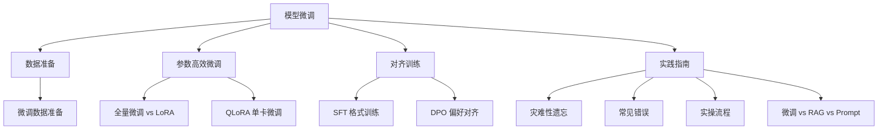

你用的 ChatGPT、Claude 都是"通用"AI（人工智能）——什么都会一点，但不一定擅长你需要的特定任务。比如你是一个律师，你需要 AI 用法律术语写合同。通用 AI 能写，但不够专业。

**微调**就是让通用 AI 在你需要的地方变得更擅长。就像请了一个家教，在你需要的科目上给 AI 补课。

你可能不需要自己微调模型。但理解了微调，你就理解了为什么有些 AI 产品"特别懂某个行业"——不是通用 AI 本身就懂，是那家公司用行业数据微调过。如果你以后想做一个特定领域的 AI 助手（比如法律助手、医疗助手），QLoRA + SFT + DPO 就是你的三件套。

## 本章目录

1. [[11.1 微调数据准备|11.1 微调数据准备]]
2. [[11.2 全量微调与LoRA|11.2 全量微调与LoRA]]
3. [[11.3 QLoRA|11.3 QLoRA：单卡微调大模型]]
4. [[11.4 SFT|11.4 SFT：教 AI 按格式说话]]
5. [[11.5 DPO与偏好对齐|11.5 DPO 与偏好对齐]]
6. [[11.6 灾难性遗忘详解|11.6 灾难性遗忘详解]]
7. [[11.7 2026年微调新趋势|11.7 2026 年微调新趋势]]
8. [[11.8 常见错误|11.8 常见错误]]
9. [[11.9 微调实操流程|11.9 微调实操流程]]
10. [[11.10 微调 vs RAG vs Prompt|11.10 什么时候微调 vs RAG vs Prompt]]

## 本章子文件夹

- [[对比/对比-LoRvsQLoRA|LoRA vs QLoRA]] · [[对比/对比-DPOvsRLHF|DPO vs RLHF]] · [[对比/对比-SFTvsRLHF|SFT vs RLHF]]
- [[深挖/深挖-LoRA|深挖：LoRA]] · [[深挖/深挖-QLoRA|QLoRA]] · [[深挖/深挖-DoRA|DoRA]] · [[深挖/深挖-PEFT|PEFT 全景]] · [[深挖/深挖-全量微调|全量微调]] · [[深挖/深挖-偏好对齐|偏好对齐]]
- [[概念/概念-模型训练管线|训练管线全景]] · [[概念/概念-训练数据集|训练数据集]] · [[概念/概念-GRPO|GRPO]]
- [[项目/用 LoRA 微调模型|实战项目：用 LoRA 微调模型]]

## 相关笔记

- [[Ch14 Agent 工作原理]] — 微调后的模型可以当 Agent 的"大脑"
- [[Ch20 模型推理部署]] — 微调完怎么把它跑起来

## 跨章节关联

- [[Ch10 LLM 原理与架构演进]] — 微调的对象：预训练 LLM
- [[Ch20 模型推理部署]] — 微调完的模型怎么部署
- [[Ch13 RAG 进化树]] — 微调 vs RAG：什么时候用哪个
- [[Ch12 Prompt 工程]] — 微调 vs Prompt：从"写提示词"到"教模型" 

## 来源

- Hu et al., "LoRA", 2021, https://arxiv.org/abs/2106.09685
- Dettmers et al., "QLoRA", 2023, https://arxiv.org/abs/2305.14314
- Rafailov et al., "DPO", 2023, https://arxiv.org/abs/2305.18290

