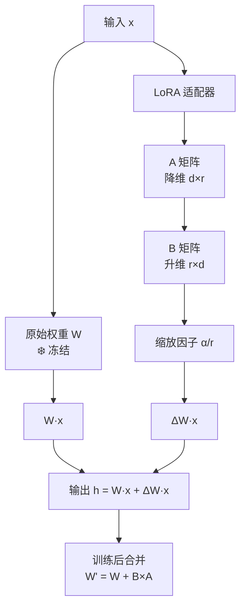

## 一句话理解

LoRA 在预训练权重矩阵旁边插入**低秩分解矩阵**（A × B），微调时只训练这两个小矩阵，原始权重完全冻结。训练完成后，小矩阵可以**合并回原权重**，推理时零额外开销。

## 零基础理解

原始模型有一个大矩阵 W（比如 4096 × 4096），它包含了模型学到的所有知识。LoRA 的洞见是：**微调带来的变化（ΔW）是"低秩"的——信息量很少，可以用两个极小的矩阵来表示。**

- A：4096 × 8（降维矩阵）
- B：8 × 4096（升维矩阵）
- B × A（或 A × B）：4096 × 4096，但"信息量"只有 8 维

> 类比：W 是一张 4K 分辨率的高清照片。ΔW 是你想加的滤镜效果。LoRA 发现，你不需要再存一张 4K 的滤镜图层——两个 480p 的小图（A 和 B）叠加起来，就能近似这个滤镜效果。

公式：`h = W·x + (α/r) · B·A·x`

其中 `α/r` 是缩放因子，控制 LoRA 对输出的影响程度。



## 核心概念

### 1. 秩（Rank, r）

秩 r 是 LoRA 最重要的超参数。它决定了低秩矩阵的中间维度，即 LoRA 模块的"容量"。

**r 的选择原则**：
- r 太小（如 r=1, 2）：容量不足，学不到足够信息，效果差
- r 适中（如 r=8, 16）：性价比最高，效果接近全量微调
- r 太大（如 r=64, 128）：接近全量微调的参数量，失去 PEFT 优势

| r 值 | 可训练参数（LLaMA-4.1-7B, Q+V） | 显存增量 | 效果 | 适用场景 |
|------|--------------------------|---------|------|---------|
| 4 | ~4M | 极小 | 基本可用 | 简单指令格式调整 |
| 8 | ~8M | 小 | 良好 | 通用推荐默认值 |
| 16 | ~16M | 中等 | 优秀 | 需要学新知识或复杂任务 |
| 32 | ~32M | 较大 | 很好 | 领域差异大、追求极致效果 |
| 64 | ~64M | 大 | 接近全量微调 | 预算充足、数据量大 |
| 128 | ~128M | 很大 | 可能过拟合 | 极少使用，仅大数据量场景 |

**经验法则**：
- 指令微调（让模型学会"怎么回答"）：r=8 足够
- 知识注入（让模型学会"新知识"）：r=16~32
- 领域迁移（从通用到专业领域）：r=16~64

### 2. Alpha 缩放（lora_alpha）

`alpha` 是与 r 配合使用的缩放参数。实际缩放因子 = `alpha / r`。

| alpha 设置 | 缩放因子 | 效果 |
|-----------|---------|------|
| alpha = r（如 r=8, alpha=8） | 1.0 | 标准强度 |
| alpha = 2r（如 r=8, alpha=16） | 2.0 | 给 LoRA 更大影响力 |
| alpha = r/2（如 r=8, alpha=4） | 0.5 | 给 LoRA 更小影响力 |

**2026 年实践**：大多数库（HuggingFace PEFT、Unsloth）默认使用 `alpha = 2r` 或 `alpha = r`。对于大多数场景，保持默认值即可，不需要单独调整 alpha。

### 3. target_modules（在哪些层加 LoRA）

决定在 Transformer 的哪些权重矩阵上应用 LoRA。

| 目标模块 | 含义 | 推荐度 | 说明 |
|---------|------|--------|------|
| q_proj | Query 投影 | 必加 | 控制"查什么"，对任务最敏感 |
| v_proj | Value 投影 | 必加 | 控制"输出什么"，对任务最敏感 |
| k_proj | Key 投影 | 推荐 | 原论文不推荐，但近年实践发现加了更好 |
| o_proj | Output 投影 | 可选 | 效果提升小，参数增加多 |
| gate_proj | 门控投影 | 可选 | LLM 的 FFN 门控，加了有时有效 |
| up_proj | 上投影 | 可选 | FFN 层，知识密集型任务推荐加 |
| down_proj | 下投影 | 可选 | FFN 层，知识密集型任务推荐加 |

**2026 年最佳实践**：
- 指令微调：`q_proj + v_proj` 通常足够
- 知识注入：`q_proj + k_proj + v_proj + up_proj + down_proj`
- 极致效果：所有线性层（`all-linear`）

### 4. LoRA 配置示例（Python）

```python
from peft import LoraConfig, get_peft_model, TaskType

# 基础配置（通用推荐）
lora_config = LoraConfig(
    task_type=TaskType.CAUSAL_LM,
    r=8,                    # 秩
    lora_alpha=16,          # alpha 缩放
    lora_dropout=0.05,      # Dropout 防止过拟合
    target_modules=["q_proj", "v_proj"],  # 目标模块
    bias="none",            # 不训练 bias
)

# 知识注入配置（更大容量）
lora_config_knowledge = LoraConfig(
    task_type=TaskType.CAUSAL_LM,
    r=32,
    lora_alpha=64,
    lora_dropout=0.1,
    target_modules=[
        "q_proj", "k_proj", "v_proj", "o_proj",
        "gate_proj", "up_proj", "down_proj"
    ],
)

# 应用 LoRA
from transformers import AutoModelForCausalLM
model = AutoModelForCausalLM.from_pretrained("meta-llama/Llama-4.1-8B")
model = get_peft_model(model, lora_config)
model.print_trainable_parameters()
# 输出: trainable params: 8,388,608 || all params: 8,038,388,608 || trainable%: 0.1044%
```

## LoRA 的核心优势

### 1. 可合并回原模型（零推理开销）

这是 LoRA 相比 Adapter 最大的优势。训练完成后：

```python
# 合并 LoRA 权重到基座模型
model = model.merge_and_unload()
# 此后推理完全等价于全量微调后的模型，零额外延迟
```

### 2. 多 LoRA 切换（一个基座 + 多个适配器）

一个基座模型可以搭载多个 LoRA adapter，按需加载：

```
基座模型 (LLaMA-4.1-8B, 16GB)
├── LoRA-医学 (50MB) → 医学问答
├── LoRA-法律 (50MB) → 法律文书
├── LoRA-代码 (50MB) → 代码生成
├── LoRA-翻译 (50MB) → 中英翻译
└── LoRA-客服 (50MB) → 客服对话
```

相比保存 5 个全量微调模型（5 × 16GB = 80GB），你只需要 16GB + 5 × 50MB = 16.25GB。

### 3. 训练效率高

- 不需要计算和存储原始权重的梯度
- 优化器状态只维护 LoRA 参数（参数量极少）
- 可以使用更大的 batch size

## LoRA 的局限性

1. **不适合大规模知识注入**：LoRA 的参数量有限，无法将大量新事实知识写入模型。如果需要模型记住海量新知识，考虑全量微调或 RAG。

2. **Rank 选择需要经验**：r 太小效果差，r 太大失去效率优势。不同任务的最优 r 不同，需要实验确定。

3. **多 adapter 融合困难**：虽然可以保存多个 adapter，但如何将多个 adapter 的能力有效融合（如同时加载医学+法律 adapter）仍是一个开放问题。

4. **对极小模型效果有限**：对于 < 100M 参数的模型，LoRA 的收益不明显。

## 2026 年定位

LoRA 是 **2026 年最主流的微调方式**，几乎所有开源模型（LLaMA 4、Qwen 3.7、Mistral Large 3、DeepSeek-V4 等）的微调生态都默认使用 LoRA。HuggingFace PEFT、Unsloth、Axolotl、LLaMA-Factory 等主流微调框架都将 LoRA 作为首要支持的 PEFT 方法。

**2026 年 LoRA 变体生态**：
- **QLoRA**：量化基座 + LoRA，消费级 GPU 微调的事实标准
- **DoRA**：权重分解 LoRA，效果更好但生态仍在追赶
- **LoRA+**：对 A 和 B 使用不同学习率，提升收敛速度
- **LoRA-FA**：冻结 A 矩阵只训练 B，进一步减少参数

## 相关笔记

- [[Ch11 模型微调]] — 微调入门
- [[深挖-QLoRA]] — 量化 LoRA，消费级 GPU 微调
- [[深挖-DoRA]] — 权重分解 LoRA，效果更优
- [[深挖-PEFT]] — PEFT 方法总览
- [[深挖-LoRA微调]] — LoRA 微调实操深入
- [[用 LoRA 微调模型]] — 项目实战
- [[深挖-全量微调]] — 全量微调与 LoRA 对比

## 来源

- Hu et al., "LoRA: Low-Rank Adaptation of Large Language Models", 2021, https://arxiv.org/abs/2106.09685
- Dettmers et al., "QLoRA: Efficient Finetuning of Quantized LLMs", 2023, https://arxiv.org/abs/2305.14314
- Liu et al., "DoRA: Weight-Decomposed Low-Rank Adaptation", 2024, https://arxiv.org/abs/2402.09353
- Hayou et al., "LoRA+: Efficient Low Rank Adaptation of Large Models", 2024, https://arxiv.org/abs/2402.12354
- HuggingFace PEFT Documentation, https://huggingface.co/docs/peft
- Unsloth: Open Source Fine-Tuning, https://github.com/unslothai/unsloth