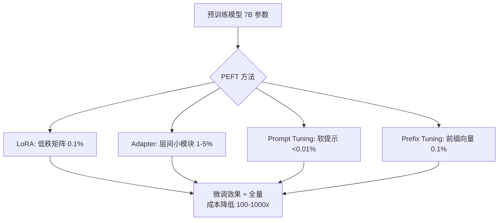

## 一句话理解

PEFT（Parameter-Efficient Fine-Tuning）是一类技术的统称，其核心思想是：**只训练模型中极少量的参数（通常 0.1% ~ 5%），冻结大部分参数，使微调效果接近全量微调，但计算和存储成本降低几个数量级。**

## 零基础理解

书已经写好了（预训练模型），你不需要重印整本书。你只需要在关键页面贴几张便利贴（PEFT 适配器），或者在目录页加一个"重点关注第X章"的标签（软提示）。读者（模型推理时）会先看到你的便利贴/标签，再结合原文，给出你想要的回答。

> 全量微调 = 重印整本书，PEFT = 贴便利贴。成本差了一万倍，但效果差不多。

## 核心概念



### 1. 参数效率（Parameter Efficiency）

参数效率衡量的是"每训练一个参数，能带来多少下游任务性能提升"。PEFT 追求极高的参数效率——用极少的可训练参数，撬动整个大模型的能力。

| 方法 | 可训练参数占比 | 典型参数量（7B 模型） |
|------|--------------|---------------------|
| 全量微调 | 100% | 7B |
| LoRA (r=8) | ~0.1% ~ 0.5% | 8M ~ 35M |
| Adapter | ~1% ~ 5% | 70M ~ 350M |
| Prompt Tuning | < 0.01% | < 1M |
| Prefix Tuning | ~0.1% ~ 1% | 7M ~ 70M |

### 2. Adapter（适配器）

最早提出 PEFT 概念的方法。在 Transformer 的每一层之间插入小型神经网络模块（Adapter），微调时只训练这些模块。

结构：输入 → LayerNorm → **Adapter（降维→激活→升维）** → 残差连接 → 原 Transformer 层

**缺点**：Adapter 是串行的——推理时必须等 Adapter 算完才能继续。这增加了推理延迟（通常 5%-20%），无法通过合并消除。

### 3. LoRA（低秩适配）

目前最主流的 PEFT 方法。不插入新模块，而是在原始权重矩阵旁边添加低秩分解矩阵（A × B），只训练 A 和 B。

**关键优势**：训练完成后，可以将 A × B 合并到原始权重矩阵 W' = W + A×B（乘以缩放因子），推理时**零额外开销**。

### 4. 软提示（Soft Prompt / Prompt Tuning）

不修改模型内部任何参数，只在输入 Embedding 层前面拼接可训练的"虚拟 Token"向量。模型本身完全冻结。

**关键优势**：可以在不访问模型权重的情况下微调（适用于 API-only 模型），多任务切换只需更换提示向量。

## PEFT 方法全景对比

| 方法 | 参数占比 | 效果（vs 全量微调） | 推理开销 | 训练速度 | 可合并 | 2026 年主流程度 |
|------|---------|-------------------|---------|---------|--------|---------------|
| **LoRA** | 0.1% ~ 0.5% | 95% ~ 99% | 无（可合并） | 快 | 是 | 最主流 |
| **QLoRA** | 0.1% ~ 0.5% | 93% ~ 97% | 无（可合并） | 中等（量化开销） | 是 | 消费级GPU首选 |
| **DoRA** | 0.2% ~ 0.5% | 96% ~ 99% | 无（可合并） | 稍慢于LoRA | 是 | 新兴，快速增长 |
| **Adapter** | 1% ~ 5% | 90% ~ 97% | 有（5%-20%） | 中等 | 否 | 基本被取代 |
| **Prompt Tuning** | < 0.01% | 70% ~ 90% | 无（输入层） | 极快 | 是（向量） | 特定场景 |
| **Prefix Tuning** | 0.1% ~ 1% | 80% ~ 92% | 有（轻量） | 快 | 否 | 被LoRA取代 |
| **P-Tuning v2** | 0.1% ~ 1% | 85% ~ 93% | 有（轻量） | 快 | 否 | 中文NLP场景仍有使用 |
| **IA3** | 0.01% ~ 0.1% | 85% ~ 95% | 无（可合并） | 极快 | 是 | 极端参数受限场景 |

## 2026 年 PEFT 选型建议

### 决策树

```
需要微调大模型？
├── 有 GPU 且显存充足（> 24GB）
│   ├── 追求极致性能 → LoRA (r=16~64) 或 DoRA
│   └── 快速实验 → LoRA (r=8, 默认配置)
├── 消费级 GPU（8GB ~ 24GB）
│   ├── 7B 模型 → QLoRA (4-bit) + Unsloth
│   └── 更大模型 → QLoRA (4-bit) + 更小的 rank
├── 无 GPU / API-only 模型
│   ├── 可以修改模型 → 考虑云端 LoRA 训练
│   └── 完全不可修改 → Prompt Tuning / 上下文学习
└── 极端存储受限（需要多任务）
    └── IA3 → 参数最少，可合并
```

### 各场景推荐

| 场景 | 推荐方法 | 理由 |
|------|---------|------|
| 通用指令微调 | LoRA (r=16) | 最成熟，效果最好 |
| 个人项目 / 学习 | QLoRA (r=8) | 单卡可跑，成本低 |
| 多任务快速切换 | LoRA | 多个 adapter，一个基座 |
| 追求最强效果 | DoRA | 效果略优于 LoRA |
| API 模型适配 | Prompt Tuning | 不修改模型内部 |
| 极小参数预算 | IA3 | 参数最少 |
| 中文 NLP 任务 | LoRA 或 P-Tuning v2 | 两者生态都较好 |

## PEFT 的局限性

1. **不适合大规模知识注入**：PEFT 的参数量有限，无法将大量新事实知识写入模型。如果需要模型记住海量新知识（如整个公司的文档库），全量微调或 RAG 更合适。

2. **对极小模型效果差**：对于 < 100M 参数的模型，PEFT 的"参数效率"优势不明显，直接全量微调可能更好。

3. **多 adapter 融合仍不成熟**：虽然可以保存多个 LoRA adapter，但如何将多个 adapter 的能力有效融合仍是一个开放问题。

4. **对全新架构支持滞后**：新模型架构发布后，PEFT 库（如 HuggingFace PEFT）需要时间适配。

5. **训练稳定性（某些方法）**：Adapter 和 Prefix Tuning 在训练初期可能不稳定，需要仔细调参。

## 相关笔记

- [[Ch11 模型微调]] — 微调基础知识
- [[深挖-全量微调]] — 全量微调与 PEFT 的对比参考
- [[深挖-LoRA]] — 最主流的 PEFT 方法
- [[深挖-QLoRA]] — 量化 + LoRA，消费级 GPU 微调
- [[深挖-DoRA]] — LoRA 改进版，权重分解
- [[深挖-PromptTuning]] — 软提示微调
- [[深挖-PrefixTuning]] — 前缀微调
- [[深挖-LoRA微调]] — LoRA 原理与实操深入

## 来源

- Houlsby et al., "Parameter-Efficient Transfer Learning for NLP (Adapter)", 2019, https://arxiv.org/abs/1902.00751
- Hu et al., "LoRA: Low-Rank Adaptation of Large Language Models", 2021, https://arxiv.org/abs/2106.09685
- Dettmers et al., "QLoRA: Efficient Finetuning of Quantized LLMs", 2023, https://arxiv.org/abs/2305.14314
- Liu et al., "DoRA: Weight-Decomposed Low-Rank Adaptation", 2024, https://arxiv.org/abs/2402.09353
- Lester et al., "The Power of Scale for Parameter-Efficient Prompt Tuning", 2021, https://arxiv.org/abs/2104.08691
- Li & Liang, "Prefix-Tuning: Optimizing Continuous Prompts for Generation", 2021, https://arxiv.org/abs/2101.00190
- Liu et al., "Few-Shot Parameter-Efficient Fine-Tuning is Better and Cheaper than In-Context Learning (IA3)", 2022, https://arxiv.org/abs/2205.05638
- HuggingFace PEFT Library, https://github.com/huggingface/peft