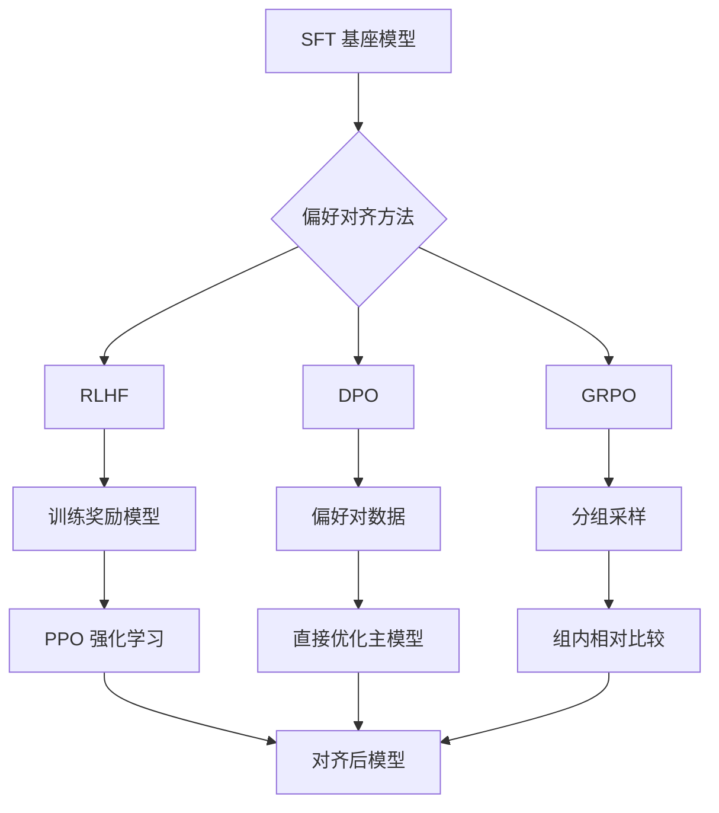

> **公式可跳过**：文中出现的 Loss 函数公式可以直接跳过，看文字解释即可理解 DPO 和 GRPO 的核心区别。

[[Ch11 模型微调]] 介绍了 SFT（监督微调，给 AI 看标准答案让它学着模仿）教 AI "怎么做"，DPO（直接偏好优化）教 AI "什么样的答案更好"。这篇深入两种偏好对齐方法的区别。

## 为什么需要偏好对齐

SFT 训练出来的模型"会做"，但"不知道做得对不对"。

比如你问"帮我写一封道歉信"。SFT 模型会给你一封格式正确的道歉信——但它可能语气太正式（你需要的是给朋友的）、或者太轻浮（你需要的是给客户的）。SFT 只学了格式，没学偏好。

偏好对齐就是教模型：**不是所有正确答案都一样好。有些答案比另一些更符合用户的期望。**



## RLHF：最早的方案

RLHF（基于人类反馈的强化学习）2022 年提出，用于训练 ChatGPT。这个方法分三步 ^[Ouyang et al., "InstructGPT", 2022]：

三步：
1. **SFT 阶段**：用高质量人工标注数据微调
2. **训练奖励模型**：让人工标注员对多个答案排序，训练一个"评分 AI"
3. **PPO 强化学习**：PPO（近端策略优化）是一种训练方法——每一步让奖励模型打分，主模型朝着高分方向优化

**问题**：第二步太复杂。需要额外训练一个奖励模型。而且 PPO 训练极不稳定。

## DPO：干掉奖励模型

DPO（Direct Preference Optimization）2023 年由 Stanford 提出 ^[Rafailov et al., "Direct Preference Optimization: Your Language Model is Secretly a Reward Model", 2023, https://arxiv.org/abs/2305.18290]。

核心洞察：**奖励模型和主模型本质上做的是同一件事——判断哪个答案更好。不需要分开训练。**

DPO 的做法：
1. 收集偏好对：每个问题有两个答案（chosen 更好，rejected 更差）
2. 直接优化主模型，让它给 chosen 的概率 > 给 rejected 的概率
3. 不需要奖励模型，不需要 PPO

数学上，DPO 的 loss 函数：

```
Loss = -log( σ( β × log(π_chosen/π_ref) - β × log(π_rejected/π_ref) ) )
```

不展开公式。直觉就是：**拉高 chosen 的概率，压低 rejected 的概率。** β 控制变化的幅度——β 大=更保守（不偏离原模型太远），β 小=更激进。

**DPO 的优点**：比 RLHF 简单 10 倍。不需要训练奖励模型，不需要调整 PPO 超参数。2024 年起成为偏好对齐的默认方法。

**DPO 的缺点**：需要高质量的偏好对。标注成本高——每个问题需要两个答案 + 人工评出哪个更好。

## GRPO：分组相对比较

GRPO（Group Relative Policy Optimization）2024 年由 DeepSeek 提出，用于训练 DeepSeek-R1 ^[DeepSeek, "DeepSeekMath: Pushing the Limits of Mathematical Reasoning", 2024, https://arxiv.org/abs/2402.03300]。

DPO 的问题：每个问题只有两个答案对比。但有时候"哪个更好"不那么明确——A 更好但 B 也不差。

GRPO 的做法：**对同一个问题生成 N 个答案（通常 N=8-16），在组内比较。**

1. 给一个问题，生成 8 个答案
2. 用规则（数学正确答案）或奖励模型给这 8 个答案打分
3. 组内排名——第一名的答案作为"chosen"，最后几名作为"rejected"
4. 按排名梯度优化模型

**GRPO 的优势**：
- 不需要人工标注偏好对——答案质量可以用规则判断（数学题答对了没有？代码能运行吗？）
- 组内比较比两两比较更稳定——排名消除了绝对分数的波动

**GRPO 的代价**：每个问题要生成 N 个答案，计算量是 DPO 的 N 倍。

## DPO vs GRPO 速查

| | DPO | GRPO |
|---|---|---|
| 几个答案对比 | 2 个（chosen vs rejected） | N 个（组内排名） |
| 依赖人工标注吗 | 依赖（偏好对） | 不依赖（规则评分） |
| 计算量 | 低 | 高（N 倍） |
| 适用场景 | 主观任务（语气、风格） | 客观任务（数学、代码） |
| 训练稳定性 | 好 | 好（比 RLHF 稳定） |
| 提出者 | Stanford 2023 | DeepSeek 2024 |

## 2026 年推荐

- **大部分场景**：DPO。简单、稳定、效果好
- **数学/代码任务**：GRPO。可以用规则自动评分，不需要人工标注
- **有大量偏好数据**：继续用 DPO
- **没有偏好数据但有评分规则**：用 GRPO

## 相关笔记

- [[Ch11 模型微调]] — SFT + DPO/GRPO 是完整的微调管线
- [[深挖-LoRA微调]] — DPO/GRPO 可以和 LoRA 一起用

## 来源

- Ouyang et al., "InstructGPT", 2022, https://arxiv.org/abs/2203.02155
- Rafailov et al., "DPO", 2023, https://arxiv.org/abs/2305.18290
- DeepSeek, "DeepSeekMath", 2024, https://arxiv.org/abs/2402.03300
