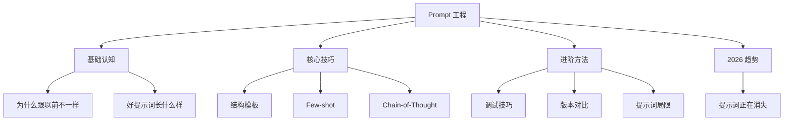

提示词就是你跟 AI 说话时，你输入的那段话。

比如：
- "帮我写一封道歉信" -> 这段话就是提示词
- "把这句话翻译成英文：今天天气真好" -> 这段话就是提示词
- "用三句话总结这篇文章的要点" + 贴上文章 -> 这段话加文章都是提示词

不需要写代码。不需要懂编程。你说人话，AI 听懂就干活。

提示词能做的事情很多：写邮件、文案、道歉信、辞职信；翻译任何语言；把长文章压缩成几句话；解释概念、查资料、给建议；改写一段话让它更礼貌、更简短、更好懂。无论你是学生、上班族还是创业者，提示词都能帮你省时间。

> **生活比喻**：提示词就像点菜——你说"随便来点吃的"，厨师（AI）可能端上任何东西；你说"来一碗不放香菜的牛肉面，微辣，面要硬一点，加个蛋"，厨师就清楚你要什么。好的提示词就是精准点菜：角色（厨师水平）、任务（要什么菜）、格式（怎么摆盘）、约束（不要什么），说清楚，减少厨师的猜测。

## 本章目录

1. [[12.1 提示词为什么跟以前不一样|12.1 提示词为什么跟以前不一样]]
2. [[12.2 提示词结构模板|12.2 提示词结构模板]]
3. [[12.3 好提示词长什么样|12.3 好提示词长什么样]]
4. [[12.4 Few-shot 实战|12.4 Few-shot 实战]]
5. [[12.5 Chain-of-Thought 深入|12.5 Chain-of-Thought 深入]]
6. [[12.6 提示词调试技巧|12.6 提示词调试技巧]]
7. [[12.7 提示词版本对比|12.7 提示词版本对比]]
8. [[12.8 2026 年-提示词正在消失|12.8 2026 年：提示词正在消失]]
9. [[12.9 提示词有什么局限|12.9 提示词有什么局限]]

## 延伸阅读

学完本章后，可以继续深入：
- [[概念-系统提示词]] -- 提示词分两种：你写的和开发者替你写的
- [[概念-三种问法]] -- Zero-shot、Few-shot、思维链的详细对比
- [[概念-提示词局限]] -- 展开讲为什么提示词有边界，以及后续三层如何补上

## 跨章节关联

- [[Ch14 Agent 工作原理]] — Prompt 的下一步：Agent 自己写 Prompt
- [[Ch13 RAG 进化树]] — 上下文工程的核心技术：RAG
- [[Ch11 模型微调]] — Prompt vs 微调：两种让 AI 听指令的方法

## 来源

- ACM, "Non-Determinism of ChatGPT in Code Generation", 2024
- Packt, "AI Under Attack", GitHub 教材
- Boris Cherny (Anthropic Claude Code 负责人), 2026 年公开演讲
- Addy Osmani (Google Chrome), 2026 年 6 月, "Loop Engineering" 命名
- 人人都是产品经理, "AI 工程的第四次跃迁", https://www.woshipm.com/ai/6414536.html

