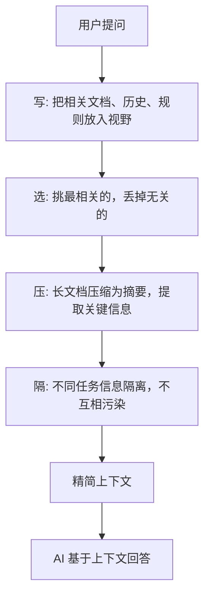

上篇讲了提示词的三个局限：AI 不记事儿、不能自己找资料、输出靠输入。这三件事指向同一个答案——**上下文工程**。

## 它是什么

一句话：**在你提问之前，自动把 AI 需要的信息准备好，塞给它。**

你用过搜索引擎吧？你打字搜索之前，搜索引擎已经在后台建好了索引——几十亿网页已经整理好了，等着你搜。上下文工程做的事类似——AI 还没开口回答，该用的资料、该记的对话历史、该遵守的规则，都已经准备好了。

提示词管"怎么问"。上下文工程管"让 AI 看见什么"。一个管嘴，一个管眼睛 ^[人人都是产品经理, "AI 工程的第四次跃迁", https://www.woshipm.com/ai/6414536.html]。

## 具体做什么

上下文工程不只是"多塞点东西进去"。它要做四件事 ^[LangChain 官方博客, "Context Engineering", 2025.07]; ^[百度 AI Studio, "上下文工程与 RAG 的本质区别", https://aistudio.baidu.com/blog/detail/738169380659013]：

- **写**：把什么放进 AI 的视野。比如相关文档、之前的对话、系统规则
- **选**：不是所有东西都放进去。挑最相关的，丢掉无关的
- **压**：东西太多装不下。把长文档压缩成摘要，把关键信息提取出来
- **隔**：不同任务的信息不能混。问翻译的时候不要塞进昨天的聊天记录

这四件事的共同目标：**让 AI 在有限的空间里，看到最有用的信息。**

## 跟你已经学过的有什么关系

你之前学 RAG（检索增强生成）的时候，其实就是上下文工程的一种做法——从外部知识库检索文档，塞进 AI 的上下文窗口。但上下文工程比 RAG 范围更大——RAG 只管"检索"，上下文工程还要管记忆、管压缩、管隔离。

这个笔记库本身就是上下文工程的例子：你打开的每一篇笔记是一段上下文，摘要负责"选"和"压"（选相关主题，压成几行概述），写新笔记前搜索已有文件就是"写"（把相关内容放进 AI 的视野）。

## 一句话

> 提示词是你对 AI 说的话。上下文是 AI 说话时手边摊开的资料。上下文工程就是帮你自动摊开这些资料。

- [[概念-Harness工程]] — 下一层：给 AI 搭工作台，让它能干活
- [[概念-提示词局限]] — 回顾：为什么需要上下文工程
- [[知识图谱]] — 看全景：上下文工程在整体图中的位置

## 相关笔记

- [[概念-Harness工程]] — 下一层：给 AI 搭工作台，让它能干活
- [[概念-提示词局限]] — 回顾：为什么需要上下文工程
- [[知识图谱]] — 看全景：上下文工程在整体图中的位置

## 来源

- 人人都是产品经理, "AI 工程的第四次跃迁：从 Prompt 到 Loop", https://www.woshipm.com/ai/6414536.html
- LangChain 官方博客, "Context Engineering", 2025 年 7 月
- 百度 AI Studio, "上下文工程与 RAG 的本质区别", https://aistudio.baidu.com/blog/detail/738169380659013
