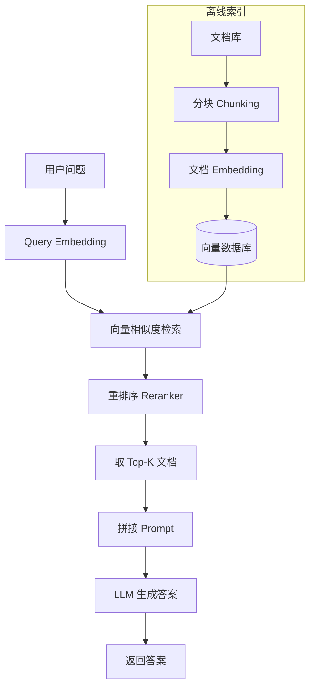

### 13.1.1 LLM 的三大局限

AI（人工智能）的知识来自训练数据。训练完之后就不会自动更新了。你问它"今天北京天气怎么样"，它不知道——训练数据里没有"今天"。具体来说，大语言模型（LLM）有三个根本性的局限：

**局限一：知识截止日期。** 每个 LLM 都有一个训练数据截止日期。GPT-4 的知识截止到 2023 年底，Claude 的知识截止到 2025 年初。截止日期之后发生的事情——新总统上任、新论文发表、新疫苗获批——模型一概不知。你问它"2026 年世界杯冠军是谁"，它要么拒绝回答，要么胡编。

**局限二：幻觉。** 即使知识在训练数据里，模型也可能编造事实。它本质上是一个"预测下一个词"的概率模型，不是事实数据库。当它不确定答案时，它会"脑补"一个看起来合理的回答——人名、日期、数字、引用，看起来像模像样，但全是编的。这在法律、医疗等高风险场景是致命的。

**局限三：无法引用来源。** 传统 LLM 输出一段文字，但不会告诉你"这句话来自哪本书的第几页"。用户无从验证信息的真实性。在学术写作、企业报告、法律意见等场景，没有来源等于没有可信度。

### 13.1.2 RAG 之前的解决方案

在 RAG 成为主流之前，解决上述问题主要有两种方案，但各有短板：

**方案一：微调。** 拿新数据重新训练模型。问题是：成本高（需要 GPU 集群，训练一次数千到数万美元）、知识固化（训练完之后知识又"停"在那一刻，下次更新还得再训一轮）、可能遗忘旧知识（灾难性遗忘）。微调更适合让模型学会"风格"和"格式"，而不是注入新知识。

**方案二：长 Prompt。** 把参考资料直接写进 Prompt 里。问题是：上下文窗口有限（早期模型只有 4K-8K token，相当于几页纸）、成本随长度线性增长（token 按量计费，长 Prompt 每次都要付费）、信息密度低（大量无关内容浪费 token）。

### 13.1.3 RAG 的核心思想

解决办法很简单，而且很优雅：在你问 AI 之前，先把相关信息搜出来，一起塞给它。AI 根据你塞的资料来回答，而不是凭记忆回答。这就是检索增强生成（Retrieval-Augmented Generation，简称 RAG）的核心思路——**不让 AI 凭记忆，让它凭证据。** 这个概念最早由 Facebook AI（现 Meta AI）在 2020 年正式提出 ^[Lewis et al., "Retrieval-Augmented Generation for Knowledge-Intensive NLP Tasks", 2020, https://arxiv.org/abs/2005.11401]。

RAG 解决了三个问题：知识截止日期（检索可以实时更新，文档库加新内容就能搜到）、幻觉（答案受检索结果约束，不能随意编造）、引用来源（检索到的文档天然就是来源，可以直接标注）。

### 13.1.4 图书管理员比喻

打个比方：你问一个图书管理员"量子力学是什么"，她不背答案。她先去书架上找两本相关的书，翻到关键页面，根据书上的内容回答你。RAG 就是帮 AI 做了这件事——先找书，再回答。

这个比喻值得深入展开，因为它揭示了 RAG 设计的每一个关键决策：

- **图书馆的藏书量** = 你的知识库规模。藏书太少，很多问题找不到答案；藏书太多，找书变慢，还可能找到不相关的书。
- **图书分类系统** = 你的分块和索引策略。杜威十进制分类法（固定规则）就像固定大小分块，而图书馆员根据内容灵活归类就像语义分块。
- **找书的方式** = 你的检索策略。按书名精确查找（关键词检索）很快，但你要找"关于幸福的书"，书名里没有"幸福"两个字的书就会被漏掉。按主题浏览（语义检索）能找到更多相关书，但可能找到一些"看起来相关但其实不相关"的书。
- **翻到关键页面** = 你的重排序和上下文选择。图书管理员不会把整本书塞给你，而是翻到最相关的几页。RAG 的重排序（Reranker）做的就是这件事——从一堆候选文档里挑出最相关的片段。
- **根据书上的内容回答** = 你的生成阶段。图书管理员不是照本宣科，而是理解内容后用自己的话回答。LLM 也是如此——它不是复制粘贴检索结果，而是基于检索结果生成连贯的答案。
- **告诉你"这是从哪本书看到的"** = 你的引用标注。好的图书管理员会告诉你出处，好的 RAG 系统也会标注引用来源。

理解了这六个环节，你就理解了 RAG 系统设计的全部核心问题。

---

> ← 上一节：[[Ch13 RAG 进化树|章首]] ｜ 下一节：[[13.2 RAG 系统架构]] →
