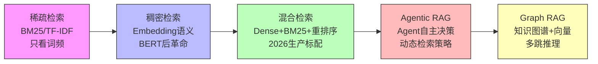

有些问题需要"多跳推理"——不是搜一次能解决的。

比如"张三的老板的老板是谁"——你得先找到"张三的老板是谁"，再找"那个人的老板是谁"。传统 RAG 搜一次只能回答第一跳。

### 13.10.1 Graph RAG 的原理

2024 年微软开源了 Graph RAG——它不把文档当纯文本存，而是先用 AI 提取里面的实体（人名、地名、公司名）和它们之间的关系（谁认识谁、谁属于什么组织），组成一张知识图谱。搜索的时候沿着图上的关系边走边查，比如从"张三"节点走到"老板"节点再走到"老板的老板"节点，几步就能回答需要多步推理的问题。相比传统 RAG 只返回一堆文本片段，Graph RAG 还返回了"谁跟谁什么关系"这种结构化信息 ^[Microsoft, Graph RAG, 2024]。

### 13.10.2 Graph RAG 的构建流程

**离线阶段（图构建）**：
1. **实体抽取**：用 LLM 从每篇文档中识别实体（人名、地名、组织、日期、概念……）。例如从"张三于 2023 年加入字节跳动，担任 AI 部门负责人"中抽取 [张三]（人物）、[字节跳动]（组织）、[AI 部门]（组织）、[2023 年]（时间）。
2. **关系抽取**：用 LLM 识别实体之间的关系。例如 [张三] --[任职于]--> [字节跳动]，[张三] --[担任]--> [AI 部门负责人]。
3. **社区发现**：用图算法（如 Leiden 算法）在知识图谱中识别"社区"——紧密关联的实体组成的子图。一个社区对应一个主题（如"字节跳动 AI 部门"）。
4. **社区摘要**：用 LLM 为每个社区生成摘要，描述这个社区的核心信息。

**在线阶段（图查询）**：
1. 用户问题来了，先做向量检索找到相关文档片段（传统 RAG 的步骤）。
2. 同时，在知识图谱中搜索相关实体和关系。比如用户问"张三的老板是谁"，先定位到"张三"节点，再沿"汇报给"边找到"李四"节点。
3. 把向量检索的文本结果 + 图谱检索的结构化结果（实体关系 + 社区摘要）一起拼接进 Prompt。

### 13.10.3 Graph RAG 的两种模式

**局部搜索（Local Search）**：只搜索与查询相关的实体的一跳或两跳邻居。适合事实查询，响应快。

**全局搜索（Global Search）**：搜索整个知识图谱的结构化摘要，适合需要"宏观理解"的问题。比如"字节跳动的 AI 部门是怎么组织的"——这个问题需要理解整个部门的结构，而不是某一个人的信息。微软的 Graph RAG 论文中，全局搜索是基于社区摘要的——先找到相关社区，再把这些社区的摘要拼接起来，让 LLM 综合回答。

### 13.10.4 Graph RAG 的适用场景

**适合 Graph RAG 的场景**：
- 多跳推理问题（"A 的老板的老板的投资人是谁"）
- 需要理解实体间关系的问题（"A 公司和 B 公司是什么关系"）
- 需要宏观视角的问题（"这个领域的核心人物和他们的关系网"）
- 文档中大量出现专有名词和实体关系的场景（法律文书、企业文档、学术论文）

**不适合 Graph RAG 的场景**：
- 简单的事实查询（"XX 的定义是什么"）——传统 RAG 更快更便宜
- 文档中实体关系稀疏的场景（如小说、散文）
- 构建知识图谱的成本（LLM 提取实体和关系需要大量 API 调用）高于收益的场景

### 13.10.5 Graph RAG vs 传统 RAG

| 维度 | 传统 RAG | Graph RAG |
|------|---------|-----------|
| 存储内容 | 文本片段 | 文本片段 + 实体 + 关系 + 社区摘要 |
| 检索方式 | 向量相似度 | 向量相似度 + 图遍历 |
| 多跳推理 | 不支持（需要多次搜索） | 天然支持（沿图边跳转） |
| 回答类型 | 文本片段总结 | 结构化信息 + 文本片段总结 |
| 索引成本 | 低（只需 Embedding） | 高（需要 LLM 抽取实体和关系） |
| 查询延迟 | 低（毫秒级） | 中（需要图遍历） |

**2026 年建议**：Graph RAG 不是传统 RAG 的替代品，而是补充。如果你的场景涉及大量实体关系和复杂推理，Graph RAG 能显著提升答案质量。但它的索引成本高（每篇文档需要多次 LLM 调用来抽取实体和关系），不适合"快速上线"的场景。从传统 RAG 开始，在需要时再引入 Graph RAG。

---

> ← 上一节：[[13.9 第四代-AI 自己决定怎么搜（Agentic RAG）]] ｜ 下一节：[[13.12 RAG 高级技术]] →
