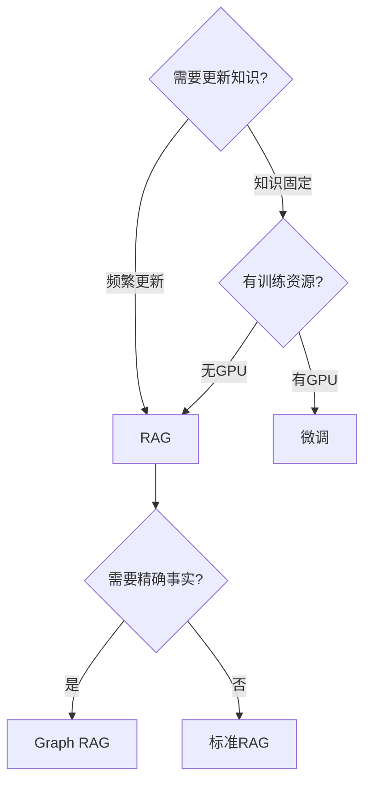

你在 [[产品-AI搜索演变]] 里看到过这个词。它听起来很学术，但做的事情很简单：**先搜资料，再让 AI 根据资料回答。** 这篇讲这个技术怎么从简单变复杂的。

你每次用 AI 搜索（比如 Perplexity——一个专门的 AI 搜索引擎，搜完资料后 AI 帮你总结成完整答案；或 ChatGPT 内置的联网搜索功能——对话时勾选搜索按钮 ChatGPT 就会先搜资料再回答），背后跑的就是 RAG。你问问题，系统搜资料，AI 总结答案——三代混合检索是最常见的做法。理解了 RAG 的这五代演变，你就理解了 AI 搜索是怎么做到的——从简单的关键词匹配，到 AI 自己决定搜什么。

> **生活比喻**：RAG 像开卷考试——AI 是考生，但它脑子里的知识（训练数据）有截止日期，2024 年之后的事它不知道。RAG 就是给考生发一本实时更新的参考书（检索外部资料），让它先翻书找答案，再结合自己的理解来回答。这样答案既有依据又有时效性，不会瞎编。

## 本章目录

1. [[13.1 为什么需要 RAG|13.1 为什么需要 RAG]]
2. [[13.2 RAG 系统架构|13.2 RAG 系统架构]]
3. [[13.3 分块策略 -- RAG 的地基|13.3 分块策略 —— RAG 的地基]]
4. [[13.4 第一代-关键词搜索（稀疏检索）|13.4 第一代：关键词搜索（稀疏检索）]]
5. [[13.5 第二代-语义搜索（稠密检索）|13.5 第二代：语义搜索（稠密检索）]]
6. [[13.6 第三代-混合检索|13.6 第三代：混合检索]]
7. [[13.7 重排序 -- 提升精度的关键|13.7 重排序 —— 提升精度的关键]]
8. [[13.8 生成阶段 -- 让 LLM 用上检索结果|13.8 生成阶段 —— 让 LLM 用上检索结果]]
9. [[13.9 第四代-AI 自己决定怎么搜（Agentic RAG）|13.9 第四代：AI 自己决定怎么搜（Agentic RAG）]]
10. [[13.10 第五代-知识图谱辅助（Graph RAG）|13.10 第五代：知识图谱辅助（Graph RAG）]]
11. [[13.12 RAG 高级技术|13.12 RAG 高级技术]]
12. [[13.13 RAG 评估|13.13 RAG 评估]]
13. [[13.14 RAG vs 微调 vs 长上下文|13.14 RAG vs 微调 vs 长上下文]]
14. [[13.15 RAG 生产部署|13.15 RAG 生产部署]]
15. [[13.16 动手搭一个 RAG|13.16 动手搭一个 RAG]]

## 五代总览

（说明：这五代分类是一个教学框架，帮你理解演变逻辑，不是学术界的官方分类。）

| 代 | 叫什么 | 怎么搜 | 懂语义吗 | 能推理吗 |
|----|--------|--------|---------|---------|
| 一 | 关键词检索 | 匹配文字 | 不懂 | 不能 |
| 二 | 语义检索 | 匹配含义 | 懂 | 不能 |
| 三 | 混合检索 | 两者一起 | 懂 | 不能 |
| 四 | 自主检索 | AI 自己决定 | 懂 | 能一点 |
| 五 | 图谱检索 | 沿关系推理 | 懂 | 能 |

## 相关笔记

- [[产品-AI搜索演变]] — RAG 在产品层的表现
- [[知识图谱]] — 第二条演化轴就是 RAG 进化树

## 跨章节关联

- [[Ch14 Agent 工作原理]] — Agentic RAG（第四代）：AI 自己决定怎么搜
- [[Ch10 LLM 原理与架构演进]] — LLM 的三大局限驱动了 RAG 的诞生
- [[Ch11 模型微调]] — RAG vs 微调 vs 长上下文：三种方案的选择

## 来源

- Meta, "Faiss: A library for efficient similarity search", 2017, https://engineering.fb.com/2017/03/29/data-infrastructure/faiss-a-library-for-efficient-similarity-search/
- Elastic, "Vector Search Introduction", https://www.elastic.co/search-labs/cn/blog/introduction-to-vector-search
- 火山引擎, "AI 跑车引擎——向量数据库", https://developer.volcengine.com/articles/7382278528115343369
- Lewis et al., "Retrieval-Augmented Generation for Knowledge-Intensive NLP Tasks", 2020, https://arxiv.org/abs/2005.11401
- Microsoft, Graph RAG, 2024

