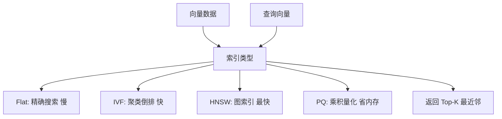

## 一句话理解

FAISS 是 Meta 于 2017 年开源的**向量相似度搜索库**，用 C++ 编写并提供 Python 接口。它不是数据库，不管理存储、不处理事务、不做持久化——它是一个纯粹的**向量计算加速器**，擅长在海量向量中快速找到最相似的 Top-K 个。

## 零基础理解

如果把向量检索比作找人：假设你有 1 亿张人脸照片，现在来了一个新面孔，要在 1 亿张里找最像的——一张张比对太慢了。FAISS 的做法是**先把照片分组，查询时只比对最可能的那几组**，这就是 ANN 的核心思想：用精度换速度，牺牲 1% 的精度换 1000 倍的性能提升。

> 向量数据库 = FAISS + 存储 + 增删改查 + 网络接口 + 权限管理。FAISS 只管最核心的那一步：给定向量和索引，快速返回近似最近邻。

## 核心概念

### ANN

近似最近邻。严格意义上的 KNN 需要遍历所有向量计算距离，在十亿级向量上不可行。ANN 通过构建索引，用"近似"换取数量级的性能提升。典型精度损失不到 1%，速度提升可达 100~1000 倍。

### IVF

基于倒排索引的向量聚类方法。使用 K-Means 将向量空间划分为多个 Voronoi 单元，查询时只搜索最近的若干单元。`nlist` 参数控制单元数量——越大则每个单元越小，搜索越快但精度越低。

### HNSW

分层可导航小世界图。目前最常用的 ANN 索引结构之一：在底层构建一个高连通的近邻图，上层是稀疏的"高速公路"图。查询时从上层快速接近目标区域，逐步下沉到下层精确搜索。时间复杂度 O(log N)，内存占用较高。

### PQ

乘积量化。将高维向量切分成多个子向量，每个子向量独立量化，压缩为短码。存储时只存短码，查询时用短码近似计算距离。能将 1024 维 float32 向量从 4KB 压缩到 64 bytes，压缩比 64x，代价是精度略有下降。

### GPU 加速

FAISS 对 GPU 的支持是核心优势之一。通过 `GpuIndexFlatL2` 等 GPU 索引，可以将暴力搜索或 IVF 的部分计算卸载到 GPU。十亿级向量在单机 8-GPU 上可实现毫秒级检索。

## FAISS 索引选型

| 索引类型 | 适用规模 | 内存占用 | 精度 | 速度 | 典型场景 |
|---------|---------|---------|------|------|---------|
| IndexFlatL2 | 百万级 | 高（存原始向量） | 100% | 慢 | 基准测试、小规模精确搜索 |
| IndexIVFFlat | 千万~亿级 | 中 | 95%~99% | 快 | 通用场景，需调参 `nlist` |
| IndexIVFPQ | 亿~十亿级 | 低（压缩） | 90%~95% | 很快 | 大规模压缩索引，内存受限 |
| IndexHNSWFlat | 千万~亿级 | 高（存图+原始向量） | 98%~99% | 最快 | 对精度要求高，内存充裕 |
| IndexIVFPQ + GPU | 十亿级 | 低 | 90%~95% | 极快 | 离线批量、十亿级检索 |

## 什么时候直接用 FAISS

- **离线批量向量检索**：对已有向量集合做一次性聚类、去重、相似度分析
- **十亿级向量**：需要极致压缩和 GPU 加速，专用向量数据库可能达不到这个量级
- **嵌入在自有系统中**：已有完整的存储和查询逻辑，只需"调用一个函数返回 Top-K"
- **研究和实验**：快速迭代索引参数，对比不同 ANN 算法效果

## 什么时候用向量数据库而不是 FAISS

- 需要**增删改查**和**持久化**——FAISS 索引是内存结构，重启即丢失
- 需要**分布式部署**和**网络接口**——FAISS 是库，不是服务
- 需要**元数据过滤**——"先过滤出 2024 年之后的文档，再在其中找相似向量"，FAISS 不支持
- 需要**生产级运维**——监控、告警、备份、滚动升级

## 2026 年定位

FAISS 依然是**底层向量检索的标杆**，Milvus、Weaviate 等向量数据库在索引层都借鉴了 FAISS 的思路甚至直接使用了 FAISS 的代码。2026 年的 FAISS 定位更清晰：**离线批量向量索引首选**，正在被 GPU 推理框架（如 TensorRT-LLM）集成，用于大模型推理中的 KV Cache 近似检索。对于需要十亿级向量检索且不想引入额外基础设施的团队，FAISS 封装成内部微服务是最轻量的方案。

## 相关笔记

- [[深挖-Elasticsearch]] — 全文检索引擎，8.x 后原生支持向量搜索，与 FAISS 形成互补
- [[深挖-pgvector]] — PostgreSQL 向量扩展，关系型数据库场景的 FAISS 替代
- [[概念-向量数据库]] — Milvus、Weaviate、Qdrant 等，底层都借鉴了 FAISS
- [[深挖-向量数据库选型]] — 从业务需求出发的选型决策框架
- [[深挖-KNN]] — K 最近邻算法基础
- [[Ch13 RAG 进化树]] — RAG 检索技术栈的完整演进

## 来源

- Meta Engineering: "Faiss: A library for efficient similarity search", 2017, https://engineering.fb.com/2017/03/29/data-infrastructure/faiss-a-library-for-efficient-similarity-search/
- FAISS GitHub: https://github.com/facebookresearch/faiss
- Johnson et al., "Billion-scale similarity search with GPUs", IEEE Transactions on Big Data, 2017, https://arxiv.org/abs/1702.08734
- FAISS Wiki — Guidelines to choose an index: https://github.com/facebookresearch/faiss/wiki/Guidelines-to-choose-an-index
- Pinecone: "What is FAISS?", https://www.pinecone.io/learn/series/faiss/