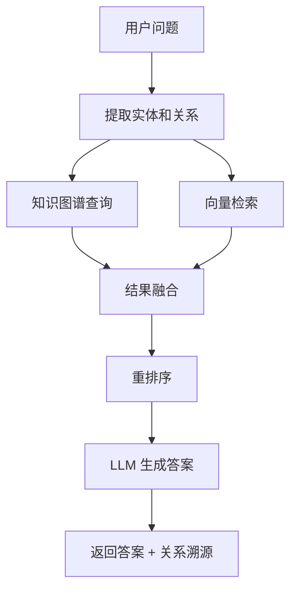

前四种检索方法都基于"文档"——搜到文档，给 AI 读，AI 回答。但有些问题需要对**关系**进行推理，而不是对**文档**进行匹配。

"张三的老板的老板是谁？"

传统 RAG 搜到"张三的老板是李四"这篇文档。但"李四的老板是谁"在另一篇文档里。传统 RAG 看不到这个跨文档的关系。Graph RAG（图谱检索增强生成）解决了这个问题——把"文档"变成"实体-关系图"，检索变成了沿图行走。

## 知识图谱是什么



不是存储文档，而是存储事实：

```
(张三) --[就职于]--> (字节跳动)
(张三) --[汇报给]--> (李四)
(李四) --[汇报给]--> (王五)
(字节跳动) --[总部位于]--> (北京)
```

查询"张三的老板的老板是谁"：
1. 找到节点"张三"
2. 沿"汇报给"边走到"李四"
3. 再沿"汇报给"边走到"王五"
4. 答案是王五

这就是"多跳推理"（Multi-hop Reasoning）——需要沿着图走多步才能得到答案 ^[Microsoft, "GraphRAG: Unlocking LLM Discovery on Narrative Private Data", 2024]。

## Microsoft Graph RAG

2024 年 7 月，微软开源了 Graph RAG ^[Microsoft GraphRAG GitHub, https://github.com/microsoft/graphrag]。核心流程：

1. **实体抽取**。从所有文档中自动提取实体（人、公司、产品、地点...）和关系（就职于、汇报给、总部位于...）
2. **社区发现**。用图算法（Leiden 算法）把紧密相关的实体聚成"社区"。一个社区 = 一个主题的子图
3. **摘要生成**。为每个社区生成一段摘要描述
4. **检索**。用户提问时，先在图里找到相关实体，再沿边扩展，同时检索相关的社区摘要

## Graph RAG vs 传统 RAG

| | 传统 RAG | Graph RAG |
|---|---|---|
| 存储单位 | 文档块 | 实体-关系三元组 |
| 检索方式 | 向量/关键词匹配 | 图遍历 |
| 多跳推理 | 做不到 | 天然支持 |
| 建索引成本 | 低（Embedding 即可） | 高（需要 NLP 抽取实体+关系） |
| 适合什么 | 一般问答 | 关系推理、全局概览 |

## 什么时候用 Graph RAG

- **组织架构查询。** "这个部门下有哪些团队？"
- **供应链追踪。** "这个芯片用了哪些供应商的零件？"
- **论文引用链。** "这篇论文引用了哪些作者的相关工作？"
- **全景总结。** "整个公司的 AI 战略包含哪些方面？"（社区摘要天然适合这类问题）

## 什么时候不必用

- 简单 FAQ：BM25（关键词匹配）+ Embedding（语义匹配）混合检索够了
- 单文档问答：RAG 就够了，不需要建图
- 实时数据：建图需要时间，不适合频繁更新的数据

## 2026 年趋势

- **轻量级 Graph RAG**。微软方案太重——LLM 抽取实体非常慢。2025-2026 年出现了轻量方案：用小模型抽取实体，用 BERT 做关系分类，成本降到原来的 1/10
- **Graph + Vector 混合**。不是替代关系——先用向量检索找到候选文档，再在图里做精确推理。两者互补
- **Neo4j 集成**。Neo4j（老牌图数据库）2025 年推出了原生 Graph RAG 支持。不需要自己搭图存储

## 实践注意

Graph RAG 最大的坑是**实体一致性**。"苹果"是水果还是公司？"Amazon"是公司还是河流？同一个实体在不同文档里可能有不同称呼（"Apple"、"苹果公司"、"Apple Inc."）。实体链接（Entity Linking）是 Graph RAG 最难的一步。

## 相关笔记

- [[Ch13 RAG 进化树]] — Graph RAG 是第五代
- [[深挖-自主检索RAG]] — Agent 自主决策 vs 图推理，不同思路
- [[深挖-混合检索]] — 大部分场景先用混合检索，复杂推理才上 Graph RAG

## 来源

- Microsoft, "GraphRAG", 2024, https://github.com/microsoft/graphrag
- Neo4j, Graph RAG Integration, 2025
