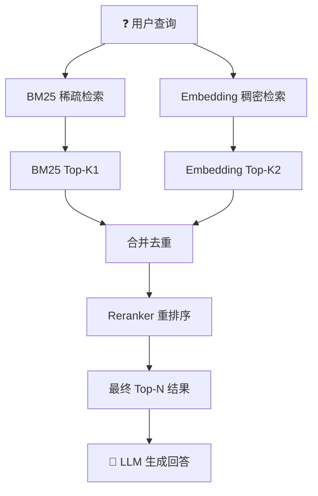

[[深挖-稀疏检索]] 能精确命中，但不懂语义。[[深挖-稠密检索]] 懂语义，但精确匹配容易漂移。混合检索把两条路合在一起，取各自的长处。2025-2026 年，生产环境几乎都是混合检索。

## 为什么单一方法不够

举个真实的例子。你搜"iPhone 15 Pro Max 256GB 深空黑"：

- **BM25**：精确命中，给你最匹配的产品页
- **Embedding**：可能给你 iPhone 14 Pro 或 iPhone 15 Pro 128GB——它们的 Embedding 向量和 iPhone 15 Pro Max 256GB 太接近了，分不清

再搜"拍照效果好的手机"：

- **BM25**：搜到一堆包含"拍照""效果""好""手机"的页面，但不知道"拍照"和"摄影"是一回事
- **Embedding**：理解你在搜"摄影能力强的手机"，给你正确的产品页

两条路各有盲区。合在一起，盲区互补 ^[StackAI, "Hybrid Search Best Practices", 2025]。

## 混合检索的工作流程

1. **并行查询**：同一条查询，同时走 BM25 和 Embedding 两条路
2. **各自返回结果**：BM25 返回 Top-K1，Embedding 返回 Top-K2
3. **合并去重**：同一个文档可能两条路都命中了，合并成一个
4. **重新排序**：用 Cross-Encoder（一个更精确但更慢的模型）对所有候选文档重新打分
5. **取最终 Top-N**：给 AI 的上下文窗口有限，只取最相关的 N 篇

## 重排序：Reranker 干什么

混合检索最关键的一步是重排序。为什么需要这一步？

BM25 和 Embedding 的分数是不能直接比较的——BM25 的 20 分和 Embedding 的 0.85 分，哪个更高？需要 Reranker 统一打分。

**常用 Reranker：**
- **Cohere Rerank**：商业 API，效果好，按调用量计费
- **bge-reranker-v2**：开源，中文效果好
- **Cross-Encoder**：最古老的方式，把"查询+文档"一起输入模型，模型直接输出相关度分数。最准但最慢

2026 年推荐：如果预算允许，用 Cohere Rerank；如果自己搭，用 bge-reranker-v2 ^[MTEB Reranking Leaderboard]。

## 权重怎么调

BM25 和 Embedding 各占多少权重？没有标准答案。看场景：

| 场景 | BM25权重 | Embedding权重 | 原因 |
|------|---------|--------------|------|
| 电商搜索 | 高 | 低 | 用户搜"SKU:ABC123"，要精确 |
| 知识库问答 | 低 | 高 | 用户问"怎么解决这个问题"，要语义 |
| 代码搜索 | 高 | 中 | 函数名精确匹配很重要，但也要理解注释 |
| 一般 RAG | 中 | 高 | 默认偏向语义，但保留精确匹配能力 |

实践建议：**从 0.3 BM25 + 0.7 Embedding 开始**，根据实际效果调整。不要手调——2026 年有了更好的办法：用一个小模型自动学习最优权重 ^[LlamaIndex, "Fusion Retrievers", 2025]。

## 混合检索的最优实践

1. **不要用同一个 Top-K。** BM25 召回 100 个，Embedding 召回 100 个，Reranker 取前 20 个
2. **元数据过滤先于检索。** 如果用户只搜"2025 年的文档"，先按年份过滤，再在过滤后的文档里做混合检索——快很多
3. **缓存 Embedding 结果。** 热门查询的 Embedding 结果可以缓存。BM25 不需要缓存——本来就快
4. **监控两个通道各自的贡献。** 如果发现 BM25 贡献为零，说明你的 Embedding 覆盖了所有场景——但你更应该怀疑是不是 Embedding 在精确匹配上藏了 bug

## 2026 年新趋势

- **自适应权重**：不用手动调 BM25/Embedding 比例，系统根据查询类型自动判断
- **多向量混合**：关键词向量 + 语义向量 + 实体向量，三条路混合
- **延迟融合 vs 早期融合**：传统方式先各自检索再合并。新研究在检索过程中就让两者交互

**Benchmark 参考**：在 MS MARCO 上，纯 BM25 MRR@10 ≈ 0.16，纯 Embedding ≈ 0.30，混合检索 ≈ 0.38，混合+重排序 ≈ 0.42。混合检索相比纯 BM25 提升 160%，投入产出比最高。

## 相关笔记

- [[深挖-稀疏检索]] — BM25 的工作机制
- [[深挖-稠密检索]] — Embedding 的工作机制
- [[深挖-图谱检索RAG]] — 混合检索还不够？加上知识图谱

## 来源

- StackAI, "Hybrid Search Best Practices", 2025
- MTEB Reranking Leaderboard
- LlamaIndex, "Fusion Retrievers", 2025
