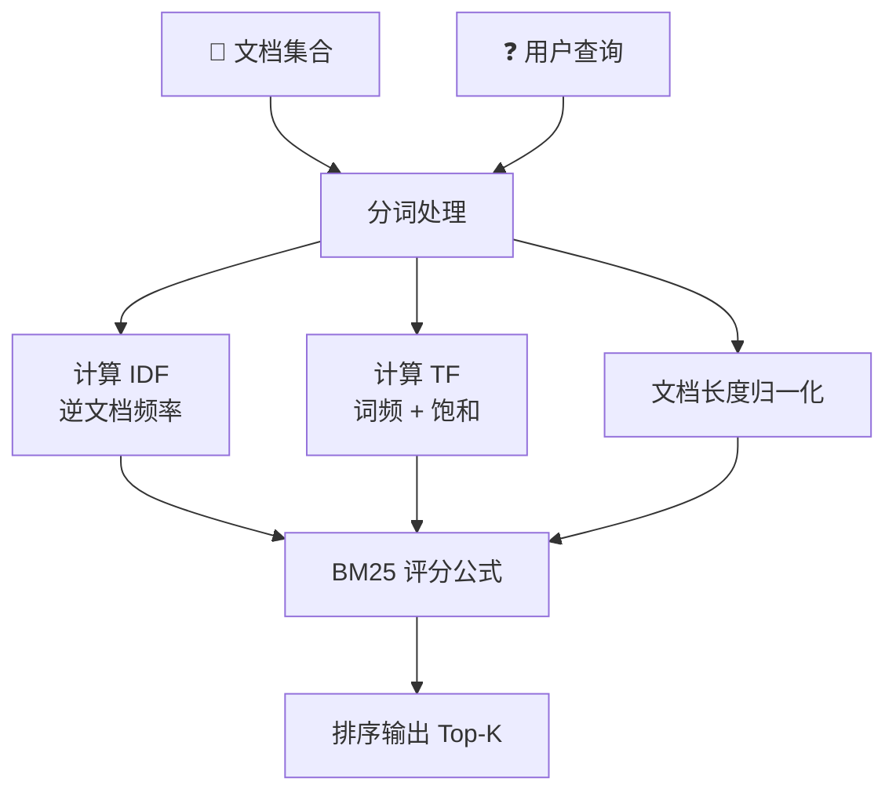

[[Ch13 RAG 进化树]] 里提到第一代检索是"关键词匹配"。这篇讲它具体怎么做的，为什么今天还在用。

## 核心公式

BM25（Best Match 25）是 1994 年提出的排序算法，至今仍是关键词检索的黄金标准。公式不复杂，不用怕：

```
BM25(D, Q) = SUM( IDF(qi) × TF(qi, D) × (k1+1) / (TF + k1×(1-b+b×len/avgLen)) )
```

拆开看就三部分 ^[Robertson & Zaragoza, "The Probabilistic Relevance Framework: BM25 and Beyond", 2009]：

**IDF（逆文档频率）**：一个词越罕见，它越重要。"量子力学"比"的"重要一万倍。IDF 就是给稀有词加权重。

**TF（词频）**：这个词在文档里出现了几次。但有个巧妙的设计——出现 3 次比出现 1 次重要，但出现 30 次不会比出现 10 次重要 3 倍。公式里的 `k1` 参数就是控制这个"饱和"速度的。

**文档长度归一化**：长文档天然含更多词，不能让它占便宜。公式里的 `b` 参数控制惩罚力度——b=0 不惩罚，b=1 满惩罚。通常设 b=0.75。



## 为什么今时今日还在用

2026 年了，Embedding 满天飞，为什么还要用这种"老古董"？

1. **精确匹配不可替代。** 搜"iPhone 15 Pro Max 256GB 深空黑"——用户要的就是这个精确型号，不是"苹果手机"。Embedding 可能把"iPhone 15 Pro"和"iPhone 14 Pro"的向量搞得很近，你搜的是 15，它给你 14。BM25 不会犯这种错。

2. **零成本。** BM25 不需要训练模型，不需要 GPU，不需要 Embedding。Lucene（Elasticsearch 的底层引擎）内建 BM25，开箱即用。

3. **混合检索的基石。** 2026 年的生产系统几乎都是 BM25 + Embedding 双路。BM25 保证精确匹配不丢失，Embedding 保证语义匹配不丢失。两条路的结果合并后重排序。

4. **专有名词、代码、ID。** "Error code 0x80070005"、"user_id: 12345"——这些对 Embedding 没有语义，但 BM25 精确命中。

## BM25 vs TF-IDF

TF-IDF 是 BM25 的前身。核心区别：

| | TF-IDF | BM25 |
|---|---|---|
| 词频饱和度 | 无（词频线性增长） | 有（k1 控制） |
| 文档长度 | 不处理 | 归一化（b 控制） |
| 调参 | 无 | 两个可调参数 |
| 实际效果 | 明显差 | 明显好 |

BM25 几乎在所有场景优于 TF-IDF。如果你还在用 TF-IDF，换成 BM25，改一行代码 ^[Trotman et al., "Improvements to BM25", 2014]。

## BM25 的局限

- **不懂语义。** "头痛"和"头疼"在 BM25 看来是两个完全不同的词
- **不懂语序。** "狗咬人"和"人咬狗"的 BM25 分数完全一样
- **不懂上下文。** 同一个词在不同句子里的含义不同，BM25 不区分

这些局限正是 Embedding（第二代稠密检索）要解决的。见 [[深挖-稠密检索]]。

## 实践：Elasticsearch 里的 BM25

Elasticsearch 默认使用 BM25。你创建一个索引，写入文档，搜索——背后就是 BM25 在工作。不需要任何配置，不需要任何训练。这就是为什么 BM25 死了三十年了还没死。

**Benchmark 参考**：在 MS MARCO（微软搜索引擎真实查询数据集）上，BM25 的 MRR@10（前 10 个结果的平均倒数排名）约为 0.16。加上 Reranker 后提升到 0.35+。作为对比，纯 Embedding 检索约为 0.30，混合检索约为 0.38 ^[MS MARCO Leaderboard]。

```json
// 搜索"深度学习框架"的 ES 查询
{
  "query": {
    "match": {
      "content": "深度学习框架"
    }
  }
}
```

不需要任何配置，不需要任何训练。这就是为什么 BM25 死了三十年了还没死——简单到没有理由不用它。

## 相关笔记

- [[Ch13 RAG 进化树]] — BM25 是第一代检索
- [[深挖-稠密检索]] — Embedding 是怎么弥补 BM25 缺陷的
- [[概念-向量数据库]] — Elasticsearch 是最早的检索引擎

## 来源

- Robertson & Zaragoza, "BM25 and Beyond", 2009
- Trotman et al., "Improvements to BM25", 2014
- Elasticsearch, BM25 Similarity, https://www.elastic.co
