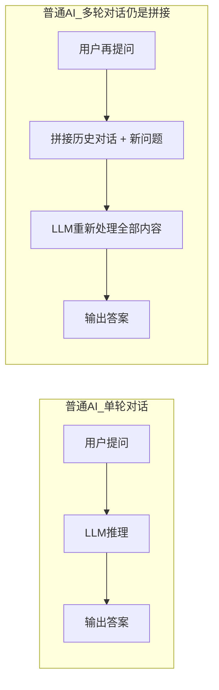
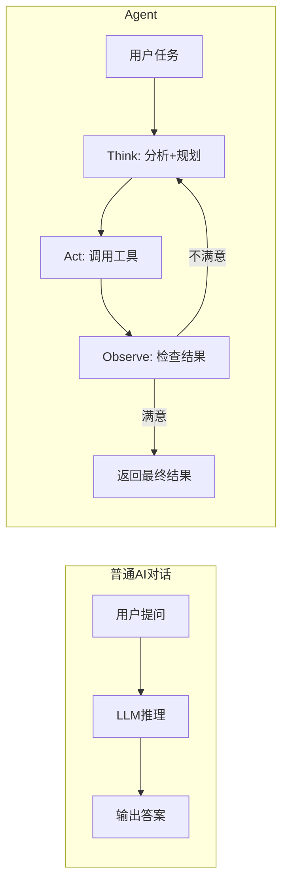

## 概念：像自动售货机一样的 AI

你用 ChatGPT（一个能对话的 AI 工具）的时候，流程非常简单：你问一个问题，AI 给你一个答案，对话结束。

这个模式很像**自动售货机**——你投币（提问），机器吐出一罐饮料（回答），交易结束。售货机不会记得你上次买了什么，不会主动建议"今天热，要不要冰的？"，更不会自己走到仓库补货。它只会做一件事：对当前的输入给出一个输出。

这就是 **"单轮对话"（Single-Turn Conversation）**——每一次问答都是独立的。AI 不记得你上一轮问了什么，不会主动调用外部工具，也不会对答案进行二次检查。它的全部能力来自预训练阶段学到的知识，以及你当前输入的那段话。^[Vaswani et al., "Attention Is All You Need", NeurIPS 2017, https://arxiv.org/abs/1706.03762 —— Transformer 架构奠定了现代 LLM 的基础，但该架构本身是"无状态"的：每次推理只看当前输入 token，不携带跨轮次的持久记忆。]

## 教学：普通 AI 能做什么，不能做什么

**能做的**（基于模型预训练知识）：
- 回答事实性问题："地球到月球多远？"
- 生成文本："帮我写一封请假邮件"
- 翻译和总结："把这段英文翻成中文并总结要点"
- 推理和分析："分析这两段话的逻辑关系"

**不能做的**（因为缺少外部交互能力）：
- **无法查实时信息**：不知道今天的天气、股价、新闻。模型的知识截止于训练数据的日期。
- **无法验证答案**：不会说"等等，这个答案可能有误，我查一下"。它给出的是统计上最可能的回答，而非"经验证为正确"的回答。^[Huang et al., "A Survey on Hallucination in Large Language Models", 2025, https://arxiv.org/abs/2311.05232 —— 系统梳理了 LLM 幻觉的成因、分类与缓解策略。]
- **无法执行操作**：不能发邮件、订机票、运行代码、读写文件。
- **无法多步推理**：复杂的多步任务（"先查 A 公司财报，再对比 B 公司，最后写分析报告"）必须由人把每一步拆开，分别提问，再人工拼接结果。

这三条限制（不能查、不能验、不能做）有一个共同的根源：**普通 AI 没有"手脚"**。它只能"想"，不能"动"。它是一个纯粹的语言模型——输入文字，输出文字，仅此而已。

更进一步，普通 AI 在架构上是**无状态（Stateless）**的。每次调用都是一次独立的计算，不携带"上次聊了什么"的信息。虽然 ChatGPT 等产品通过把历史对话重新塞进 prompt 来模拟"记忆"，但这只是权宜之计——上下文窗口有上限，历史对话越长，处理成本越高（呈平方级增长），延迟也越大。^[Reactive Transformer / RxT 研究团队，Hugging Face Blog, 2025 年 10 月 —— 指出标准 Transformer 处理 N 轮对话的复杂度为 O(N^2 * T)，而状态化架构可维持恒定延迟。]

## 注意事项：普通 AI 不是"笨"，是"被设计成这样"

这里有一个重要但容易被忽视的点：普通 AI 的"局限性"不是缺陷，而是**设计选择**。

单轮问答模式有三个优势：**快**（1-3 秒出结果）、**便宜**（单次 LLM 调用的 token 成本）、**安全**（不存在工具误用风险）。对于大量简单任务（翻译、总结、改写、分类），这个模式完全够用。2025 年的一项工程指南指出，如果从"单轮对话"升级到"Agent"只是因为"大家都在用 Agent"，而不是因为任务确实需要多步工具调用，结果往往是成本翻 15 倍、延迟翻 10 倍，但效果提升微弱。^[FutureAGI, "Agentic vs Non-Agentic AI: The 2026 Definition", 2025, https://futureagi.com/blog/agentic-vs-non-agentic-ai-2026/]

判断一个任务是否需要 Agent，可以问五个问题：^[FutureAGI, 同上]
1. 任务是否需要根据中间结果动态调整后续步骤？
2. 是否需要调用模型在运行时自行选择的外部工具？
3. 用户能否接受超过 10 秒的等待时间？
4. 预算能否承受 5-20 倍的 token 成本？
5. 工具误用的风险是否在可接受范围内（有安全护栏）？

如果五个问题中至少三个答案是"否"，那用普通 AI 对话就够了——强行 Agent 化反而得不偿失。

## 普通 AI vs Agent：一张表看清区别

搞懂了普通 AI 的局限，Agent 的优势就一目了然——Agent 正是为了解决"不能查、不能验、不能做"这三个问题而设计的。下表对比了两者的本质差异：

| 维度 | 普通 AI 对话 | Agent |
|---|---|---|
| 任务复杂度 | 一问一答，单步 | 多步任务，自主拆解 |
| 是否需要工具 | 不需要，纯文本推理 | 需要（搜索、运行程序、操作文件等） |
| 能否自我纠错 | 不能，输出即终稿 | 能，发现错误后调整重试 |
| 人对它的角色 | 每轮都要手动提问 | 一次给任务，它自己跑完 |
| 状态管理 | 无状态，每轮独立 | 有状态，步骤间保持工作记忆 |
| 延迟 | 1-3 秒 | 10-60 秒（多次推理 + 工具调用） |
| 成本 | 1x 基准 | 5-20x 基准 |
| 典型架构 | 单次 LLM 调用 | Think-Act-Observe 循环 |

## 关联

- [[概念-纯对话]] — 纯对话模式的详细技术解析
- [[概念-对话到Agent演化]] — 从对话到 Agent 的演化路径
- [[概念-FunctionCalling]] — 工具调用的技术基础：Function Calling
- [[Ch13 RAG 进化树]] — RAG 的演化全景，Agentic RAG 是最终形态
- [[14.2 Agent-多步自主执行]] — 下一节：Agent 如何突破这些局限

---

> ← 上一节：[[Ch14 Agent 工作原理|章首]] ｜ 下一节：[[14.2 Agent-多步自主执行]] →
