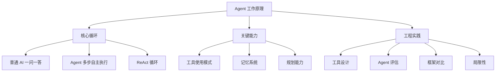

Agent（可以理解为"能自己干活的 AI"）和普通 AI 最大的区别：普通 AI 你问一句它答一句，Agent 你给一个任务，它自己规划步骤、调用工具、检查结果、调整再来。这篇讲它怎么做到的。

## 跟你有什么关系

你现在用的很多产品，底层已经是 Agent 了：

- **Perplexity**（AI 搜索工具）：搜一个问题，Agent 自己判断搜几次、怎么搜、结果够不够、要不要换关键词再搜。
- **Claude Code**（AI 编程工具）：修一个程序错误，Agent 自己读代码、定位问题、修改、运行测试、检查结果。
- **审查 Agent**：你在这个笔记库里写笔记，审查 Agent 自动读你的笔记、打分、提修改建议。

Agent 不是一个新技术——它是一堆已有技术（工具调用、分步推理、自我检查）组合起来，让 AI 从"听话回答"变成"自主干活"。理解 Agent 的工作原理，你就能理解未来几年 AI 产品的发展方向。

> **生活比喻**：Agent 像自动驾驶汽车——普通 AI 是副驾导航，你问"前面左转对吗"它说"对"；Agent 是自动驾驶，你设好目的地，它自己规划路线、看红绿灯、遇到堵车绕行、到了告诉你。你只需要定目标，过程它自己搞定。

## 本章目录

1. [[14.1 普通 AI-一问一答|14.1 普通 AI：一问一答]]
2. [[14.2 Agent-多步自主执行|14.2 Agent：多步自主执行]]
3. [[14.3 举个例子|14.3 举个例子]]
4. [[14.4 Agent 的三种工具使用模式|14.4 Agent 的三种工具使用模式]]
5. [[14.5 Agent 的记忆系统|14.5 Agent 的记忆系统]]
6. [[14.6 Agent 的规划能力|14.6 Agent 的规划能力]]
7. [[14.7 Agent 的工具设计|14.7 Agent 的工具设计]]
8. [[14.8 2026 年 Agent 的新变化|14.8 2026 年 Agent 的新变化]]
9. [[14.9 Agent 评估|14.9 Agent 评估]]
10. [[14.10 Agent 的局限性|14.10 Agent 的局限性]]
11. [[14.11 2026 年主流 Agent 框架对比|14.11 2026 年主流 Agent 框架对比]]

## 相关笔记

- [[概念-Loop工程]] — Agent 的底层循环机制
- [[Ch13 RAG 进化树]] — Agentic RAG 就是让检索本身也由 Agent 来智能决策：搜不搜、搜几次、换什么关键词、结果不够要不要再搜——这些不再是人写死的流程，而是 Agent 循环里的自主判断
- [[产品-AI对话演变]] — 从对话到 Agent 的产品演变

## 跨章节关联

- [[Ch13 RAG 进化树]] — Agentic RAG：RAG 的最终形态是 Agent
- [[Ch16 多 Agent 协作]] — 单 Agent 的下一步：多 Agent 协作
- [[Ch12 Prompt 工程]] — Prompt 正在被 Agent 取代：从"怎么问"到"怎么做"
- [[Ch15 Agent 通信协议]] — Agent 之间怎么通信：MCP 和 A2A

## 来源

- Yao et al., "ReAct: Synergizing Reasoning and Acting in Language Models", 2022, https://arxiv.org/abs/2210.03629
- Anthropic, "Building Effective Agents", 2024, https://www.anthropic.com/engineering/building-effective-agents
