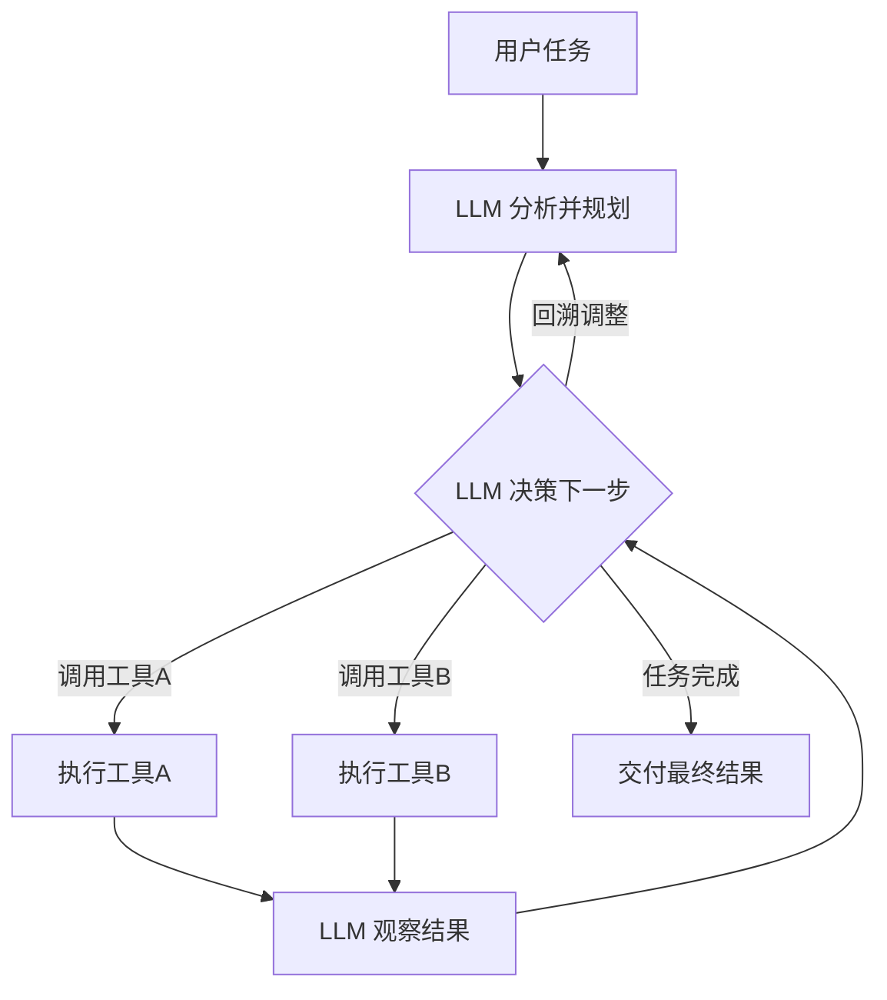

## 一句话理解

Agentic Workflow（智能体工作流）是一种**模型自主决定路径，不是预定义规则而是 LLM 做决策**的工作流模式。这是三种工作流模式中最灵活、最强大、也最难控制的一种。在 Agentic Workflow 中，LLM 不仅是任务的执行者，更是流程的**决策者**——它自己决定下一步该调用哪个工具、是否需要回溯、什么时候任务完成。

> 类比：一个有经验的助理——你交代"帮我安排下周的出差"，他会自己决定：先查日历、再订机票、然后订酒店，如果某个航班满了，他会自己找替代方案。你不需要告诉每一步怎么做。

## 核心特征



### 1. LLM 作为决策者（LLM as Decision-Maker）

这是 Agentic Workflow 与 Static/Dynamic Workflow 最本质的区别。在 Static Workflow 中，决策者是代码（固定路径）；在 Dynamic Workflow 中，决策者是代码（预定义规则）；在 Agentic Workflow 中，**决策者是模型**。

| 维度 | Static Workflow | Dynamic Workflow | Agentic Workflow |
|------|:---:|:---:|:---:|
| 决策者 | 代码（固定） | 代码（规则） | **模型（自主）** |
| 路径来源 | 硬编码 | 预定义枚举 | 模型实时生成 |
| 控制粒度 | 函数级 | 分支级 | 任务级 |

### 2. 工具使用（Tool Use / Function Calling）

Agentic Workflow 的核心机制是 **Tool Use**（也称 Function Calling）。模型不直接产生最终答案，而是输出一个"工具调用请求"——比如"调用 search_database 函数，参数是..."。系统执行这个工具调用，把结果返回给模型，模型再决定下一步。

### 3. 循环与迭代（Loop and Iteration）

Agentic Workflow 天然包含循环：模型调用工具 → 获得结果 → 分析结果 → 决定是否继续调用工具 → 最终产出答案。这个循环（通常称为 Agent Loop）可以持续多轮，直到模型认为任务完成。

### 4. 涌现行为（Emergent Behavior）

因为模型自主决策，Agentic Workflow 可能产生开发者没有预料到的行为——模型可能选择一条"绕远路"来解决问题，或者组合使用两种工具来达到单一工具无法实现的效果。这种涌现性既是 Agentic Workflow 的优势（灵活性），也是风险（不可预测性）。

## 适用场景

| 场景 | 说明 | 为什么需要 Agentic |
|------|------|-------------------|
| 复杂推理（Complex Reasoning） | 多步逻辑推理，中间步骤不确定 | 不能用固定规则穷举所有推理路径 |
| 开放任务（Open-Ended Tasks） | 目标明确但路径不明确 | 无法预定义所有可能的解决方案 |
| 多步研究（Multi-Step Research） | 需要搜索、阅读、综合、验证 | 搜索什么、读什么、怎么综合，都需要模型判断 |
| 代码生成与调试（Code Gen & Debug） | 写代码 → 运行 → 看报错 → 修改 | 不知道会报什么错，需要模型自己分析 |
| 自主数据分析（Autonomous Data Analysis） | 探索数据 → 发现规律 → 生成报告 | 探索方向由数据特征决定，无法预定义 |

## Agentic Workflow 的核心循环

```
┌─────────────────────────────────────────────────────────┐
│                    Agent Loop (核心循环)                  │
│                                                         │
│   用户输入 ──→ LLM 分析 ──→ 决定调用工具？                │
│                  ↑              │                       │
│                  │         Yes  │  No                   │
│                  │              ↓        ↓               │
│                  │         执行工具调用   生成最终回答      │
│                  │              │                       │
│                  └── 工具结果返回 ──┘                     │
└─────────────────────────────────────────────────────────┘
```

## 代码示例：ReAct 模式的 Agent

```python
import json
from typing import Any

# 工具定义
def search_database(query: str) -> list[dict]:
    """搜索内部数据库"""
    # 实际实现...
    return [{"title": "结果1", "content": "..."}]

def calculate(expression: str) -> float:
    """执行数学计算"""
    return eval(expression)  # 生产环境请使用安全的计算方式

TOOLS = {
    "search_database": search_database,
    "calculate": calculate,
}

TOOL_DESCRIPTIONS = """
可用工具：
1. search_database(query: str) - 搜索内部数据库
2. calculate(expression: str) - 执行数学计算
"""

def agent_loop(user_query: str, max_iterations: int = 10) -> str:
    """Agent 主循环：模型自主决定每一步"""
    messages = [
        {"role": "system", "content": f"你是一个有用的助手。你可以使用以下工具：\n{TOOL_DESCRIPTIONS}\n\n当你需要使用工具时，请以JSON格式输出：\n{{\"tool\": \"工具名\", \"args\": {{\"参数名\": \"值\"}}}}\n\n当你准备好回答用户时，请以JSON格式输出：\n{{\"action\": \"final_answer\", \"content\": \"你的回答\"}}"},
        {"role": "user", "content": user_query}
    ]

    for i in range(max_iterations):
        # LLM 自主决定：调用工具还是给出答案
        response = llm_call(messages)

        try:
            decision = json.loads(response)
        except json.JSONDecodeError:
            # 如果模型输出不是 JSON，直接返回
            return response

        # 模型决定给出最终答案
        if decision.get("action") == "final_answer":
            return decision["content"]

        # 模型决定调用工具
        tool_name = decision.get("tool")
        tool_args = decision.get("args", {})

        if tool_name in TOOLS:
            tool_result = TOOLS[tool_name](**tool_args)
            # 将工具结果返回给模型，让模型继续决策
            messages.append({"role": "assistant", "content": response})
            messages.append({"role": "user", "content": f"工具 {tool_name} 的执行结果：\n{json.dumps(tool_result, ensure_ascii=False)}"})
        else:
            messages.append({"role": "user", "content": f"工具 {tool_name} 不存在，可用工具：{list(TOOLS.keys())}"})

    return "达到最大迭代次数，任务未完成"

# 使用
result = agent_loop("帮我查一下上个月的销售总额，并计算同比增长率")
```

## 与 Static/Dynamic 的本质区别

> **Static Workflow**：决策者是人（开发者），在代码中固定了一切。
> **Dynamic Workflow**：决策者是人（开发者），预定义了所有分支和规则，模型只做选择题。
> **Agentic Workflow**：决策者是模型，开发者只提供工具和约束，模型自主决定路径。

## 2026 年的趋势

Agentic Workflow 是 2025-2026 年 AI 应用开发的最大热点。关键趋势：

1. **Agent 框架的成熟**：LangGraph、CrewAI、AutoGen、Anthropic Agent SDK 等框架让 Agent 开发变得更简单
2. **MCP（Model Context Protocol）**：标准化了工具定义和调用，Agent 可以无缝接入各种外部工具
3. **Agentic 与 Dynamic 的融合**：不是非此即彼，而是在合适的节点让模型自主决策，其他节点保持确定性
4. **成本与延迟的优化**：随着模型推理速度提升和成本下降，Agentic 的实用性在快速提高

## 相关笔记

- [[概念-StaticWorkflow]] — 固定步骤工作流
- [[概念-DynamicWorkflow]] — 条件分支工作流
- [[深挖-工作流模式]] — 三种工作流模式的深度对比
- [[对比-StaticvsDynamicvsAgenticWorkflow]] — 三种模式的横向对比
- [[Ch14 Agent 工作原理]] — Agent 的完整工作机制
- [[概念-FunctionCalling]] — Agent 的核心技术基础
- [[概念-ReActAgent]] — Reasoning + Acting 的经典 Agent 范式

## 来源

- https://www.anthropic.com/engineering/building-effective-agents — Anthropic 官方：构建高效 Agent 的指南
- https://docs.anthropic.com/en/docs/build-with-claude/tool-use — Anthropic Tool Use 文档
- https://arxiv.org/abs/2210.03629 — ReAct: Synergizing Reasoning and Acting in Language Models
- https://langchain-ai.github.io/langgraph/ — LangGraph Agent 框架
- https://modelcontextprotocol.io/ — MCP 协议规范