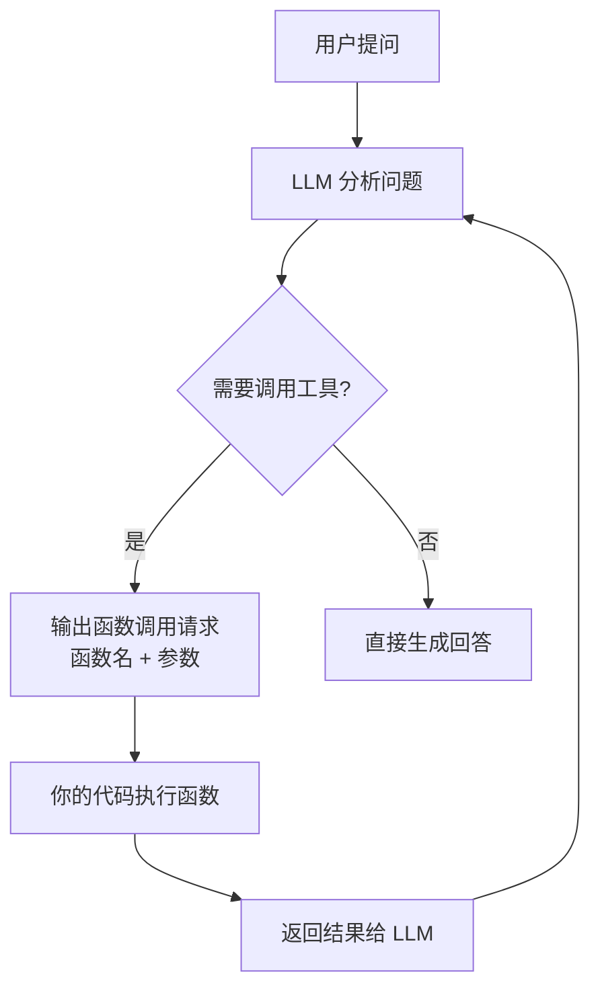

## 一句话理解

Function Calling让模型不直接回答，而是输出结构化的函数调用请求——"我要调用这个工具，参数是这些"。模型不再编造答案，而是精确表达它需要什么外部信息来完成任务。

## 零基础理解

**你问"今天北京天气怎么样"：**

- 纯对话模式：模型可能编造一个天气（幻觉），或者拒绝回答
- Function Calling模式：模型输出 `{"function": "get_weather", "parameters": {"city": "北京", "date": "今天"}}`

然后**你的代码**执行这个函数（调用天气API），把结果返回给模型，模型再根据真实数据生成回答。模型变成了"指挥官"，它知道该调用什么、传什么参数，但实际执行由你的代码完成。

## 核心概念



### JSON Schema定义工具

使用Function Calling前，你需要先定义"模型可以调用哪些函数"：

```json
{
  "name": "get_weather",
  "description": "获取指定城市在指定日期的天气信息",
  "parameters": {
    "type": "object",
    "properties": {
      "city": {
        "type": "string",
        "description": "城市名称，如'北京'、'上海'"
      },
      "date": {
        "type": "string",
        "description": "日期，格式YYYY-MM-DD，或'今天'"
      }
    },
    "required": ["city", "date"]
  }
}
```

### 模型返回函数名+参数

当用户的问题需要调用函数时，模型不会生成文本回答，而是返回一个结构化的函数调用请求：

```json
{
  "id": "call_abc123",
  "function": {
    "name": "get_weather",
    "arguments": "{\"city\": \"北京\", \"date\": \"2026-07-01\"}"
  }
}
```

### 你的代码执行函数

模型不执行函数——它只是"表达意图"。实际执行由你的代码完成：

```
模型输出 → 你的代码解析 → 调用真实API → 获取结果 → 返回给模型
```

### 结果返回给模型

函数执行结果返回给模型后，模型结合原始问题和函数结果，生成最终的用户回答：

```
用户: "今天北京天气怎么样？"
→ 模型: 调用 get_weather("北京", "2026-07-01")
→ 代码: 返回 {"temperature": 25, "condition": "晴"}
→ 模型: "今天北京天气晴朗，气温25°C，适合户外活动。"
```

## Function Calling vs Tool Use

OpenAI叫Function Calling，Anthropic叫Tool Use，机制相同但细节有差异：

| 维度 | Function Calling (OpenAI) | Tool Use (Anthropic) |
|------|---------------------------|----------------------|
| 提出时间 | 2023年6月 | 2024年3月 |
| 工具定义格式 | JSON Schema (functions数组) | JSON Schema (tools数组) |
| 并行调用 | 支持(parallel_tool_calls) | 支持(原生设计) |
| 流式调用 | 支持(streaming function calls) | 支持(streaming tool_use blocks) |
| 强制调用 | tool_choice参数 | tool_choice参数 |
| 典型返回 | finish_reason: "tool_calls" | stop_reason: "tool_use" |
| 开发体验 | 成熟，文档丰富 | 设计更结构化，约束更清晰 |

## Function Calling的演化

### 单次调用(2023年6月)

最初的版本：模型一次只能调用一个函数，等待结果后再继续。适合简单场景："查天气"、"搜索文档"。

### 并行调用(2023年11月)

模型可以同时发起多个独立的函数调用。例如"比较北京和上海今天的天气"——模型可以并行调用两次`get_weather`，大幅减少等待时间。

### 流式调用(2024年)

模型可以在生成回答的过程中，随时决定调用函数，调用完成后继续生成。这使交互更加流畅，减少了用户感知的延迟。

### MCP标准化(2024年11月至今)

Anthropic提出MCP协议，将"工具连接"标准化。Function Calling定义了"模型如何表达调用意图"，MCP定义了"工具如何被发现和连接"。

| 阶段 | 能力 | 解决的问题 |
|------|------|------------|
| 单次调用 | 一次一个函数 | 基本工具调用 |
| 并行调用 | 一次多个独立函数 | 减少等待时间 |
| 流式调用 | 边生成边调用 | 交互流畅度 |
| MCP标准化 | 统一工具连接协议 | 工具生态互通 |

## 2026年定位

Function Calling已成为所有主流模型的基础能力：

- **OpenAI**：GPT-5.5、GPT-5.6 全系列支持
- **Anthropic**：Claude Opus 4.8、Claude Sonnet 4.6 全系列支持(称为Tool Use)
- **Google**：Gemini 3.5 Pro 全系列支持(称为Function Calling)
- **开源模型**：Llama 4.1、Qwen 3.7、DeepSeek-V4 等均支持

Function Calling是整个Agent生态的技术基石。没有它，就没有ReAct循环，没有Tool Use，没有MCP，没有Agent。

## 相关笔记

- [[Ch14 Agent 工作原理]] — Agent如何使用Function Calling
- [[概念-ToolUse]] — Anthropic的Tool Use实现
- [[概念-ReActAgent]] — Function Calling在ReAct循环中的角色
- [[概念-MCP]] — 工具连接的标准化协议
- [[Ch15 Agent 通信协议]] — Agent间通信协议
- [[概念-ToolUse]] — 工具调用的深入分析

## 来源

- OpenAI Function Calling Guide: https://platform.openai.com/docs/guides/function-calling
- OpenAI Function Calling Announcement (2023): https://openai.com/index/function-calling-and-other-api-updates/
- Anthropic Tool Use Documentation: https://docs.anthropic.com/en/docs/build-with-claude/tool-use
- OpenAI Parallel Function Calling: https://platform.openai.com/docs/guides/function-calling/parallel-function-calling