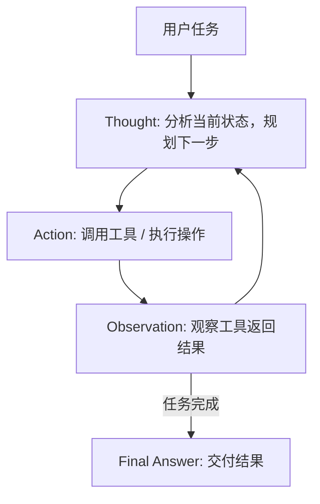

[[Ch14 Agent 工作原理]] 里提到 AI Agent（能自己干活的 AI）的核心是"看-想-做-检查"循环。这个循环最早的学术形式叫 ReAct（读作"瑞艾克特"）——2022 年 Yao 等人提出的框架，至今仍是 Agent 设计的基础 ^[Yao et al., "ReAct", 2022]。

## ReAct 解决什么问题



在 ReAct 之前，AI 做推理有两种路线：

1. **纯推理（思维链）**：AI 在心里一步步想，但想完了直接给答案。想错了没办法纠正——因为没跟外部世界交互。
2. **纯行动（只管做）**：AI 直接动手，不做显式推理。行动很机械——不知道为什么要这么做。

ReAct 把两者合在一起：**一边想一边做，根据做的结果修正想的。**

## ReAct 的三步循环

原始论文定义的循环是 **Thought -> Action -> Observation**：

**Thought（思考）**：AI 判断现状，决定下一步。"现在我需要查天气。""搜索结果不够，我需要换个关键词。"

**Action（行动）**：AI 调用工具。"Search[北京明天天气]""Calculator[3.14 * 5^2]"

**Observation（观察）**：AI 收到工具返回的结果。根据结果决定下一步：继续搜索？够了，回答？

## 一个完整例子

用户问："2024 年诺贝尔物理学奖得主是谁，他多大年纪？"

```
Thought 1: 需要搜索诺贝尔物理学奖2024年得主
Action 1: Search["2024 Nobel Prize Physics winner"]
Observation 1: "John Hopfield and Geoffrey Hinton..."

Thought 2: 找到了得主是 John Hopfield 和 Geoffrey Hinton。需要知道他们的年龄。先搜第一个。
Action 2: Search["John Hopfield age"]
Observation 2: "John Hopfield, born July 15, 1933..."

Thought 3: John Hopfield 2024-1933=91岁。还要搜 Hinton。
Action 3: Search["Geoffrey Hinton age"]
Observation 3: "Geoffrey Hinton, born December 6, 1947..."

Thought 4: Geoffrey Hinton 2024-1947=77岁。信息齐全，可以回答了。
Answer: 2024年诺贝尔物理学奖授予John Hopfield（91岁）和Geoffrey Hinton（77岁）。
```

注意 AI 不是一次性搜完——它搜一步，看一步，决定下一步。这就是 ReAct 的精髓：**根据观察调整思考，根据思考决定行动。**

## ReAct vs 普通 Agent 循环

我在 [[Ch14 Agent 工作原理]] 里用"看-想-做-检查"四步教学框架。对比原始 ReAct 三步：

| | ReAct 原生 | 教学简化版 |
|---|---|---|
| 步骤数 | 3 | 4 |
| 起点 | 想（Thought） | 看（Perceive） |
| "检查" | 合并在 Observation 里 | 独立成一步 |
| 适合 | 准确理解 | 初学者 |

教学版把"看"和"检查"拆开，更好理解。但实现上，ReAct 的 Observation 本身就包含了"看结果"和"判断够不够"。

## ReAct 的局限

1. **贪心决策**。每步只根据当前观察做决策。可能陷入局部最优——搜了三次发现方向错了，但已经浪费了时间
2. **没有长期规划**。不能先规划"总共需要 5 步"，然后执行。走到哪算哪
3. **不知道什么时候停**。"再搜一轮会不会更好？"——ReAct 没有判断标准，通常靠外部限制（最大轮次）

这些局限，后来的 Agent 框架（LangGraph、AutoGen）用状态图、记忆系统、规划器来弥补。见 [[深挖-Agent记忆]] 和 [[深挖-Agent规划]]。

## ReAct 的实现

ReAct 的魔法不在代码，在提示词格式。你只需要告诉 AI："按这个格式回答——先想、再做、再看结果、再回答。" AI 的推理能力被这个格式约束成结构化的决策循环。

（以下代码供有编程基础的读者参考。零基础读者可以跳过，不影响理解。）

```
你是一个能使用工具的 AI 助手。回答问题时，按以下格式：

Thought: 你的思考过程
Action: 工具名[参数]
Observation: 工具返回的结果
...（重复）
Answer: 最终答案

可用工具：
- Search[关键词]：搜索网络
- Calculator[表达式]：计算数学表达式
```

这就是 ReAct 的全部魔法——**不是代码，是提示词格式。** 模型的推理能力被这个格式"约束"成结构化的决策循环 ^[ReAct 原论文, Section 3]。

## 相关笔记

- [[Ch14 Agent 工作原理]] — ReAct 是 Agent 循环的学术基础
- [[深挖-Agent规划]] — ReAct 之后的规划改进
- [[深挖-自主检索RAG]] — ReAct 在检索场景的应用

## 来源

- Yao et al., "ReAct", 2022, https://arxiv.org/abs/2210.03629
