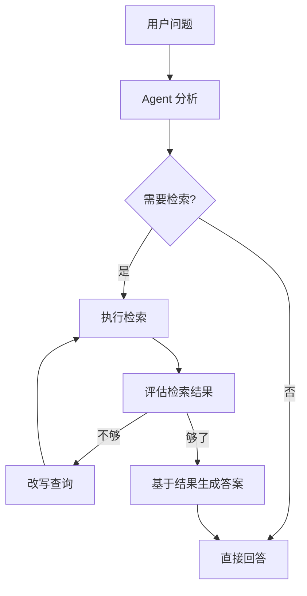

前三种检索方式（[[深挖-稀疏检索]]、[[深挖-稠密检索]]、[[深挖-混合检索]]）都是**固定流程**——搜一次，返回结果，给 AI。Agentic RAG（自主检索增强生成）打破了固定流程：**AI 自己决定搜几次、怎么搜、搜完要不要再搜。**

## 和传统 RAG 的根本区别

传统 RAG：用户问 -> 检索 -> 给 AI -> AI 回答。一条直线，一次搜索，一轮回答。

Agentic RAG：用户问 -> AI 判断 -> 检索 -> AI 看结果 -> 不够好？换个方式再搜 -> 够了 -> 回答。**循环路线，多次搜索，多轮判断。**

这不是"检索变快了"——是"检索有了脑子" ^[LangChain, "Agentic RAG Guide", 2025]。

## 它怎么做决定的

Agentic RAG 里的 AI 在检索环节可以做这些决策：

**1. 改写查询。**
用户问："这玩意儿怎么修？" Agent 理解上下文后，把查询改写为"iPhone 15 Pro 屏幕更换步骤"，再搜。原始查询太模糊，直接搜不出来。

**2. 拆解问题。**
用户问："对比 iPhone 15 和三星 S24 的拍照和续航"
Agent 拆成两个子问题：
- "iPhone 15 拍照效果 + 续航时间"
- "三星 S24 拍照效果 + 续航时间"
分别检索，分别获取信息，最后合并回答。

**3. 判断要不要再搜。**
第一轮搜出来的结果不够好（信息不全、来源不可靠、互相矛盾）-> Agent 决定换个关键词再搜一轮。

**4. 验证检索结果。**
搜出来的信息是 2023 年的 -> Agent 判断"可能过时了" -> 加上"2025"的关键词再搜一轮。

## 和 ReAct 的关系

Agentic RAG 是 ReAct 模式（Think -> Act -> Observe）在检索场景的应用：

- Think：判断当前检索结果够不够
- Act：调用检索工具，换个方式搜
- Observe：看新结果，判断要不要继续

详见 [[Ch14 Agent 工作原理]] ^[Yao et al., "ReAct", 2022]。

## 实现方式

Agentic RAG 可以用 LangChain（一个 AI 工具库）或 LlamaIndex（另一个 AI 工具库）来实现。基本思路是给 AI 配备检索工具，让它在思考-行动循环中自己决定什么时候搜、搜什么。

（以下代码供有编程基础的读者参考。零基础读者可以跳过，不影响理解。）

## 什么时候用

| 场景 | 用传统 RAG 还是 Agentic |
|------|----------------------|
| FAQ 问答 | 传统 RAG。问题固定，一次检索够了 |
| 产品对比 | Agentic。需要多次检索不同维度 |
| 多步推理 | Agentic。"2024 年融资最多的 AI 公司，它们的 CEO 分别是谁" |
| 事实核查 | Agentic。搜完后需要验证来源可信度 |

## 代价

Agentic RAG 不是免费的：
- **延迟更高**。传统 RAG 一次检索 200ms，Agentic 可能 2-3 轮检索，延迟翻倍
- **成本更高**。每次检索 + 每次 AI 判断都要花钱
- **可能陷入循环**。Agent 判断"不够好"，再搜，"还是不够好"，再搜...需要设置最大检索轮次

## 相关笔记

- [[Ch13 RAG 进化树]] — Agentic RAG 是第四代
- [[深挖-混合检索]] — 传统 RAG 的最优方案
- [[深挖-图谱检索RAG]] — 另一种处理复杂查询的方式

## 来源

- LangChain, "Agentic RAG Guide", 2025
- Yao et al., "ReAct: Synergizing Reasoning and Acting", 2022
- LlamaIndex, FunctionCallingAgent
