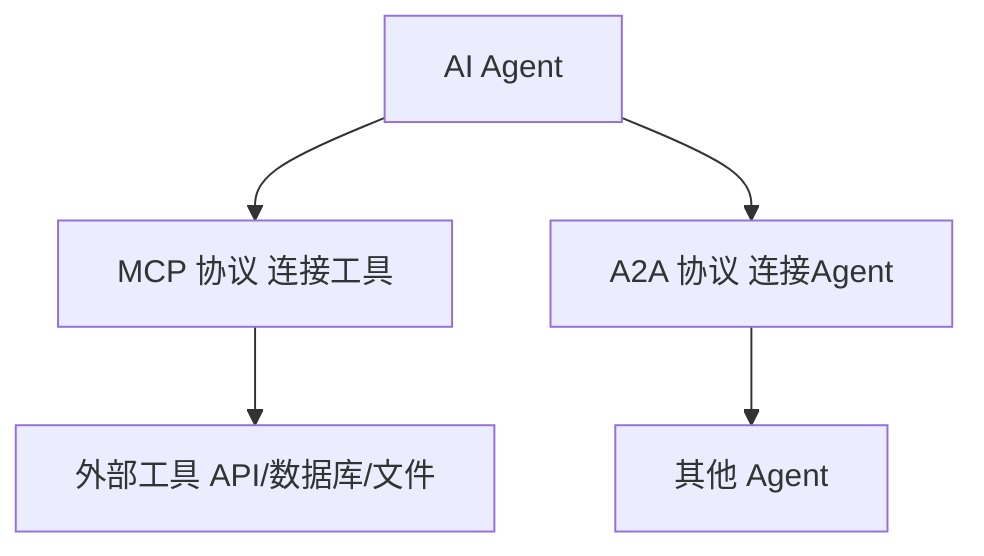

MCP 管的是"AI 连工具"。还有一个问题没解决：**Agent 之间怎么互相派活？**

2025 年 4 月，Google 宣布了 A2A（智能体间通信协议）^[Google, A2A, 2025.04]。它解决的问题是：**让不同公司做的 Agent 能互相通信、互相派任务。**

打个比方：MCP 是 USB-C（管硬件连接），A2A 是电子邮件协议（管信息互通）。你可以用 USB-C 把设备连起来，但两台电脑之间怎么发邮件——那是另一个层面的标准。

### 15.3.1 Agent Card：Agent 的"名片"

A2A 的核心概念是 **Agent Card**——一个 JSON 文件，描述 Agent 的身份和能力。每个 Agent 公开一个 Agent Card，其他 Agent 通过读取它来了解：
- **身份**：Agent 的名称、描述、版本
- **能力**：它能做什么（搜索、写作、翻译、编程……）
- **接口**：怎么调用它（URL、认证方式、支持的输入输出格式）
- **限制**：速率限制、最大输入长度、支持的语言

```json
{
  "name": "SearchAgent",
  "description": "专业的网页搜索 Agent，支持中英文",
  "url": "https://search-agent.example.com",
  "capabilities": ["web_search", "news_search", "image_search"],
  "rateLimit": "100 requests/minute"
}
```

### 15.3.2 Task 生命周期

A2A 中的任务有明确的生命周期：

```
提交任务 → 排队 → 处理中 → 完成/失败/取消
```

- **提交**：Agent A 向 Agent B 提交一个任务，附带任务描述和输入数据
- **排队**：Agent B 确认收到任务，加入队列
- **处理中**：Agent B 开始处理，可以发送进度更新（如"已处理 60%"）
- **完成**：Agent B 返回结果给 Agent A
- **失败**：如果出错，Agent B 返回错误信息
- **取消**：Agent A 可以随时取消尚未完成的任务

### 15.3.3 消息流

A2A 支持多种消息模式：
- **请求-响应**：A 派活给 B，B 完成后返回结果（最常见的模式）
- **流式推送**：B 边处理边推送中间结果（类似 ChatGPT 的打字效果）
- **广播**：A 同时向多个 Agent 派活，收集所有结果后汇总

有了 A2A：
- 一个负责搜索的 Agent 可以把搜到的资料发给一个负责写作的 Agent
- 一个负责代码审查的 Agent 可以把问题清单发给一个负责修改的 Agent
- 这些 Agent 可以是不同公司做的、运行在不同服务器上

### 15.3.4 MCP 与 A2A 怎么分工

两个协议解决不同层面的问题，互补而非竞争：

| | MCP | A2A |
|---|---|---|
| 管什么 | AI 连工具 | Agent 连 Agent |
| 谁提出 | Anthropic（2024.11） | Google（2025.04） |
| 类比 | USB-C（统一硬件接口） | 电子邮件协议（统一信息互通） |
| 解决什么问题 | 不用为每个 AI 重新写工具 | 不同 Agent 能互相派活 |
| 架构 | Client-Server（AI 是 Client，工具是 Server） | Agent-to-Agent（对等通信） |
| 通信协议 | JSON-RPC 2.0 | HTTP + JSON（RESTful） |
| 传输方式 | STDIO / SSE | HTTP / WebSocket |
| 核心概念 | Resources、Tools、Prompts | Agent Card、Task、Message |
| 安全模型 | 客户端控制授权，按 Server 授权 ^[MCP Spec, OAuth 2.0, 2025, https://spec.modelcontextprotocol.io/] | Agent Card 声明能力 + OAuth 支持 |
| 2026 年生态 | Claude Code、Claude Desktop、Cursor、Continue、Zed、VS Code | Google ADK、LangChain、CrewAI、Atlassian Rovo |



**一个典型的协作场景**：主 Agent 通过 MCP 调用搜索工具获取资料，分析后决定需要专业写作协助，于是通过 A2A 把写作任务委派给写作 Agent。写作 Agent 自己也可能通过 MCP 调用语法检查工具。两个协议各司其职，协同工作。

> 想深入了解两个协议的配合方式，看 [[概念-MCP+A2A]] 和 [[对比-MCPvsA2A]]。

---

> ← 上一节：[[15.2 MCP-AI 连接工具的通用接口]] ｜ 下一节：[[15.6 和传统 API 调用的区别]] →
