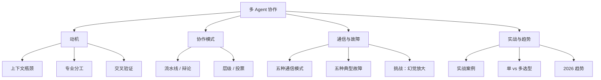

[[Ch14 Agent 工作原理]] 讲了单个 Agent（能自己干活的 AI）怎么工作。但当一个任务太复杂，一个 AI 容易出错——注意力分散、记不住太多东西、决策混乱。多个 AI 协作把大任务拆开，交给几个专业 AI 分别处理，再合并结果。

> **生活比喻**：多 Agent 协作像装修队——水电工、木工、油漆工各司其职，一个总包工头（协调者）分配任务、检查进度、处理冲突。一个人装修整栋房子容易出错，一群人分工协作既快又稳：每个人只做自己擅长的活，出问题了也容易定位是谁的锅。

## 本章目录

1. [[16.1 为什么需要多 Agent|16.1 为什么需要多 Agent]] — 上下文窗口瓶颈、专业分工、交叉验证
2. [[16.2 四种协作模式|16.2 四种协作模式]] — 流水线、辩论、层级、投票
3. [[16.3 多 Agent 架构模式深入|16.3 多 Agent 架构模式深入]] — 代码实现 + 框架选择指南
4. [[16.4 怎么避免 Agent 之间扯皮|16.4 怎么避免 Agent 之间扯皮]] — 五种典型故障与解决方案
5. [[16.5 Agent 间通信|16.5 Agent 间通信]] — 五种通信模式 + MCP/A2A 协议
6. [[16.6 多 Agent 的挑战|16.6 多 Agent 的挑战]] — 通信开销、错误传播、幻觉放大、成本叠加
7. [[16.8 多 Agent 实战案例|16.8 多 Agent 实战案例]] — 研究报告、代码审查、客服系统、竞品分析
8. [[16.11 2026 年多 Agent 趋势|16.11 2026 年多 Agent 趋势]] — AaaS、Agent 市场、人机协作、自组织、安全规范
9. [[16.12 什么时候用单 Agent vs 多 Agent|16.12 什么时候用单 Agent vs 多 Agent]] — 决策对照表

## 相关笔记

- [[Ch14 Agent 工作原理]] — 单个 Agent 怎么工作
- [[Ch15 Agent 通信协议]] — [[Ch15 Agent 通信协议|MCP]] 和 [[Ch15 Agent 通信协议|A2A]] 让多 Agent 互操作标准化
- [[深挖-工作流模式]] — 流水线模式就是固定 Workflow

## 跨章节关联

- [[Ch14 Agent 工作原理]] — 多 Agent 的前置：单 Agent 原理
- [[Ch15 Agent 通信协议]] — Agent 之间怎么通信：MCP 和 A2A
- [[Ch13 RAG 进化树]] — 多 Agent RAG：每个 Agent 管不同的知识库

## 来源

- Li et al., "Multi-Agent Debate", 2023, https://arxiv.org/abs/2305.19118
- Du et al., "Improving Factuality through Multiagent Debate", 2023, https://arxiv.org/abs/2305.14325
- CrewAI, https://crewai.com
- AutoGen, https://microsoft.github.io/autogen

