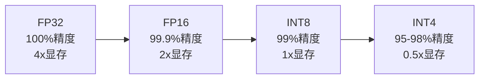

| 格式 | 原理 | 适合什么 | 代表工具 |
|------|------|---------|---------|
| GGUF | 把模型每个参数的精度从 16 位降到 4-8 位（好比把高清照片压成 JPEG） | 家用电脑、手机 | llama.cpp、Ollama |
| AWQ | 分析模型各层对量化的敏感度，重要层保持高精度，不重要的多压缩 | 服务器显卡 | vLLM |
| GPTQ | 一次性压缩整个模型，不需要先分析 | 服务器显卡 | vLLM |

这三种量化格式各有来头：**GGUF** 是 llama.cpp 社区为普通硬件设计的——不挑显卡，CPU 也能跑，牺牲一点精度换来"人人可用"。**AWQ**（Activation-aware Weight Quantization）更聪明：先跑一遍数据，看模型每层哪些参数对结果敏感，重要的保留高精度，不重要的多压缩——精度损失极小，但需要服务器显卡跑。**GPTQ** 则是一键压缩，不先分析，速度快，适合快速部署。这三个是"压缩格式"；而 **vLLM** 不是压缩工具，它是一个高性能推理引擎（运行模型的软件），专门在显卡服务器上跑量化后的模型，能同时服务上百用户。

GGUF 是最常见的——你下载的"7B 模型"（70 亿参数的意思）通常就是 GGUF 格式，可以在普通电脑上跑。

---

> ← 上一节：[[20.1 问题-AI 模型太大了]] ｜ 下一节：[[20.3 怎么跑]] →
