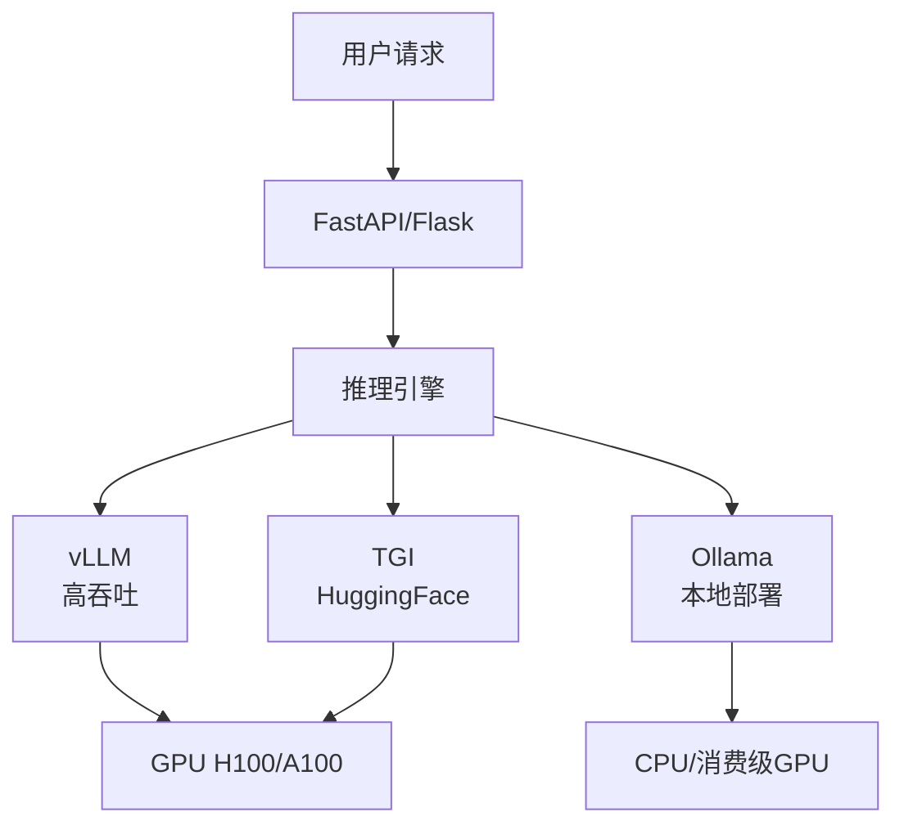

## 快速选型速查

如果你是第一次接触部署，这张表可以帮你快速定位该用什么：

| 场景 | 用什么 | 需要什么硬件 | 月成本（估算） |
|------|--------|------------|--------------|
| 自己玩玩、问问题 | Ollama | 普通电脑（最好有独立显卡） | 0（电费忽略不计） |
| 追求极致性能、省资源 | llama.cpp | 任何电脑、甚至树莓派 | 0 |
| 做服务给别人用 | vLLM | 显卡服务器 | 5000-20000 元（云 GPU） |
| 手机上用 | GGUF + 移动端推理 | 近年旗舰手机 | 0 |
| 不想折腾，用云 API | OpenAI / Anthropic / Groq | 不需要 | 按量付费，几十到几百元 |

下面展开每种部署方案的具体细节。

## 20.8.1 单 GPU 部署

**消费级 GPU（RTX 4090/5090，24-32GB 显存）**：适合个人开发者、小团队内部使用。通过 GGUF INT4 量化，可以跑 30-70B 参数的模型。7B 模型在 RTX 4090 上可以跑到 100+ tokens/s，体验流畅。成本约 1-2 万元一次性投入。

**企业级 GPU（A100 80GB/H100 80GB）**：适合服务几十到几百个并发用户。可以跑未量化的 70B 模型或量化后的 405B 模型。H100 上 70B 模型 FP16 推理可达 50+ tokens/s。成本约 10-30 万元（购买）或 1-3 美元/小时（云租用）。

## 20.8.2 多 GPU 部署

当模型大到单张 GPU 装不下，或者需要同时服务上千用户时，就需要多 GPU 部署。

**张量并行（Tensor Parallelism）**：把模型的每一层切分到多张 GPU 上。比如一张 GPU 算注意力头的一半，另一张算另一半，然后合并结果。优点是实现简单，缺点是 GPU 之间需要高频通信（每层都要同步），网络带宽要求高。适合单机多卡（8 张 GPU 以内）。

**流水线并行（Pipeline Parallelism）**：把模型按层切分——GPU 0 负责前 10 层，GPU 1 负责中间 10 层，GPU 2 负责最后 10 层。数据像流水线一样依次经过各 GPU。优点是 GPU 间通信少，缺点是有"流水线气泡"（前一张 GPU 在等后一张 GPU 算完）。适合模型非常大（数百 GB）的场景。

**数据并行（Data Parallelism）**：每张 GPU 都有模型完整副本，不同 GPU 处理不同用户请求。这是最常见的提升吞吐量的方式。vLLM 和 TGI 都内置了数据并行支持。

实际部署中，通常是张量并行 + 数据并行组合使用：同一台机器内用张量并行，多台机器间用数据并行。

## 20.8.3 CPU 部署

什么场景下用 CPU 推理？

1. **对延迟不敏感的场景**：批量处理文档、离线数据标注、夜间跑批。CPU 推理速度虽然慢（通常 1-5 tokens/s），但支持超大内存（可达 TB 级），可以跑未压缩的 405B 模型。
2. **隐私要求极高的场景**：金融、医疗、政务数据不能离开本地服务器，而这些机构不一定有 GPU 服务器。CPU 推理让它们也能用 AI。
3. **成本极端敏感的场景**：CPU 服务器的租用成本远低于 GPU 服务器。1 台 64 核 CPU 服务器月租约 3000 元，而 1 张 A100 云 GPU 月租约 15000 元。

llama.cpp 是 CPU 推理的首选引擎，它针对 AVX2/AVX-512 指令集做了深度优化。2026 年，llama.cpp 在高端 CPU 上跑 7B 模型可以达到 10-15 tokens/s，接近可用的阅读速度。

## 20.8.4 云部署 vs 本地部署：决策矩阵

| 考量因素 | 云部署 | 本地部署 |
|---------|--------|---------|
| 初始成本 | 零，按量付费 | 硬件采购 5-50 万元 |
| 运维成本 | 低，云厂商负责 | 高，需要专人维护 GPU 服务器 |
| 数据隐私 | 数据经过云厂商 | 数据不出公司 |
| 延迟 | 受网络影响，通常 50-200ms | 局域网内 <10ms |
| 弹性伸缩 | 秒级扩容 | 受限于硬件数量 |
| 合规要求 | 需确认云厂商合规认证 | 完全自主可控 |
| 适合场景 | 初创公司、快速原型、弹性需求 | 大企业、金融医疗、稳定负载 |

一个实用的决策逻辑：**如果日均 Token 消耗低于 1000 万，用 API 更划算。如果超过 1 亿，自建更划算。中间地带看数据隐私和延迟要求。**

---

> <- 上一节：[[20.7 推理优化技术深入]] ｜ 下一节：[[20.9 2026年推理成本分析]] ->
