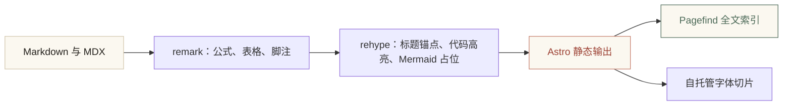

夜里把最后一版配色改完，屏幕上那张米白的纸终于不那么刺眼了。这件事做了很久：不是写内容，而是把「纸」找对。

## 为什么还要手写

现成的博客模板很多，大多也足够好看。但它们的好看是**通用**的好看——清爽、居中、无衬线。而中文有自己的脾气：字是方的，行距要松，标点要占位，首行要缩进。把这些交给一套为英文设计的排版规则，读起来总会有一点不对劲。

所以这次决定从零开始，只做一件事：让中文读起来舒服。

> 「凡文字，少时须令气象峥嵘，彩色绚烂；渐老渐熟，乃造平淡。」
>
> —— 苏轼《与侄书》

### 三个具体的决定

1. **不用纯白**。纸色取 `#f6f2e8`，是宣纸在灯下的米白，比纯白柔和，长读不刺眼。[^1]
2. **行距 1.95**。中文方块字横排时，字形密度远高于拉丁字母，行距不够就会糊成一片。
3. **首行缩进两字**。这是中文排版的旧规矩，比段落间距更能保持文气连贯。

## 纸与墨的配比

配色克制到只有四种颜色在动：纸、墨、朱砂、赭金。朱砂只出现在印章、强调与光标上，面积不超过整页的百分之一。暗色模式叫做「夜墨」，是把纸换成深褐、把墨换成暖灰，而不是简单地反色。

| 角色 | 宣纸 | 夜墨 | 用在哪里 |
| :--- | :--- | :--- | :--- |
| 纸 | `#f6f2e8` | `#14130f` | 页面底色 |
| 墨 | `#24211c` | `#e8e1d2` | 正文 |
| 朱砂 | `#9c4033` | `#c47b68` | 印章、强调 |
| 赭金 | `#a5875a` | `#c6a979` | 分隔、点缀 |

配色之外，还有一层几乎看不见的纸纹：一层极淡的噪点，像宣纸的纤维。它不参与构图，只负责让屏幕少一点塑料感。

## 能动手的书房

一个只能读的博客是静态的。我想让它能动手——读到哪里有想法，随手就能记下来。

- [x] 选中文字即可批注，批注保存在浏览器本地
- [x] 高亮会一直留在文中，点击可回看、编辑
- [x] 一键导出为 Markdown
- [x] 全文检索（Pagefind，无服务端）
- [ ] 批注同步到云端（大概不会做，那样就不私密了）

写作本身则尽量不管排版。数学、流程图、代码、脚注、表格都直接写：

$$
T_{\text{读}} = \left\lceil \frac{N_{\text{字}} + \alpha N_{\text{词}}}{320} \right\rceil
$$

上面的阅读时长估算里，$N_{\text{字}}$ 是中文字数，$N_{\text{词}}$ 是西文词数，$\alpha$ 是折算系数——一行公式，比一段文字解释得清楚。

```ts
// 构建流程：静态生成之后再做全文索引
const steps: Step[] = [
  { name: 'astro build', desc: '渲染 Markdown、KaTeX、代码高亮' },
  { name: 'pagefind', desc: '把 HTML 切成可检索的片段' },
];
```



## 还没做完的事

字体切片是按字下载的，第一屏只会取到实际用到的几十 KB；Mermaid 与搜索面板都是按需加载，不读图、不搜字就不会下载。这些细节读者不会察觉，但「好看」和「快」从来是同一件事的两面。[^2]

至于内容——书房已经有了纸和笔，剩下的就是把日子一笔一笔写上去。

[^1]: 关于纸色的一点私心：我更喜欢老纸那种微微发黄的米色，它在夜里看起来像一盏没关的灯。
[^2]: 本文的公式、图表与脚注都是真实渲染的，你可以点一下目录、选中一句话，或者按 <kbd>Ctrl</kbd> + <kbd>K</kbd> 试试。
