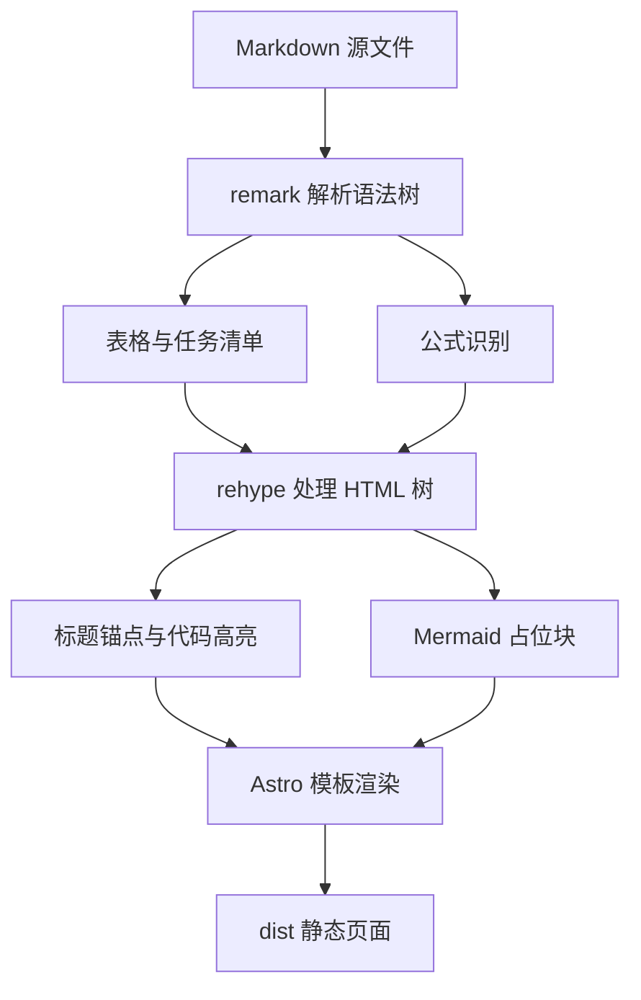
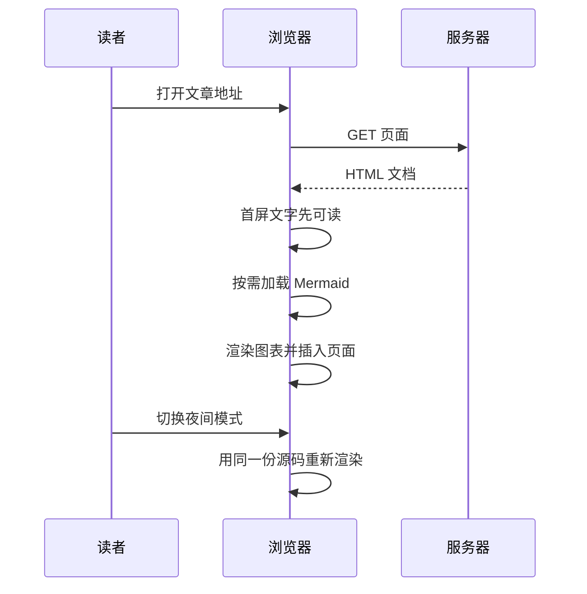

---
title: 一篇文章的旅程
subtitle: 从 Markdown 源文件到浏览器里的那一页
description: 一篇 Markdown 从落笔到出现在页面上，要经过解析、插件链、模板与静态输出，再由浏览器补上图表与交互。沿着这条链路走一遍，能看清每个部件各自的职责。
pubDate: 2025-09-18
category: 技术
tags: [Markdown, Mermaid, 构建]
featured: true
cover: /images/posts/cover-ink-path.svg
---

写下这篇文章的时候，我在编辑器里敲的是纯文本：几行短横线、几个星号、若干个美元符号。几个小时后它变成你正在看的这一页，有目录、有公式、有脚注、有可以点开的图。中间发生了什么，值得写清楚——因为这条链路上的每一环，都决定了你能看到什么、看不到什么。

## 一、源文件与那几行元信息

每篇文章是一个 `.md` 文件，开头几行用短横线夹起来，叫 Frontmatter。它不属于正文，而是给程序看的：标题、日期、分类、标签、是否精选。正文从第二个 `---` 之后开始，才是人读的部分[^1]。

```md
---
title: 一篇文章的旅程
pubDate: 2025-09-18
category: 技术
tags: [Markdown, Mermaid, 构建]
---
```

这些字段由一份 schema 校验，类型不对或者缺字段，构建会直接失败。这是好事：错误发生在构建机上，而不是发生在读者打开页面、看见一个「undefined」的时候。

## 二、解析：Markdown 不是一种

Markdown 是一族方言。表格、任务清单、删除线来自 GFM 的扩展；`$...$` 里的公式，标准 Markdown 根本不认识。所以解析器要一层层加插件。

普通 Markdown 的写法，被转换成两个阶段：先处理「Markdown 语法树」（remark），再处理「HTML 树」（rehype）。前者管语法，后者管产物[^2]。



插件顺序不是随便排的。公式必须在代码高亮之前识别，否则 `$` 会先被当成普通字符；标题锚点要放在最后，否则锚点会被包进标题文字里。这类问题没有文档会写，只能靠一次一次构建失败试出来。

## 三、图表为什么是空壳

Mermaid 是个例外：它在构建期只留下一个空壳。

原因是字体度量。Mermaid 需要知道每个字的宽度，才能把框画得刚好装下文字、把线连到合适的位置。构建机上的 Node 进程没有浏览器那种排版引擎，量不出宽度，画出来的图会错位。所以这里只写一个带源码的占位块，等浏览器打开页面，用真正的中文度量去排。

```ts
// 构建期：把 ```mermaid 换成一个带源码的空壳
const block = {
  tagName: 'div',
  properties: {
    className: ['mermaid-block'],
    'data-mermaid': raw.trim(),
    role: 'img',
  },
};
```

源码放在 `data-mermaid` 属性里，还有一个可见的 `<pre>` 作为兜底。脚本没跑起来的时候，读者看到的是源码而不是空白——能读，只是不好看。这是有意的退化。

## 四、一次访问的时序

下面这张图是同一个过程从另一个角度：读者、浏览器、服务器各自的活儿。



关键在于前四步：文字在图表渲染之前就已经可读。视频里那种「先白屏、再一起冒出来」的观感，通常不是网络慢，而是整页都卡在等脚本。

## 五、产物是什么

构建结束，`dist` 里躺着的是纯静态文件。看一下每一层的输入输出：

| 阶段 | 输入 | 输出 |
| :--- | :--- | :--- |
| 收集 | `src/content/posts/*.md` | 带类型的内容条目 |
| remark | Markdown 语法树 | 补上表格、公式节点 |
| rehype | HTML 树 | 锚点、高亮、占位块 |
| Astro | 模板与内容 | 静态 HTML |
| 浏览器 | HTML 与脚本 | 图表、主题、批注 |

一行 `npx astro build` 之后，页面上不存在「渲染」这个动作，只有「读取」。这也是它快的原因，另外的文章里写过。

## 六、浏览器补的那一半

静态 HTML 交付的是「读完就够用」的那部分。剩下的是渐进增强：渲染图表、记住夜间模式、按需搜索、选中文字批注。这些脚本都不在首屏的关键路径上，不读图、不搜索，就不会下载。

代价是复杂度被挪到了两处：构建时的一条插件链，和浏览器里的一小段水合逻辑。前者出错会让构建失败，很吵；后者出错往往很安静——图没画出来，或者主题闪一下[^3]。安静的错更难查，所以这里的每一段脚本都留了控制台日志。

## 七、顺手做完的几件小事

正文之外，还有几件事在构建期一并做掉。读者看不见，却决定了这一页读起来顺不顺：

- **目录**。加锚点的时候顺手记下每个标题的层级与文字，模板据此生成右侧目录。标题改了，目录跟着改，不用另写一份。
- **图片**。放在 `public` 里的图原样复制，路径直接写 `/images/...`；放在文章旁边、用相对路径引用的图，会被压缩一次，转成带哈希的文件名，顺便量出宽高，省得加载时版面往下跳。
- **脚注**。正文里的 `[^1]` 被替换成一个上标链接，指向文末的注释，注释末尾再给一条反链。这一层由 Markdown 解析器完成，模板只管样式。
- **阅读时长**。字数在构建期数一遍，除以一个经验速度，得到顶上那句「约 X 分钟」。它不精确，但够读者判断要不要现在开始读。

这几件事都不难，难在顺序与取舍：哪一步该在构建时做，哪一步必须留给浏览器。判断错了，页面就会白等一次。

[^1]: 内容收集用的是 Astro 的 content collections 加 glob loader，条目的 id 取自文件名。所以改文件名等于换 URL，旧链接会失效。
[^2]: Shiki 在构建期把代码切成带颜色的 token，输出的是纯粹的 `<span>`，页面上不再需要高亮脚本，也不会闪烁。
[^3]: 主题切换时重画图表会有肉眼可见的停顿，图越大越明显。可以接受，因为这件事不常做。

