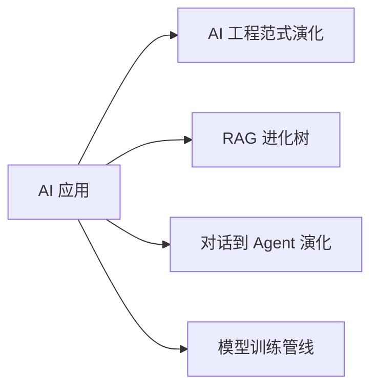
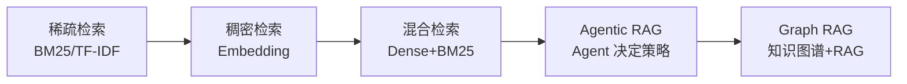
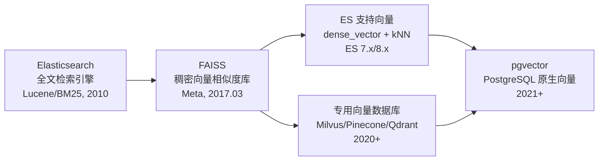
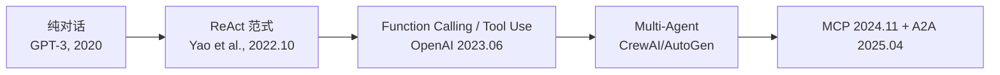
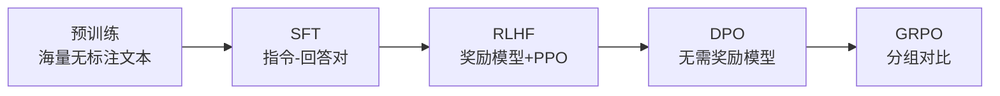
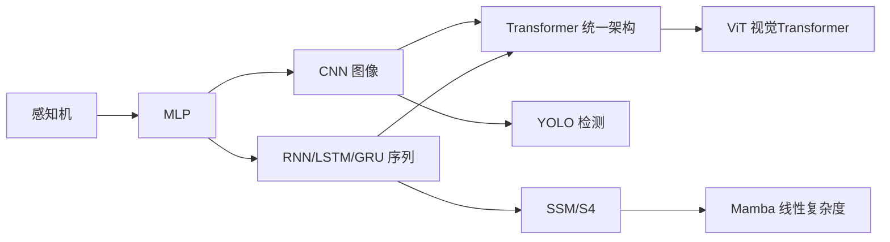

> 这不是词典。这是地图。每个节点是一个概念，每条线是一层进化。在 Obsidian Graph View 里看最清楚。

## 核心演化轴

四条主线，贯穿全部应用层知识：

1. [[概念-AI工程范式演化]]：Prompt -> Context -> Harness -> Loop
2. [[Ch13 RAG 进化树]]：稀疏检索 -> 稠密检索 -> 混合检索 -> Agentic RAG -> Graph RAG
3. [[概念-对话到Agent演化]]：纯对话 -> Function Calling -> Tool Use -> ReAct Agent -> Multi-Agent -> MCP/A2A
4. [[概念-模型训练管线]]：预训练 -> SFT -> RLHF -> DPO -> GRPO -> 模型合并

---

## 轴一：[[概念-AI工程范式演化]]

四次范式跃迁，不是替代而是层叠。[[概念-四次范式跃迁|详见]]。

| 范式 | 核心问题 | 本 vault 落地 |
|------|---------|--------------|
| [[Ch12 Prompt 工程]] | 怎么问 | agent.md 全部规则 |
| [[概念-Context工程]] | 让模型看见什么 | 漏斗模型：摘要 -> 全文 |
| [[概念-Harness工程]] | 把模型放在什么环境里 | 文件夹结构 + wikilink 约束 |
| [[概念-Loop工程]] | 让系统自己转起来 | Perceive->Think->Act->Observe 循环 |

相关：[[概念-提示词纪律]]、[[概念-漏斗架构]]、[[概念-Agent原理与ReAct]]

---

## 轴二：[[Ch13 RAG 进化树]]

从最简单的关键词匹配到 Agent 自主决策检索策略。

### 逐级详解

**[[深挖-稀疏检索]]**：BM25、TF-IDF。只看词频，不懂语义。"苹果手机"和"iPhone"算两个东西。来源：传统信息检索。

**[[深挖-稠密检索]]**：Embedding 向量相似度。"苹果手机"和"iPhone"在向量空间很近。需要 [[概念-Embedding模型]] + [[深挖-向量数据库]]（Milvus/Pinecone/Qdrant/pgvector）。来源：BERT 之后的文本表示革命。

**[[深挖-混合检索]]**：稠密 + 稀疏双路 + [[深挖-重排序]]。显著降低检索失败率，2026 年生产环境标配。来源：StackAI RAG 最佳实践、Firecrawl 2026 混合检索指南。

**[[深挖-自主检索RAG]]**：Agent 自主决定：搜几次？用什么策略？是否需要改写查询？是否需要验证结果？检索不再是固定管线，而是动态决策。来源：LangChain/LlamaIndex 2025-2026 演进。

**[[深挖-图谱检索RAG]]**：知识图谱 + RAG。先建实体-关系图，检索时利用图结构推理。"A 的老板的老板是谁"这种多跳问题，传统 RAG 答不好。来源：Microsoft Graph RAG 2024, Neo4j 集成。

### 横向组件

- [[深挖-分块策略]]：Recursive -> Semantic -> Late Chunking -> Agentic Chunking

## 来源

- 综合 Coursera、roadmap.sh、Towards Data Science、Medium 五份路线图交叉对比
- 各技术条目引用的原始论文见各章来源节
- [[概念-Embedding模型]]：text-embedding-3 / bge-large / Jina v3 / Cohere v3
- [[深挖-向量数据库选型]]：Milvus vs Pinecone vs Qdrant vs pgvector
- [[深挖-重排序]]：Cohere Rerank / bge-reranker / Cross-Encoder / ColBERT
- [[深挖-RAG评估]]：RAGAS / TruLens / DeepEval

### 检索基础设施演化（0 -> 1）

向量检索不是一夜之间冒出来的。这条线从零开始。

**[[深挖-Elasticsearch]]**：2010 年诞生，基于 Apache Lucene 的分布式全文检索引擎。核心能力是倒排索引 + BM25 关键词搜索。在 AI 时代之前，它就是搜索的代名词。2019 年（7.x）引入 `dense_vector` 字段类型，2022 年（8.x）支持原生 kNN 向量搜索。不是"专用向量数据库"，但至今仍是生产环境最常见的混合检索引擎 ^[Elastic, "Vector Search Introduction", https://www.elastic.co/search-labs/cn/blog/introduction-to-vector-search]; ^[华为开发者, "Elasticsearch 向量检索发展史", https://developer.huawei.com/consumer/cn/forum/topic/0207133454587368016]。

**[[深挖-FAISS]]**（Facebook AI Similarity Search）：Meta 2017 年 3 月开源。不是数据库——是 C++ 库，提供高效的稠密向量近似最近邻（ANN）搜索算法。支持 GPU 加速，可处理十亿级向量。关键贡献：把向量相似度搜索从实验级推到了工业级。Milvus、Weaviate 等专用向量数据库的底层引擎都借鉴或直接使用了 FAISS ^[Meta Engineering, "Faiss: A library for efficient similarity search", 2017.03.29, https://engineering.fb.com/2017/03/29/data-infrastructure/faiss-a-library-for-efficient-similarity-search/]; ^[FAISS GitHub, https://github.com/facebookresearch/faiss]。

**专用向量数据库（2020+）**：在 FAISS 的基础上加了数据库能力——CRUD、分布式、权限、过滤。Milvus（2019 开源）、Pinecone（2021 商用）、Qdrant（2021）、Weaviate（2019）。它们和 FAISS 的关系就像 PostgreSQL 和 B-tree：一个提供底层引擎，一个提供完整数据库 ^[火山引擎, "AI 跑车引擎——向量数据库", https://developer.volcengine.com/articles/7382278528115343369]。

**[[深挖-pgvector]]**（2021+）：PostgreSQL 扩展，让传统关系型数据库支持向量存储和 ANN 搜索。2026 年趋势：与其单独维护一个向量数据库，不如在已有的 PostgreSQL 上加 pgvector。适合不想引入新基础设施的团队。

**ES vs FAISS vs 专用向量 DB 选型：**

| | ES | FAISS | Milvus/Pinecone |
|---|---|---|---|
| 定位 | 全文搜索 + 向量 | 向量算法库 | 专用向量数据库 |
| 全文搜索 | 原生最强 | 无 | 需额外集成 |
| 向量性能 | 中等 | 极致 | 高 |
| 部署复杂度 | 已有 ES 则零成本 | 需应用层封装 | 独立服务 |

2026 年生产环境常态：ES 做混合检索（BM25 + kNN），FAISS 做离线批量向量索引，专用向量 DB 做高并发在线 ANN。

---

## 轴三：[[概念-对话到Agent演化]]

从一问一答到自主多步执行。注意：此轴按**概念/架构演化**排列，非严格时间线。ReAct 论文 (2022.10) 实际上先于 Function Calling API (2023.06)。

### 逐级详解

**[[概念-纯对话]]**：用户问，模型答。无外部能力。GPT-3 时代。上下文就是全部。

**[[概念-ReActAgent]]**：Reasoning + Acting 交替循环。Think -> Act -> Observe -> Think -> ... 直到任务完成。核心突破：模型有了"中间思考"步骤，能根据上一步结果调整策略。论文：Yao et al., "ReAct: Synergizing Reasoning and Acting in Language Models", arXiv 2022.10 ^[Yao et al., https://arxiv.org/abs/2210.03629]。

**[[概念-FunctionCalling]] / [[概念-ToolUse]]**：OpenAI 2023 年 6 月推出 Function Calling，Anthropic 推出 Tool Use。两者本质相同——JSON Schema 定义工具，模型返回结构化调用请求。名称不同但机制一致 ^[OpenAI, https://openai.com/index/function-calling-and-other-api-updates/]; ^[Propelius, https://propelius.ai/blogs/function-calling-vs-tool-use-ai-agents/]。

**[[概念-MultiAgent]]**：多个 Agent 角色分工。[[深挖-CrewAI]]（角色扮演）、[[深挖-AutoGen]]（对话式协作）、[[深挖-LangGraph]]（图编排）。每个 Agent 专注一件事，通过通信协调。

**[[概念-MCP+A2A]]**：互操作标准。[[概念-MCP]]（Anthropic, 2024.11）= Agent 连工具的标准接口 ^[Anthropic, https://www.anthropic.com/news/model-context-protocol]。[[概念-A2A]]（Google, 2025.04）= Agent 之间通信的标准协议 ^[Google, https://developers.googleblog.com/en/a2a-a-new-era-of-agent-interoperability/]。2026 年双协议形成互补生态。

### 关键区别：Agent vs 普通 API 调用

| | 普通 API 调用 | Agent |
|---|---|---|
| 决策 | 预定流程 | 自主判断下一步 |
| 工具 | 固定调用 | 动态选择工具 |
| 循环 | 无（一次调用） | 有（Think-Act-Observe） |
| 记忆 | 无状态 | 跨步保持上下文 |
| 纠错 | 失败即终止 | 观察错误 -> 重试 |

---

## 轴四：[[概念-模型训练管线]]

### 分支：微调方法谱系

- [[深挖-全量微调]] -> [[深挖-PEFT]] -> [[深挖-LoRA]] -> [[深挖-QLoRA]] -> [[深挖-DoRA]]
- [[深挖-PromptTuning]]（软提示）vs [[深挖-PrefixTuning]] vs [[深挖-Adapter]]

### 训练后技术

- [[深挖-模型合并]]：TIES / MergeKit，多适配器合而为一
- [[深挖-量化]]：GGUF / AWQ / GPTQ，精度换速度
- [[深挖-推测解码]]：小模型预测，大模型验证，加速推理

---

## 旁支网络（穿插关系）

### 神经网络演化

说明：
- [[深挖-ViT]] 源自 Transformer，不是 CNN。将图像切为 patch 序列直接输入 Transformer（Dosovitskiy et al., ICLR 2021）
- [[深挖-Mamba]] 源自状态空间模型 SSM/S4 谱系（Gu et al., 2021），不是 Transformer。常被定位为 Transformer 的替代方案，但技术上独立演化（Gu & Dao, 2023）
- [[深挖-YOLO]] 是 CNN 检测器，属 CNN 谱系

[[深挖-KNN]] 不在这条线——它是懒惰学习，不是神经网络。和 [[深挖-SVM]]、[[深挖-决策树]] 同属经典 ML 时代。

### [[深挖-Lang家族]]

- [[深挖-LangChain]]：链式编排，Prompt + LLM + Tool 串成 Chain。适合线性流程
- [[深挖-LangGraph]]：图编排 + 状态管理，支持循环、条件分支、人工审核。生产级 Agent 首选
- [[深挖-LangSmith]]：调试/评估/监控，Agent 的可观测层

### [[深挖-工作流模式]]

| 模式 | 结构 | 适用 |
|------|------|------|
| [[概念-StaticWorkflow]] | 固定步骤，无分支 | 简单 ETL、报告生成 |
| [[概念-DynamicWorkflow]] | 条件分支，路径可变 | 客服路由、内容审核 |
| [[概念-AgenticWorkflow]] | 模型自主决定路径 | 复杂推理、开放任务 |

### [[概念-上下文管理技术]]（Function Calling 出现之前）

在没有 Function Calling 的年代，如何让模型用外部工具？

1. **[[概念-提示词注入]]**：把工具描述 + 可用数据直接塞进 Prompt。"你可以用搜索引擎，结果如下：..."
2. **[[概念-渐进式加载]]**：分步注入上下文。先给摘要，需要时再给全文。本 vault 的漏斗模型前身
3. **[[概念-Hook机制]]**：模型输出特定标记时触发外部函数。`[SEARCH: xxx]` -> 执行搜索 -> 结果插回上下文
4. **[[深挖-上下文压缩]]**：对话历史太长时，摘要压缩后继续。LangChain `ConversationSummaryMemory`

后来 [[概念-FunctionCalling]] 把这些变成了 API 原语，不再需要 hack。

### [[概念-FunctionCalling演化]]

1. 无 FC 时代：提示词注入 / Hook
2. OpenAI Function Calling：JSON Schema 定义函数
3. Tool Use：标准化 + 并行调用 + 流式
4. MCP：跨模型、跨应用的统一工具协议

### [[概念-图数据库与知识图谱]]

- [[概念-Neo4j]]：图数据库，存实体-关系。[[深挖-图谱检索RAG]] 的基础设施
- [[知识图谱]]：实体 + 关系的结构化知识网络。和向量数据库互补——向量管相似，图谱管关系
- [[概念-ObsidianGraphView]]：你正在看的这个 vault，wikilink 天然形成知识图谱

---

## 横向概念组（就近对比）

| 概念对 | 区别一句话 |
|--------|-----------|
| [[对比-SFTvsRLHF]] | SFT 教模型"怎么做"，RLHF 教模型"做得好不好" |
| [[对比-DPOvsRLHF]] | RLHF 需要训练奖励模型，DPO 直接从偏好对学 |
| [[深挖-偏好对齐]] | DPO 基于偏好对(chosen vs rejected)学习，GRPO 基于组内相对排名学习 |
| [[对比-LoRvsQLoRA]] | LoRA 全精度基座 + 低秩适配，QLoRA 4-bit 基座 + 同款适配 |
| [[对比-RAGvs微调]] | RAG 给模型查资料，微调改模型参数 |
| [[对比-ToolUsevsFunctionCalling]] | OpenAI 叫 Function Calling，Anthropic 叫 Tool Use。机制相同——JSON Schema 定义工具，模型返回调用请求 |
| [[对比-MCPvsA2A]] | MCP 管 Agent 连工具，A2A 管 Agent 间通信 |
| [[对比-LangChainvsLangGraph]] | LangChain 是链（线性），LangGraph 是图（循环+分支） |
| [[对比-CNNvsTransformer]] | CNN 擅长局部特征（卷积核），Transformer 擅长全局关系（自注意力） |
| [[对比-RNNvsTransformer]] | RNN 串行处理序列，Transformer 并行 + 直接建模任意距离依赖 |
| [[对比-稠密检索vs稀疏检索]] | 稠密 = 语义相似度，稀疏 = 关键词匹配 |
| [[对比-AgenticRAGvsGraphRAG]] | Agentic = 检索策略动态，Graph = 检索对象是知识图谱 |
| [[对比-StaticvsDynamicvsAgenticWorkflow]] | Static=固定路径，Dynamic=条件分支，Agentic=模型自主 |

---

回到 [[摘要|笔记目录]] · [[专有名词索引]]
