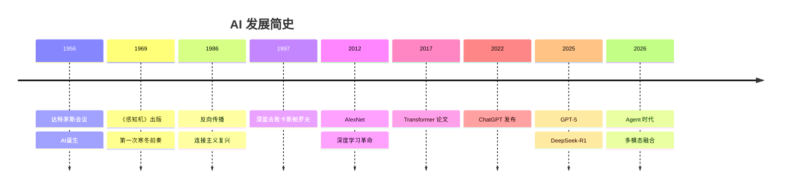

AI 不是一夜之间出现的。从 1956 年到今天，经历了三次浪潮、两次寒冬。这一章不讲算法细节，讲历史脉络——每个时代的核心思想是什么、为什么兴起、为什么倒下，以及哪些已经过时的技术你不需要学，但需要知道它们存在过。

> **生活比喻**：AI 的发展史像一个人的成长——小时候只会背规则，大人说"见到长辈要问好"就照做（符号主义，人写规则）；青春期开始从经验中学习，被烫过一次就知道不碰热水（连接主义，从数据中学）；成年后有了足够的阅历和资源，才真正爆发出能力（深度学习，大数据+大算力）。每次成长都会撞上瓶颈，但每次突破都站上了新高度。

读完这一章，你会对 AI 70 年的起伏有一个清晰的时间轴，并且能识别那些「面试会被问到但工作中不需要用」的经典技术。

## 本章目录

1. [[1.1 第一次浪潮-符号主义|1.1 第一次浪潮：符号主义的兴起与寒冬（1956--1980）]]
2. [[1.2 第二次浪潮-连接主义|1.2 第二次浪潮：连接主义的兴起与寒冬（1986--2012）]]
3. [[1.3 第三次浪潮-深度学习|1.3 第三次浪潮：深度学习（2012--至今）]]
4. [[1.4 关键人物|1.4 关键人物]]
5. [[1.5 2026年AI格局|1.5 2026 年 AI 格局]]

## 参考表格

### 三次浪潮对比总览

| 浪潮 | 时间 | 核心理念 | 驱动力 | 瓶颈 | 留下的遗产 |
|------|------|---------|--------|------|-----------|
| **第一次：符号主义** | 1956--1974 | 智能=逻辑推理，人写规则让机器推理 | 政府资助（DARPA）、学术热情 | 规则无法穷举真实世界，组合爆炸（if-then 规则数量指数级增长） | Lisp 语言、知识表示、搜索算法（A* 算法至今仍是路径规划的基础） |
| **第二次：连接主义** | 1986--2012 | 不写规则，让机器从数据里自己学 | 反向传播算法、统计学习理论成熟 | 算法复杂度跟不上数据规模；SVM 的 O(n²) 在大数据下崩溃 | 反向传播算法、CNN 原型（LeNet）、分布式表征思想 |
| **第三次：深度学习** | 2012--至今 | 不写规则，让机器从数据里自己学（延续连接主义）+ 大数据+大算力 | 大数据（互联网产生海量标注数据）+ 大算力（GPU 集群）+ 老算法（CNN/Transformer 终于等到足够数据和算力） | 数据需求大（小样本场景仍然困难）、可解释性差、能耗高 | Transformer 架构、预训练范式、Scaling Law（模型越大效果越好） |

**贯穿三次浪潮的规律**：每次浪潮的兴起都是因为「找到了一个能 work 的范式」，每次寒冬都是因为「那个范式遇到了天花板」。符号主义的天花板是规则写不完，连接主义的天花板是算力和数据不够，深度学习的天花板是什么——这个问题在 2026 年仍然悬而未决。

### 五个你今天不需要学的技术

| 技术 | 时代 | 为什么不需要学了 |
|------|------|-----------------|
| 专家系统 | 1970s--1980s | 规则驱动，被数据驱动替代 |
| SVM | 1990s--2010s | 深度学习在大数据上全面碾压 |
| HMM | 1990s--2010s | Transformer 在序列建模上完全替代 |
| 决策树（单独使用） | 1980s--2000s | 被 XGBoost / 随机森林替代，但仍需理解概念 |
| 传统计算机视觉（SIFT、HOG） | 2000s--2015 | 被 CNN 端到端替代 |

但你需要知道这些名字——读老论文时会遇到，面试时可能被问到。

### 关键转折点年表

| 年份 | 事件 | 意义 |
|------|------|------|
| 1956 | 达特茅斯会议 | AI 诞生 |
| 1969 | Minsky & Papert 出版《感知机》 | 第一次寒冬的导火索之一 |
| 1973 | Lighthill 报告发布 | 英国政府撤资，第一次寒冬正式开始 |
| 1986 | 反向传播算法普及（Rumelhart, Hinton & Williams） | 连接主义崛起 |
| 1992 | 日本第五代计算机项目失败 | 第二次寒冬 |
| 1997 | IBM 深蓝击败国际象棋冠军 | AI 第一次在智力游戏上超越人类 |
| 2012 | AlexNet 赢得 ImageNet | 深度学习时代开启 |
| 2014 | GAN（生成对抗网络）提出 | AI 能生成逼真图像 |
| 2017 | Transformer 论文发表 | 现代 AI 的基石 |
| 2020 | GPT-3 发布 | 大语言模型时代开启 |
| 2022 | ChatGPT 发布 | AI 走入普通人的生活 |

## 相关笔记

- [[Ch02 Python 与数据科学生态|第2章 Python]] -- 深度学习时代的工具链
- [[Ch04 机器学习核心算法|第4章 机器学习]] -- SVM 和 HMM 的后继者
- [[Ch06 神经网络基础|第6章 神经网络]] -- 连接主义的现代形态

## 跨章节关联

- [[Ch02 Python 与数据科学生态]] — AI 简史之后：从理论到工具
- [[Ch04 机器学习核心算法]] — 符号主义到连接主义：机器学习的诞生
- [[Ch22 AI 技术全景]] — 2026 年格局的全景视图

## 来源

- Russell & Norvig, "Artificial Intelligence: A Modern Approach", 4th ed., 2020, Pearson
- McCarthy, Minsky, Rochester, Shannon, "A Proposal for the Dartmouth Summer Research Project on Artificial Intelligence", 1955
- McCorduck, P., "Machines Who Think", 2004, A.K. Peters
- Minsky, M., Papert, S., "Perceptrons", 1969, MIT Press
- Lighthill, J., "Artificial Intelligence: A General Survey", 1973, Science Research Council
- Rumelhart, D.E., Hinton, G.E., Williams, R.J., "Learning Representations by Back-Propagating Errors", 1986, Nature
- Krizhevsky, A., Sutskever, I., Hinton, G.E., "ImageNet Classification with Deep Convolutional Neural Networks", 2012, NeurIPS
- Vaswani, A. et al., "Attention Is All You Need", 2017, NeurIPS
- Newquist, H.P., "The Brain Makers", 1994, Sams Publishing
