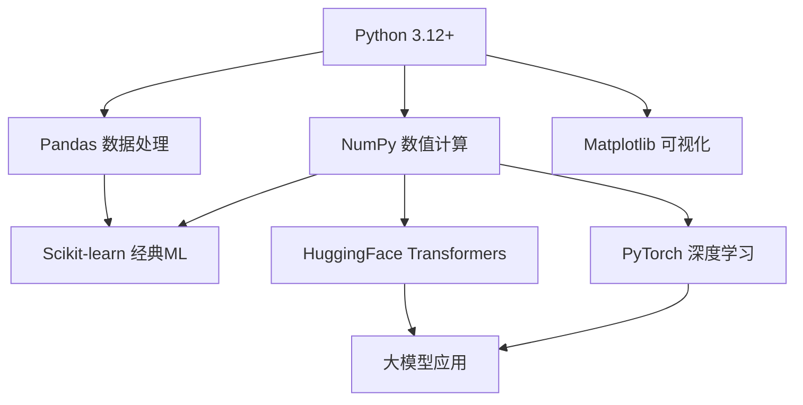

这是本文最重要的信息：**你不需要成为程序员。**

2026 年，AI 工具的使用门槛已经降到历史最低。你不需要：

- 理解 Python 的面向对象、装饰器、生成器、元类
- 掌握 Git、Docker、Kubernetes、CI/CD
- 会写单元测试、设计模式、系统架构
- 看懂算法复杂度、数据结构、编译原理

你只需要会：
- 用 `pip install` 装库
- 用 `requests` 调 API
- 用 `json` 解析返回结果
- 用 `pandas` 读表格、洗数据
- 用 `matplotlib` 画几张图看看趋势

**本质上，你的工作是"会调用 AI 就行"。** 调用者不需要知道模型内部怎么训练——就像你不需要知道发动机怎么造，也能开车。你只需要知道方向盘在哪、油门在哪、刹车在哪。

而且 2026 年的 AI 编程助手（Claude Code、Cursor、GitHub Copilot）已经可以帮你写大部分代码。你只要告诉它"帮我把这个 CSV 里的空值删掉，画个年龄分布直方图"，它帮你生成代码。你的价值不在于"会写代码"，而在于"知道让 AI 做什么"。

---

> ← 上一节：[[2.5 零基础最需要的 5 个 Python 库]] ｜ 下一节：[[2.7 2026 年推荐学习路径-不要从头学 Python，按需学]] →
