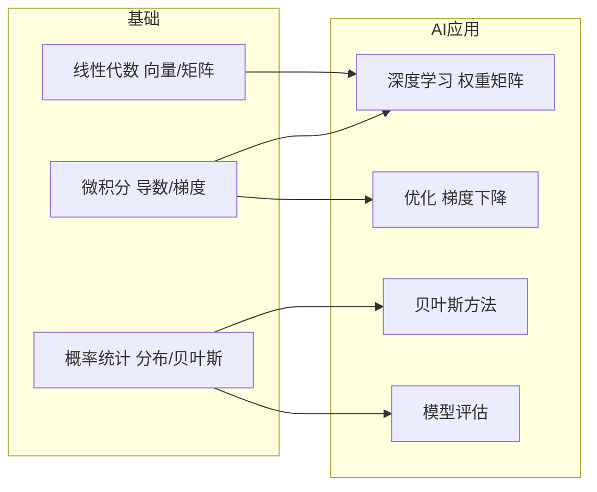

你不需要成为数学家。做 AI 应用层工作，三个数学领域各需要懂一点：线性代数（理解矩阵运算）、概率统计（理解数据）、微积分（理解优化）。每个领域只讲用得上的部分。

## 学习哲学：直觉比推导更重要

这是 AI 应用层最重要的区分：**你不需要会推导，但需要会理解。**

**数学推导**：从公式出发，一步步变换，最终得到结果。比如写出交叉熵损失函数的表达式，对权重矩阵求偏导，展开链式法则，得到梯度更新公式。这是研究员和框架开发者做的事。

**数学直觉**：不推导，但理解"发生了什么"。比如：
- 梯度下降：想象你蒙着眼睛站在山坡上，想走到山谷最低点。每一步都朝最陡的下坡方向走。你不需要写出梯度公式，但理解"为什么每一步都往下走最终能到谷底"。
- Softmax：把任意实数映射成概率。数值大的变成大概率，所有概率加起来等于1。你不需要记住 e^zi / sum(e^zj) 这个公式，但需要理解"为什么语言模型的输出总是概率"。
- 学习率：步子太大可能跳过最优解，步子太小走得太慢。你不需要解最优学习率的数学方程，但需要有"调参时先试 0.001"的直觉。

**检查你是否掌握了数学直觉**：你能不能用大白话向一个非技术人员解释梯度下降在做什么？如果能，你的数学直觉够了。如果只能背公式但解释不了，那你的数学推导对应用层工作是多余的。

## 本章不要求

做 AI 应用层，你完全不需要：
- 会证数学定理
- 手算矩阵乘法（有 NumPy）
- 深入理解特征值分解、SVD（奇异值分解）的原理细节（LoRA 用到了这些，但 PEFT 库自动处理底层）
- 概率论的公理化体系

AI 应用层的数学要求就是：**看得懂向量和矩阵，知道梯度下降在干嘛，理解概率分布是 AI 输出的基础。** 10 个小时的学习足够。

## 本章目录

1. [[3.1 线性代数-向量和矩阵|3.1 线性代数：向量和矩阵]]
2. [[3.2 概率统计-理解不确定性|3.2 概率统计：理解不确定性]]
3. [[3.3 微积分-理解优化|3.3 微积分：理解优化]]
4. [[3.4 优化理论 - 让 AI 找到最优解|3.4 优化理论 — 让 AI 找到最优解]]
5. [[3.5 信息论基础|3.5 信息论基础]]
6. [[3.6 数学在 AI 各领域的应用地图|3.6 数学在 AI 各领域的应用地图]]
7. [[3.7 零基础数学学习路径|3.7 零基础数学学习路径]]
8. [[3.8 2026年-你需要多少数学|3.8 2026年：你需要多少数学]]

## 相关笔记

- [[Ch02 Python 与数据科学生态]] — NumPy 就是做矩阵运算的
- [[Ch06 神经网络基础]] — 梯度下降和反向传播的实际应用
- [[深挖-LoRA微调]] — 矩阵分解的数学直觉
- [[概念-信息熵]] — 信息熵、交叉熵、KL 散度的详细定义

## 跨章节关联

- [[Ch04 机器学习核心算法]] — 数学之后：ML 算法中的数学直觉
- [[Ch06 神经网络基础]] — 梯度下降：数学在神经网络中的直接应用
- [[Ch09 Transformer 架构精讲]] — 矩阵运算：Transformer 的数学基础

## 来源

- 3Blue1Brown, "Essence of Linear Algebra", https://www.3blue1brown.com/topics/linear-algebra
- 3Blue1Brown, "Neural Networks", https://www.3blue1brown.com/topics/neural-networks
- Shannon, C.E. (1948), "A Mathematical Theory of Communication", https://people.math.harvard.edu/~ctm/home/text/others/shannon/entropy/entropy.pdf

