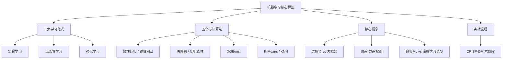

深度学习统治了今天的 AI，但机器学习是地基。本章从基础范式出发，覆盖核心算法、关键概念和实战流程。

> **生活比喻**：机器学习算法像不同类型的厨师——线性回归是拿尺子量着菜谱做的严谨派，决策树是"如果食材发黏就扔掉，如果颜色正常就下锅"一步步判断的经验派，XGBoost 是让多位厨师依次改进同一道菜，每位专注修正上一位的失误。不同菜系用不同厨师，不同数据用不同算法。

## 本章目录

1. [[4.1 三大类学习|4.1 三大类学习]] — 监督学习（含分类与回归）、无监督学习、强化学习
2. [[4.3 五个必知算法|4.3 五个必知算法]] — 线性回归、逻辑回归、决策树与随机森林、XGBoost、K-Means、KNN，含 scikit-learn API 速查
3. [[4.5 过拟合和欠拟合|4.5 过拟合和欠拟合]] — 偏差-方差权衡、检测方法、解决方案
4. [[4.6 2026年-经典ML vs 深度学习的选型|4.6 2026年：经典ML vs 深度学习的选型]] — 表格数据选 XGBoost，图像/文本选深度学习
5. [[4.7 机器学习项目实战流程|4.7 机器学习项目实战流程]] — CRISP-DM 六阶段完整流程

## 跨章关联

- 逻辑回归的 Sigmoid 函数 -> 神经网络的激活函数（[[Ch06 神经网络基础]]）
- 梯度提升的"逐个修正残差"思想 -> 深度学习的梯度下降（[[Ch06 神经网络基础]]）
- 过拟合 -> LoRA 微调中用 Dropout 防止过拟合（[[Ch11 模型微调]]）。Dropout 在训练时随机关掉一部分神经元，强迫模型不依赖任何单一路径，从而学到更泛化的知识
- 分类/回归 -> Agent 在做决策规划时，判断"走哪条路"本质上是一个分类问题（[[Ch14 Agent 工作原理]]）

## 相关笔记

- [[Ch06 神经网络基础]] — 深度学习是 ML 的子集
- [[Ch11 模型微调]] — 微调是监督学习的一种
- [[Ch03 AI 需要的数学]] — 概率论是 ML 的数学基础
- [[Ch05 模型评估与特征工程]] — 过拟合检测、交叉验证、特征工程
- [[Ch04 机器学习核心算法|概念子文件夹]] — 决策树、集成学习、无监督学习、异常检测等深入展开
- [[Ch04 机器学习核心算法|深挖子文件夹]] — KNN、SVM、决策树算法详解

## 跨章节关联

- [[Ch05 模型评估与特征工程]] — 训练完模型：怎么评估好坏
- [[Ch06 神经网络基础]] — 从经典 ML 到深度学习
- [[Ch11 模型微调]] — 从训练到微调：ML 方法的延续

## 来源

- Scikit-learn, https://scikit-learn.org
- Kaggle, "State of Data Science", 2023
- Hastie, Tibshirani & Friedman, "The Elements of Statistical Learning", Springer, 2009
- Bishop, "Pattern Recognition and Machine Learning", Springer, 2006
