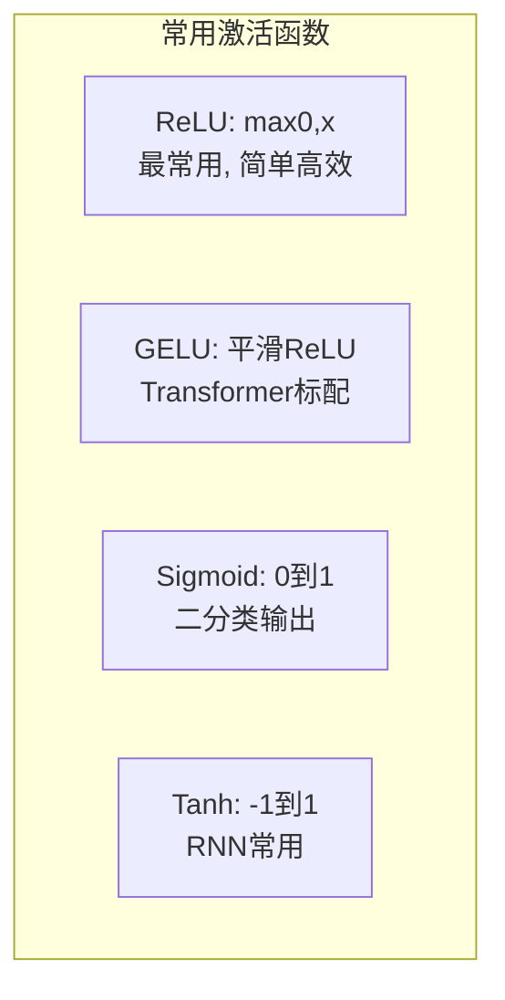

如果不用[[概念-ReLU|激活函数]]，不管堆多少层，整个网络还是线性的——只能画直线。真实世界不是直线。

[[概念-ReLU|ReLU]]（Rectified Linear Unit）：`f(x) = max(0, x)`——正数就原样输出，负数就输出 0。简单到不像话，但效果极好。2012 年 AlexNet 第一个大规模使用，从此 ReLU 统治了深度学习。

[[概念-GELU|GELU]]（Gaussian Error Linear Unit）：ReLU 的平滑版。Transformer 的标准激活函数。它的特别之处在于不是一刀切（负数→0），而是根据输入的大小概率性地决定输出——输入越正越容易通过，越负越容易被抑制，这让梯度流动更顺畅。比 ReLU 效果好一点点，计算量也大一点点。

Sigmoid：把任何实数压到 (0, 1)。神经网络最后一层用 Sigmoid 做二分类，用 [[概念-Softmax|Softmax]]（Sigmoid 的多类别版本）做多分类。**[[Ch10 LLM 原理与架构演进|LLM]]（Large Language Model，大语言模型——就是你在用的 ChatGPT/Claude/Gemini 这类 AI 的统称）** 输出下一个 [[Ch10 LLM 原理与架构演进|token]]（前面 Ch01 讲过，AI 处理的最小文本单位）的概率时，用的就是 Softmax。

---

> ← 上一节：[[6.3 神经网络为什么有效]] ｜ 下一节：[[6.5 常见激活函数深入]] →
