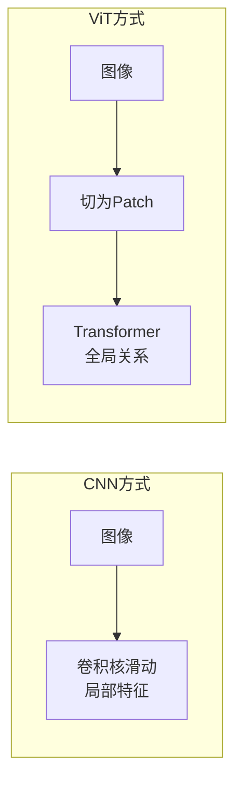

CNN 擅长局部特征（卷积核 3x3 的小窗口）。[[Ch09 Transformer 架构精讲|Transformer]] 擅长全局关系（自注意力看整张图任意两个位置的关系）。

2020 年 **[[深挖-ViT|ViT]]（Vision Transformer，视觉 Transformer）** 出现后——它把图片切成一个个小方块（patch），每个块当作一个"词"，直接用 Transformer 的自注意力来理解全局关系，不再依赖 CNN 的局部滑动窗口——Transformer 逐渐在视觉领域取代 CNN。但 CNN 在数据量较小的场景、移动端推理、实时检测（YOLO）上仍然有优势。见 [[Ch09 Transformer 架构精讲]]。



### 7.11.1 2026 年的真实格局：不是替代，是分工

纯 CNN 和纯 ViT 的争论在 2024-2025 年基本结束。2026 年的共识是：**混合架构**是主流，CNN 和 ViT 各司其职。

**CNN 在 2026 年仍然不可替代的场景**：
- **实时检测**：YOLO 系列的速度优势（30-60 FPS）是 ViT 无法比拟的。自注意力的 O(N²) 计算复杂度在实时场景是硬伤。自动驾驶、无人机、AR 眼镜都依赖 CNN 的低延迟。
- **移动端和边缘设备**：MobileNet/EfficientNet 级别的模型只有几 MB，可以在手机上以 <5ms 的延迟运行。ViT 即使经过压缩（如 MobileViT），在同等延迟下精度仍不如纯 CNN。
- **小数据场景**：CNN 的局部性（locality）和平移不变性（translation equivariance）是强先验——在小数据集（几千到几万张）上，这些先验让 CNN 比 ViT 泛化更好。ViT 需要大量数据来"学会"局部性。
- **工业检测**：生产线上的缺陷检测通常是固定视角、固定光照、固定物体类型——CNN 的局部特征匹配在这个场景下效率极高。

**ViT 在 2026 年占据优势的场景**：
- **大数据 + 大模型**：百万级以上数据，ViT 的自注意力能学到 CNN 学不到的全局关系。DINOv2（Meta 2023/2024）用 ViT 在 1.42 亿张无标注图片上自监督训练，学到的特征在下游任务上全面超越 ImageNet 预训练的 CNN。
- **多模态**：CLIP、GPT-5.5 Vision、Gemini Vision 全部用 ViT 编码图片。因为 ViT 的输出序列（patch tokens）天然适合和文本 token 拼接，CNN 的特征图网格需要额外的适配层。
- **需要全局理解的任务**：OCR（文字识别需要理解整个页面布局）、医学影像（病变可能在任何位置，需要全局上下文）、遥感图像分析（大范围地物分类需要全局上下文）。
- **分割任务**：SAM 用 ViT 作为图像编码器，因为分割需要理解"物体是什么"（全局语义）和"物体边界在哪里"（局部细节），ViT 的自注意力天然适合。

**混合架构（CNN + Transformer）**：
- **Swin Transformer（2021）**：在局部窗口内做自注意力（类似 CNN 的局部性），然后通过窗口移动逐步扩大感受野。既有 CNN 的效率，又有 Transformer 的全局建模能力。
- **ConvNeXt（2022）**：用纯 CNN 架构 + ViT 的训练策略，证明了 CNN 和 ViT 的差距很大程度来自训练方法，而非架构本身。
- **CoAtNet（2021）**：前几层用 CNN（效率高），后几层用 Transformer（全局建模），是混合架构的典范。
- **自动驾驶中的混合架构**：CNN 做实时感知（检测、分割），Transformer 做时序融合和路径规划。Tesla FSD 和 Waymo 都采用这种方案。

### 7.11.2 选型决策树（2026）

```
你的任务需要实时（>30 FPS）吗？
├── 是 → 选 CNN（YOLO 系列）
└── 否 → 你的数据量多大？
    ├── < 1万张 → 选 CNN（ImageNet 预训练 + 微调）
    ├── 1万-100万张 → 选 混合架构（CoAtNet / Swin）
    └── > 100万张 → 选 ViT（DINOv2 预训练）
        例外：如果是多模态任务 → 必选 ViT
        例外：如果是移动端部署 → 必选 CNN
```

---

> ← 上一节：[[7.10 图像分割-像素级的理解]] ｜ 下一节：[[7.12 2026年CV的应用前沿]] →
