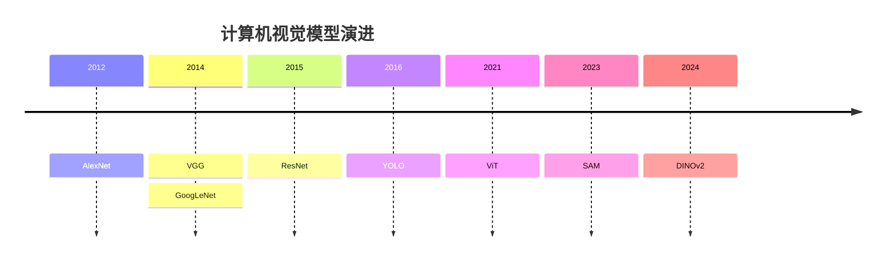

**AlexNet（2012）**：深度学习引爆点。8 层，第一次在 **ImageNet**（一个包含 1000 多个类别、超过 120 万张人工标注图片的超大规模图像数据库——2010 年代它是判断一个视觉模型好不好的"奥运会"标准）上用 **GPU**（图形处理器，原本为游戏渲染设计，但它的几千个核心恰好适合深度学习里的大量并行矩阵运算——没有 GPU 就没有现代 AI，Ch01 的三条曲线里"大算力"指的就是它）训练深度 CNN。错误率从 26% 降到 16%。

**VGG（2014）**：更深——16-19 层。用更小的 3x3 卷积核堆叠。简单但有效。

**ResNet（2015）**：152 层。核心创新是"[[Ch06 神经网络基础|残差连接]]"——每层的输入直接跳到输出，解决深层网络梯度消失的问题。ResNet 的理念（跳跃连接）直接影响了后来的 Transformer。

**[[深挖-YOLO|YOLO]]（2015-至今）**：不看整张图分类，而是在图上画框——"这里有个人，那里有辆车"。YOLO 把"检测"变成了"回归"——直接预测框的坐标和类别。2024 年的 YOLOv10 已经迭代了 10 个版本。

### 经典架构速查对比

| 架构 | 年份 | 层数 | 核心创新 | 一句话定位 |
|------|------|------|---------|-----------|
| **LeNet-5** | 1998 | 5 | 卷积+池化+全连接范式 | CNN 鼻祖，定义了基本骨架 |
| **AlexNet** | 2012 | 8 | ReLU + Dropout + GPU 训练 | 深度学习革命引爆点，ImageNet 错误率从 26% 降到 16% |
| **VGG** | 2014 | 16-19 | 全部用 3x3 小卷积核堆叠 | 证明"深度本身就是优势"，结构极其规整 |
| **GoogLeNet (Inception)** | 2014 | 22 | Inception 模块：同一层并行多尺寸卷积，1x1 卷积降维 | 22 层但参数只有 AlexNet 的 1/12，效率优先 |
| **ResNet** | 2015 | 50-152 | 残差连接：`output = F(x) + x` | 152 层可训练，残差理念直接催生了 Transformer |
| **DenseNet** | 2017 | 121-264 | 密集连接：每层接收前面所有层的输出 | 特征复用极致，参数更少但显存消耗大 |
| **MobileNet** | 2017 | 28 | 深度可分离卷积：逐通道+逐点 | 专为移动端设计，模型只有几 MB |
| **EfficientNet** | 2019 | B0-B7 | NAS 搜索 + 深度/宽度/分辨率复合缩放 | 同等精度下参数少 8 倍、速度快 6 倍 |
| **ConvNeXt** | 2022 | T/S/B/L | CNN 现代化：大卷积核 + LayerNorm + GELU + ViT 训练策略 | 纯 CNN 追平 ViT，证明差距来自工程细节而非架构本质 |

**关键洞察**：CNN 的演进方向是"更高效地利用参数"——从 AlexNet 的盲目堆叠，到 GoogLeNet 的并行多尺度，到 ResNet 的跳跃连接，到 EfficientNet 的自动搜索最优比例。每个架构解决了一个核心问题。详细的技术解析见 [[7.6 经典 CNN 架构详解-从 1998 到 2022 的创新之路]]。

---

> ← 上一节：[[7.4 CNN 的核心组件深入]] ｜ 下一节：[[7.6 经典 CNN 架构详解-从 1998 到 2022 的创新之路]] →
