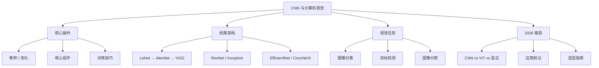

[[Ch06 神经网络基础]] 讲了一个通用网络——全连接层堆叠。但处理图片时，全连接层有致命缺陷：把一张 224x224 的图片展开成 50176 个数字，第一层就有几千万个参数。太多了，根本训练不动。

CNN（卷积神经网络）解决了这个问题。它的核心思想朴素而深刻：图片中相邻的像素才有关联，远处的像素几乎无关，所以每个神经元只需要看一小块区域。卷积核在图片上滑动，局部观察、参数共享、逐层抽象——从边缘到纹理到物体部件再到完整物体。

## 本章目录

1. [[7.1 卷积-滑动窗口看局部|7.1 卷积：滑动窗口看局部]]
2. [[7.2 卷积运算的数学直觉|7.2 卷积运算的数学直觉]]
3. [[7.3 池化-缩小特征图|7.3 池化：缩小特征图]]
4. [[7.4 CNN 的核心组件深入|7.4 CNN 的核心组件深入]]
5. [[7.5 经典架构|7.5 经典架构（含架构速查对比表）]]
6. [[7.6 经典 CNN 架构详解-从 1998 到 2022 的创新之路|7.6 经典 CNN 架构详解：从 1998 到 2022 的创新之路]]
7. [[7.8 CNN 的训练技巧|7.8 CNN 的训练技巧]]
8. [[7.9 目标检测 - 从 R-CNN 到 YOLO|7.9 目标检测 -- 从 R-CNN 到 YOLO]]
9. [[7.10 图像分割-像素级的理解|7.10 图像分割：像素级的理解]]
10. [[7.11 CNN vs ViT vs 混合架构-2026 年 CV 领域格局|7.11 CNN vs ViT vs 混合架构：2026 年 CV 领域格局]]
11. [[7.12 2026年CV的应用前沿|7.12 2026年CV的应用前沿]]
12. [[7.13 什么时候选什么技术|7.13 什么时候选什么技术]]
13. [[7.14 CNN学习路线|7.14 CNN学习路线]]

## 与前置章节的关联

- 卷积 = 特殊的矩阵乘法。每个卷积操作本质上是把图像局部区域展开成向量，与卷积核权重做点积——这和 [[Ch03 AI 需要的数学|Ch03 线性代数]] 中矩阵乘法的"行乘列"是同一个操作。
- 池化 = **降维**。把几百维的特征图压缩到几十维，同时保留最重要的信息——就像把一张高清照片缩成缩略图，虽然细节少了，但你还是能认出拍的是什么。降维是 AI 里反复出现的操作，[[Ch19 多模态深度原理|Ch19]]|[[Ch19 多模态深度原理|Ch19]]、[[Ch20 模型推理部署|Ch20]]|[[Ch20 模型推理部署|Ch20]] 本质上都在降维。
- YOLO 的目标检测 = [[Ch04 机器学习核心算法|回归问题]]。检测框的中心坐标 (x, y) 和宽高 (w, h) 是四个连续数值——这就是回归，只不过输出从标量变成了四元组。
- ResNet 的残差连接 = Transformer 的残差连接。`output = F(x) + x` 这个公式在 [[Ch06 神经网络基础|ResNet]] 和 [[Ch09 Transformer 架构精讲|Transformer]] 中一模一样——它是深层网络梯度能稳定回传的数学保障。

## 相关笔记

- [[Ch06 神经网络基础]] -- CNN 是神经网络的一种
- [[Ch09 Transformer 架构精讲]] -- Transformer 如何取代 CNN
- [[Ch01 AI 简史与必知过时技术]] -- AlexNet 的历史地位

## 跨章节关联

- [[Ch06 神经网络基础]] — CNN 的前置：神经网络基础
- [[Ch09 Transformer 架构精讲]] — ViT：Transformer 在视觉中的应用
- [[Ch19 多模态深度原理]] — 从 CNN 到多模态视觉

## 来源

- Krizhevsky et al., "AlexNet", 2012
- He et al., "ResNet", 2015
- Redmon et al., "YOLO", 2015
