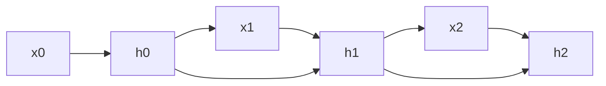

全连接网络和 CNN 都是"看完就忘"——输入一个数据，输出一个结果，下一个输入和上一个没关系。RNN 多了一个"隐藏状态"——网络处理每个单词时，会参考上一个单词留下的记忆。

### 8.1.1 展开循环图：信息如何在时间步间传递

RNN 的核心思想可以用一句话概括：**同一个网络，在不同时间步被反复使用，每次处理新输入时都参考之前的记忆。**

把 RNN 的循环"展开"来看，它其实是同一个网络在不同时间步的副本：

```
时间步 t=1:  输入 x₁  →  [RNN Cell]  →  输出 y₁
                                     ↘
                                      隐藏状态 h₁
                                     ↙
时间步 t=2:  输入 x₂  →  [RNN Cell]  →  输出 y₂  (参考了 h₁)
                                     ↘
                                      隐藏状态 h₂
                                     ↙
时间步 t=3:  输入 x₃  →  [RNN Cell]  →  输出 y₃  (参考了 h₂)
```



注意：t=1、t=2、t=3 用的是**同一个 RNN Cell**（同一组权重参数），只是输入不同、隐藏状态不同。这就是"循环"的含义——同一个网络循环使用，每次接收新输入和旧记忆，产生新输出和新记忆。

**具体到"我打你"这个例子**：

```
输入"我" -> RNN -> 隐藏状态 h₁ = [关于"我"的记忆]
输入"打" + h₁ -> RNN -> 隐藏状态 h₂ = [关于"我打"的记忆]
输入"你" + h₂ -> RNN -> 输出 "句子主语是'我'，动作是'打'，宾语是'你'"
```

"打"这个字的意思，取决于前面是"我"还是"别"——RNN 的隐藏状态记住了前面是什么。相比之下，如果输入是"别打我"，处理"打"时前面的记忆是"别"，整个句子的含义就完全不同了。

### 8.1.2 隐藏状态的本质

隐藏状态 h 是一个向量（比如 128 或 256 维），它把"到目前为止读到的所有信息"压缩成一个数字表示。每个时间步，RNN 做两件事：

1. **更新记忆**：h_new = tanh(W_h × h_old + W_x × x_new + b) —— 把旧记忆和新输入混合，经过非线性变换
2. **产生输出**：y = softmax(W_y × h_new) —— 根据当前记忆做出预测

这个公式有一个致命问题：**梯度消失**。后面会详细解释。

---

> ← 上一节：[[Ch08 RNN 与序列模型|章首]] ｜ 下一节：[[8.2 LSTM-更长的记忆]] →
