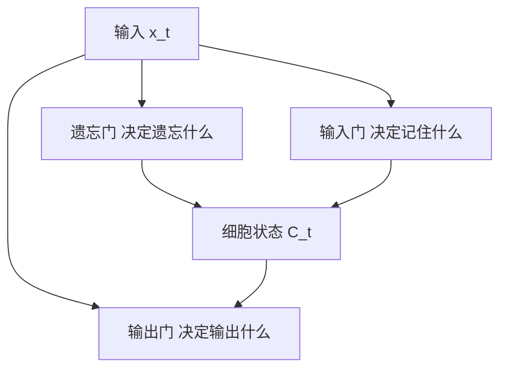

普通 RNN 有"短期记忆丧失"——第 100 个词很难影响第 1 个词的理解。原因是梯度在[[Ch06 神经网络基础|反向传播]]中指数衰减（反向传播过 100 层，梯度的乘积越来越小）。

LSTM（长短期记忆，1997 年）用三个"门"解决了这个问题：

### 8.2.1 遗忘门：决定扔掉什么

遗忘门看当前的输入和上一刻的隐藏状态，输出一个 0 到 1 之间的数字，乘到旧的记忆上。0 表示"全忘掉"，1 表示"全保留"。

**比喻**：你在读一本小说。读到第 10 章时，第 1 章里"路边有棵树的细节"已经不重要了——遗忘门把它从记忆中淡化。但"主角的父母被杀了"这个核心情节——遗忘门让它保持为 1，继续留在记忆里。

**公式**：f_t = sigmoid(W_f × [h_{t-1}, x_t] + b_f)

### 8.2.2 输入门：决定记住什么

输入门分两步：先决定哪些值要更新（sigmoid 层），再创建候选值（tanh 层），两者相乘后加到记忆里。

**比喻**：继续读小说。第 10 章出现了新角色"神秘黑衣人"。输入门判断：这个角色重要吗？如果重要，把他的信息写入长期记忆；如果不重要（比如只是个送外卖的），就不写入。

**公式**：i_t = sigmoid(W_i × [h_{t-1}, x_t] + b_i)，候选值 C̃_t = tanh(W_c × [h_{t-1}, x_t] + b_c)

### 8.2.3 输出门：决定输出什么

输出门决定当前记忆的哪些部分要输出到隐藏状态（进而影响当前时刻的预测）。

**比喻**：你被问到"主角现在的目标是什么？"。输出门从记忆中筛选出"复仇"这个关键信息，忽略"路边有棵树"这种无关细节，给出一个精准的回答。

**公式**：o_t = sigmoid(W_o × [h_{t-1}, x_t] + b_o)，h_t = o_t × tanh(C_t)

### 8.2.4 三个门总结

| 门 | 作用 | 决定什么 | 输出范围 |
|---|---|---|---|
| 遗忘门 | 删除旧记忆 | 哪些旧信息不再需要 | 0（全忘）~ 1（全留） |
| 输入门 | 添加新记忆 | 哪些新信息值得记住 | 0（忽略）~ 1（全记） |
| 输出门 | 输出当前记忆 | 哪些记忆影响当前输出 | 0（隐藏）~ 1（全输出） |

三个门让 LSTM 可以有选择地"记住重要的，忘掉不重要的"，从而让信息跨越几十甚至上百个时间步。

### 8.2.5 GRU vs LSTM

GRU（门控循环单元，2014 年）是 LSTM 的简化版——把三个门合并成两个，参数更少，效果差不多。现代 Seq2Seq 模型中更常用 GRU。

| | LSTM（1997） | GRU（2014） |
|---|---|---|
| 门数量 | 3 个（遗忘、输入、输出） | 2 个（重置、更新） |
| 状态数量 | 2 个（细胞状态 C + 隐藏状态 h） | 1 个（只有隐藏状态 h） |
| 参数量 | 较多 | 较少（约少 25%） |
| 训练速度 | 较慢 | 较快 |
| 效果 | 经典，稳定 | 大多数任务和 LSTM 持平 |
| 使用场景 | 需要精细控制长期记忆 | 数据量不大、追求效率 |
| 选择建议 | 不确定时选 LSTM | 想更快、更简单时选 GRU

---

> ← 上一节：[[8.1 RNN-有记忆的网络]] ｜ 下一节：[[8.3 梯度消失与梯度爆炸-为什么深层 RNN 训练不好]] →
