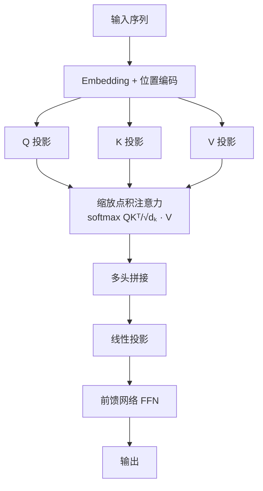

> **公式可跳过**：下面出现的数学公式可以直接跳过，看后面的文字解释也能理解自注意力的核心思想。

核心公式：

```
Attention(Q, K, V) = softmax(QK^T / √d_k) × V
```

### 9.2.1 Query/Key/Value 的直觉：图书馆检索

理解 Q/K/V 最好的比喻是**图书馆检索**：

- **Query（查询）**：你走进图书馆时脑子里想找的问题。比如"我想了解黑洞的物理原理"
- **Key（键）**：图书馆里每本书的索引标签。比如《天体物理学导论》的标签是"天体物理、黑洞、相对论"
- **Value（值）**：书的实际内容。拿到书之后你能读到完整的知识

检索过程：用你的 Query 去匹配所有书的 Key，计算匹配度（相似度分数），然后按匹配度加权阅读所有书的内容。匹配度高的书你花更多时间读（高权重），匹配度低的一扫而过（低权重）。最终你得到的不是一个单一答案，而是所有相关内容按相关性加权后的综合理解。

在 Transformer 中，每个 token 同时扮演三个角色：它有自己的 Query（我要找什么相关信息）、Key（我有什么可以提供给别人的）、Value（我的实际语义内容）。Q 和 K 决定"谁关注谁"，V 决定"关注到什么内容"。

### 9.2.2 缩放点积注意力的每一步

让我们追踪一个完整的注意力计算流程。假设输入是一个长度为 n 的序列，每个 token 的向量维度为 d_model：

**第 1 步：投影生成 Q、K、V。** 输入 X ∈ R^{n × d_model} 分别乘以三个可学习的权重矩阵：

```
Q = X · W_Q     (W_Q ∈ R^{d_model × d_k})
K = X · W_K     (W_K ∈ R^{d_model × d_k})
V = X · W_V     (W_V ∈ R^{d_model × d_v})
```

通常 d_k = d_v = d_model / h（h 是注意力头数）。这一步的物理含义：把每个 token 的通用表示分别投影到"查询空间"、"键空间"和"值空间"。不同的投影矩阵让模型学会什么信息该放在查询里、什么该放在键里、什么该放在值里。

**第 2 步：计算注意力分数。** S = QK^T ∈ R^{n × n}。S_{i,j} 是 token i 的 Query 与 token j 的 Key 的点积，表示 token i 应该多大程度关注 token j。一次矩阵乘法，计算了所有 n² 个 token 对之间的关系。

**第 3 步：缩放。** S = S / √d_k。这是关键一步，详见 9.2.3 节。

**第 4 步：Softmax 归一化。** A = softmax(S, dim=-1)。对每一行（每个 token 的查询）做 softmax，确保每个 token 对所有位置的注意力权重之和为 1。A_{i,j} 可以解释为 "token i 对 token j 的关注概率"。

**第 5 步：加权求和。** O = A · V ∈ R^{n × d_v}。每个 token 的输出是所有 token 的 Value 按注意力权重加权求和。一个 token 对另一个 token 关注越多，后者的 Value 对前者的输出影响越大。

整个流程的复杂度分析：QK^T 是 n × n 矩阵，这是 O(n²) 的计算和内存瓶颈。这也是为什么长上下文（128K+）对 Transformer 如此具有挑战性。

### 9.2.3 为什么除以 √d_k：数学推导

这是 Transformer 论文中最精妙的设计细节之一。假设 q 和 k 的每个分量是独立的随机变量，均值为 0，方差为 1。那么点积 q·k = Σ_{i=1}^{d_k} q_i · k_i 的方差为：

```
Var(q·k) = Σ_{i=1}^{d_k} Var(q_i · k_i)
         = Σ_{i=1}^{d_k} Var(q_i) · Var(k_i)     [因为独立且均值为0]
         = Σ_{i=1}^{d_k} 1 · 1
         = d_k
```

所以 q·k 的标准差是 √d_k。当 d_k = 64 时，点积值通常在 [-24, 24] 范围内（3σ 区间）。如果不缩放，这些值经过 softmax 后会极端分化——最大的值趋近于 1，其余趋近于 0，softmax 进入饱和区。饱和区的梯度接近 0，模型几乎无法学习。

除以 √d_k 后，点积的方差变为 1，值域集中在 [-3, 3] 附近，softmax 输出相对平滑，梯度正常流动。这就是为什么这个因子是 √d_k 而不是 d_k 或其他值——它直接来自概率论中独立随机变量点积的方差分析。

^[Vaswani et al., 2017 论文第 4 页脚注给出了这个推导]

### 9.2.4 注意力权重矩阵描述

不同层的注意力模式有显著差异，这已被大量可视化研究证实：

- **底层（第 1-2 层）**：注意力集中在对角线附近，即每个 token 主要关注它的邻居。模式类似 n-gram——token i 关注 token i-1、i-2。这是"局部特征提取"层
- **中层（第 3-8 层）**：开始出现句法结构。某些注意力头专门关注主谓关系（主语 token 关注谓语 token）、动宾关系。还有一些头关注标点符号（尤其是句号、逗号作为句子边界标记）
- **高层（第 9-12 层以上）**：语义级别的注意力。共指关系（"小明...他"——"他"关注"小明"）、主题关联（语义相关的词互相高权重关注）。注意力分布更分散，更全局
- **特定模式**：某些头是"位置头"（几乎总是关注固定偏移量，如 i-1 或 i+1），某些是"广播头"（几乎均匀关注所有位置，类似全局平均池化），某些是"稀疏头"（只关注极少几个特定位置）

### 9.2.5 自注意力 vs 交叉注意力 vs 因果注意力

三种注意力变体，区别在于 Q、K、V 的来源和是否加掩码：

| 类型 | Q 来源 | K 来源 | V 来源 | 掩码 | 用途 |
|------|--------|--------|--------|------|------|
| 自注意力 | 自身 | 自身 | 自身 | 无 | 编码器、解码器自注意力 |
| 交叉注意力 | 解码器 | 编码器 | 编码器 | 无 | 编码器-解码器桥接 |
| 因果注意力 | 自身 | 自身 | 自身 | 上三角 -∞ | 解码器自注意力、Decoder-Only |

- **自注意力**：每个 token 可以看到所有其他 token（包括自己）。信息可以双向流动。"我"既能看到前面的词也能看到后面的词。这是编码器的核心机制
- **交叉注意力**：解码器用自己的 Q 去查询编码器的 K 和 V。让解码器在生成每个输出 token 时"回看"输入序列。这是 Encoder-Decoder 架构的关键组件
- **因果注意力（掩码自注意力）**：通过掩码矩阵 M（M_{i,j} = -∞ 当 j > i）屏蔽未来 token。每个 token 只能看到自己和之前的 token，不能"偷看"未来。这是 Decoder-Only 架构的核心机制，确保自回归生成的正确性

输入序列首先经过 [[概念-Embedding模型|Embedding]] 层，将每个 [[概念-Token|token]] 映射为稠密向量（d_model 维），然后加上位置编码注入顺序信息。整个流程如下：



^[Alammar, same source]; ^[d2l.ai, "Attention Mechanisms", https://d2l.ai/chapter_attention-mechanisms/index.html]; ^[Clark et al., "What Does BERT Look At?", 2019, https://arxiv.org/abs/1906.04341]

---

> ← 上一节：[[9.1 为什么需要 Transformer - RNN 的困境]] ｜ 下一节：[[9.3 多头注意力 - 为什么需要多个头]] →
