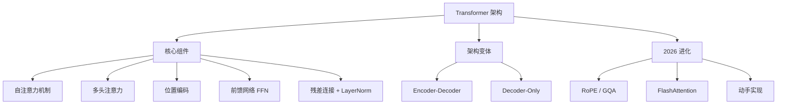

> Transformer 是现代 AI 的基石。从 2017 年的论文到 2026 年的每一款大模型，核心架构没变，但每个组件都被反复优化过。本章讲原理，不讲推导。第 10 章讲 LLM 层面的演进。
>
> **生活比喻**：Transformer 像全班同学同时传纸条——RNN 是挨个传，你传给我、我传给他，效率低还容易传丢（长句子忘开头）；Transformer 是所有人同时互传，每个人都能直接看到全班所有人的纸条内容（自注意力），然后自己决定重点关注谁的信息。这样一次传完，不用排队，速度快了上百倍。

> **一句话总结**：Transformer = 自注意力（全局并行建模）+ 位置编码（注入顺序）+ 残差连接 + LayerNorm。2026 年标准 LLM 架构 = Decoder-Only + GQA + RoPE + FlashAttention。本章从 RNN 的困境出发，逐个拆解这些组件为什么被发明、如何工作、以及现代变体如何将其推向极致。

## 本章目录

1. [[9.1 为什么需要 Transformer - RNN 的困境|9.1 为什么需要 Transformer — RNN 的困境]]
2. [[9.2 自注意力机制 - 深度拆解|9.2 自注意力机制 — 深度拆解]]
3. [[9.3 多头注意力 - 为什么需要多个头|9.3 多头注意力 — 为什么需要多个头]]
4. [[9.4 位置编码 - Transformer 的序列感知|9.4 位置编码 — Transformer 的"序列感知"]]
5. [[9.5 前馈网络（FFN）- Transformer 的知识存储|9.5 前馈网络（FFN）— Transformer 的"知识存储"]]
6. [[9.6 残差连接与层归一化|9.6 残差连接与层归一化]]
7. [[9.7 完整编码器-解码器架构|9.7 完整编码器-解码器架构]]
8. [[9.8 Decoder-Only - 为什么 LLM 只用解码器|9.8 Decoder-Only — 为什么 LLM 只用解码器]]
9. [[9.9 2026 Transformer 进化|9.9 2026 Transformer 进化]]
10. [[9.10 动手实现 Self-Attention|9.10 动手实现 Self-Attention]]

## 跨章节关联

- [[Ch10 LLM 原理与架构演进]] — Transformer 之后：LLM 的架构演进
- [[Ch19 多模态深度原理]] — ViT：Transformer 在视觉领域的应用
- [[Ch08 RNN 与序列模型]] — Transformer 的前身：为什么需要替代 RNN
- [[Ch06 神经网络基础]] — 注意力机制的前置：神经网络怎么学习

## 来源

1. Vaswani et al., "Attention Is All You Need", 2017, https://arxiv.org/abs/1706.03762
2. Bahdanau et al., "Neural Machine Translation by Jointly Learning to Align and Translate", 2014, https://arxiv.org/abs/1409.0473
3. Sutskever et al., "Sequence to Sequence Learning with Neural Networks", 2014, https://arxiv.org/abs/1409.3215
4. Jay Alammar, "The Illustrated Transformer", https://jalammar.github.io/illustrated-transformer/
5. Lilian Weng, "The Transformer Family", https://lilianweng.github.io/posts/2020-04-07-the-transformer-family/
6. d2l.ai, "Attention Mechanisms", https://d2l.ai/chapter_attention-mechanisms/index.html
7. Ranksquire, "LLM Architecture 2026", https://ranksquire.com/2026/04/13/llm-architecture-2026/
8. Knight Li, "LLM Architecture Evolution 2023-2026", https://knightli.com/en/2026/05/17/llm-architecture-evolution-2023-2026/
9. IBM, "What is Grouped-Query Attention?", https://www.ibm.com/think/topics/grouped-query-attention
10. Developers Digest, "LLM Architecture Complexity: [[概念-MoE|MoE]] & FlexAttention", https://www.developersdigest.tech/blog/llm-architecture-complexity-moe-flexattention
11. Dao et al., "FlashAttention-1", 2022, https://arxiv.org/abs/2205.14135
12. Dao, "FlashAttention-2", 2023, https://arxiv.org/abs/2307.08691
13. Shah et al., "FlashAttention-3", 2024, https://arxiv.org/abs/2407.08608
14. Sebastian Raschka, "LLM Research Papers 2026 Part 1", https://magazine.sebastianraschka.com/p/llm-research-papers-2026-part1
15. Su et al., "RoFormer: Enhanced Transformer with Rotary Position Embedding", 2021, https://arxiv.org/abs/2104.09864
16. Press et al., "Train Short, Test Long: Attention with Linear Biases", 2022, https://arxiv.org/abs/2108.12409
17. Shazeer, "GLU Variants Improve Transformer", 2020, https://arxiv.org/abs/2002.05202
18. Geva et al., "Transformer Feed-Forward Layers Are Key-Value Memories", 2021, https://arxiv.org/abs/2012.14913
19. Meng et al., "Locating and Editing Factual Associations in GPT", 2022, https://arxiv.org/abs/2202.05262
20. Shazeer et al., "Outrageously Large Neural Networks: The Sparsely-Gated Mixture-of-Experts Layer", 2017, https://arxiv.org/abs/1701.06538
21. Fedus et al., "Switch Transformers", 2022, https://arxiv.org/abs/2101.03961
22. Zhang & Sennrich, "Root Mean Square Layer Normalization", 2019, https://arxiv.org/abs/1910.07467
23. Ba et al., "Layer Normalization", 2016, https://arxiv.org/abs/1607.06450
24. Clark et al., "What Does BERT Look At?", 2019, https://arxiv.org/abs/1906.04341
25. Michel et al., "Are Sixteen Heads Really Better than One?", 2019, https://arxiv.org/abs/1905.10650
26. Voita et al., "Analyzing Multi-Head Self-Attention", 2019, https://arxiv.org/abs/1905.09418
27. Peng et al., "YaRN: Efficient Context Window Extension", 2023, https://arxiv.org/abs/2309.00071
28. Gu & Dao, "Mamba: Linear-Time Sequence Modeling", 2023, https://arxiv.org/abs/2312.00752
29. Lieber et al., "Jamba: A Hybrid Transformer-Mamba Language Model", 2024, https://arxiv.org/abs/2403.19887

