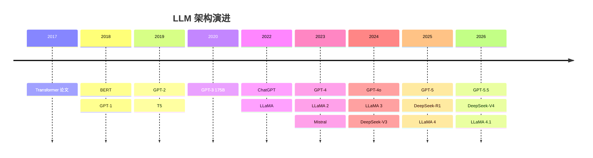

## 概述：六大家族，三个梯队

2026 年的开源 LLM 格局已经形成了清晰的"六大家族"和"三个梯队"。与两年前只有 Llama 和 Mistral 撑场面的局面相比，今天的开源生态堪称百花齐放。更重要的是，开源模型与闭源模型的差距正在以前所未有的速度缩小——DeepSeek-V4 在推理能力上已与 GPT-5.5 看齐，但 API 价格仅为后者的 1/30 ^[Artificial Analysis, "LLM Leaderboard", https://artificialanalysis.ai/leaderboards]。

以下按影响力排序：

| 模型系列 | 开发者 | 参数范围 | 架构特点 |
|---------|--------|---------|---------|
| Llama 4/4.1 | Meta | 8B–405B | [[Ch09 Transformer 架构精讲|GQA]]（分组查询注意力，减少 KV Cache）+ [[Ch09 Transformer 架构精讲|RoPE]]（旋转位置编码），开源生态最完善 |
| Qwen 3/3.7 | 阿里 | 0.5B–72B | MoE 变体（部分版本），多语言能力突出，全尺寸开源从手机到服务器 |
| DeepSeek-V4 | 深度求索 | 1.2T（60B 激活） | MLA（多头潜在注意力）+ MoE，推理极强，成本极低 |
| Mistral Large 3 | Mistral AI | 7B–Large | Sliding Window + GQA，欧洲开源标杆 |
| Gemma | Google | 2B–27B | Gemini 技术降维版，轻量高效 |
| GLM 5.2 | 智谱AI | 开源全系列 | 国产开源三强，视频理解突出 |

^[Knight Li, "LLM Architecture Evolution 2023-2026", https://knightli.com/en/2026/05/17/llm-architecture-evolution-2023-2026/]; ^[Developers Digest, "LLM Architecture Complexity", https://www.developersdigest.tech/blog/llm-architecture-complexity-moe-flexattention]

## 格局分析：开源与闭源的分界线正在模糊

2026 年的一个决定性趋势是：**"开源 vs 闭源"不再是二选一的质量取舍，而是变成了部署策略的选择。** DeepSeek-V4 在数学和代码推理上可与 GPT-5.5 和 Claude Opus 4.8 正面竞争，而 Qwen 3.7 的中文能力在所有模型中排名第一。开源模型不再是闭源模型的"廉价替代品"，而是有自己不可替代的优势：数据不出企业网络、模型可定制微调、推理成本自主可控。

但开源的代价是基础设施投入。DeepSeek-V4 的 1.2T 总参数需要最少 4 张 H200 才能运行（通过 MoE 的稀疏激活，实际激活约 60B 参数），对个人开发者来说门槛依然不低。这也是为什么 Qwen 3.7 的 0.5B-7B 小尺寸版本在边缘端和手机端备受欢迎——全尺寸覆盖让开源方案有了"阶梯式"的部署路径。

## 架构演进时间线

从 2017 年 Transformer 论文发表到 2026 年 GPT-5.5 和 DeepSeek-V4 的双峰格局，这十年间 LLM 架构的主线从未改变——**Decoder-Only Transformer + 规模扩展。** 变化的是细节之处的工程智慧：从稠密到稀疏（MoE）、从短窗口到长上下文、从单一模态到原生多模态。

## 注意事项

- **参数规模不等于能力。** DeepSeek-V4 的 1.2T 是总参数，每次推理只激活约 60B。直接比较总参数是误导性的——关注激活参数和实际推理性能。
- **开源不等于免费。** 部署 671B+ 的开源模型需要可观的硬件投入（详见 [[10.9 LLM选型决策框架]] 的硬件选型指南）。
- **架构在收敛。** 2026 年几乎所有前沿模型都采用了 MoE + GQA + RoPE 的技术栈，差异化越来越体现在训练数据质量和 RLHF 后训练上。

## 关联

- [[概念-DeepSeek]] — DeepSeek 家族的 MLA + MoE 架构详解
- [[概念-Gemini]] — Gemini 系列的原生多模态路线
- [[概念-MoE]] — MoE 稀疏激活架构的技术原理
- [[10.4 MoE-稀疏激活的艺术]] — MoE 架构的深入展开
- [[10.8 2026年主流LLM能力对比]] — 六大家族的能力横向对比
- [[10.9 LLM选型决策框架]] — 如何根据场景选择模型

---

> 上一节：[[10.1 什么是 LLM]]  |  下一节：[[10.4 MoE-稀疏激活的艺术]]  |
